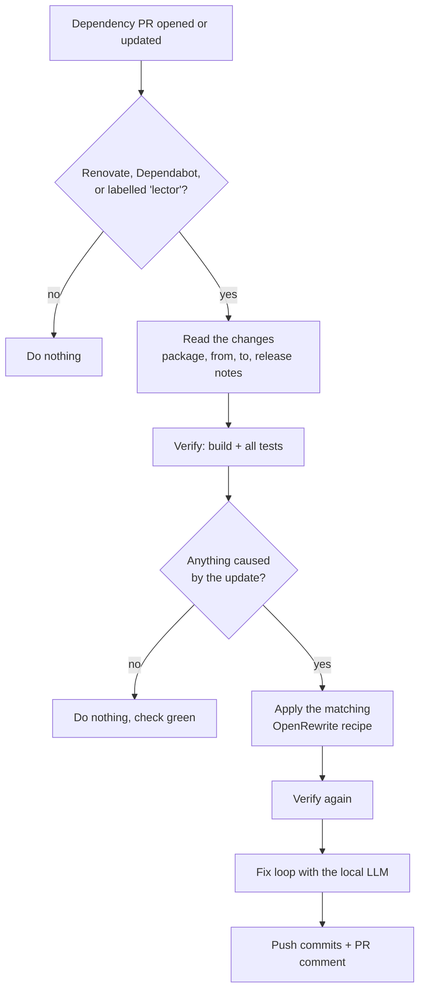

# lector-ai

**Fixes what a dependency update broke, inside your CI, with OpenRewrite and a local LLM.**

When Renovate, Dependabot, or anyone else opens a dependency-update PR that breaks the build or the tests, lector-ai
applies the matching OpenRewrite recipe, lets a local model (Ollama) fix the remaining errors in small, verified
steps, and pushes the result as reviewable commits with a report on the PR. Failures that already existed before the
update, and flaky tests, are reported but never touched. Nothing is ever merged automatically.

> **Status: pre-release.** The pipeline works end to end, but `v0.1.0` is not published yet: the release is blocked
> until the license check in [`docs/licensing.md`](docs/licensing.md) is done. Until then, build the images yourself
> (see [Images](#images)). Milestones and what is still open: [`docs/features.md`](docs/features.md).

- [What it does](#what-it-does)
- [How it works](#how-it-works)
- [What is supported](#what-is-supported)
- [Setup on GitHub](#setup-on-github)
- [Setup on GitLab](#setup-on-gitlab)
- [Configuration](#configuration)
- [CLI](#cli)
- [Limitations](#limitations)
- [Development](#development)

## What it does

- **Reacts to dependency PRs:** Renovate and Dependabot PRs, and any other PR you label `lector` (a manual bump, Snyk,
  another bot).
- **Checks first, fixes only when needed:** it builds the PR and runs the full test suite. If nothing the update caused
  is broken, it changes nothing.
- **Fixes only what the update broke:** compile errors always count. A failing test counts only if it passes on the
  base commit and fails again on a rerun. Pre-existing and flaky failures are listed in the report, not fixed.
- **Deterministic first, AI second:** an OpenRewrite recipe runs where one exists (Spring Boot 3.3 → 3.4, …). The LLM
  only fixes what is left.
- **Can't cheat:** guardrails reject any model edit that deletes or skips tests, removes assertions, stubs out code,
  adds suppressions, disables tests in the build file, or touches generated code.
- **Stays on your infrastructure:** the model runs in an Ollama container next to the job. Source code and build logs
  never leave your CI.
- **Leaves a reviewable result:** one commit per recipe and per fix, authored by your bot, a sticky comment that says
  what was fixed and what is left, and the label `ai-assisted`.

## How it works



1. **Trigger.** The workflow runs on `pull_request` events. lector-ai checks the PR's author and branch (Renovate,
   Dependabot) or the opt-in label `lector`, and only works on PRs from the same repository, never on forks.
2. **Read the update.** An *update source* turns the PR into a list of dependency changes: Renovate's PR body
   (grouped PRs included), Dependabot's `fetch-metadata` output, or, for labelled PRs, the difference between the
   resolved versions of base and head.
3. **Verify and attribute.** The *ecosystem adapter* (Maven, Gradle, TypeScript) builds the project and runs every
   test. Failing tests are rerun once (flaky?) and then run on the base commit (pre-existing?). Only failures the
   update caused go on.
4. **Recipe.** A recipe index, built from the official OpenRewrite recipe BOM at build time, picks the most specific
   recipe for each change. No LLM picks recipes. A recipe that would move any package to a lower version is discarded.
5. **Fix loop.** Errors are clustered by root cause. For each cluster the model gets *grounding*: the real API
   signatures of the new version (`javap`, `.d.ts` files), the release notes, the recipe's diff, and only the code
   around the error. It answers with search/replace edits, never whole files. Every edit passes the guardrails, then
   the project is verified again. Budgets stop the loop (attempts, time, no progress).
6. **Output.** Renovate PRs get the commits on their own branch. Dependabot and labelled PRs get a **companion PR**
   (`heal/<branch>`) into the PR's branch, because Dependabot discards foreign commits. A sticky comment reports
   recipes, fixes, rejected attempts, and what is left.

More detail: [`docs/concept.md`](docs/concept.md) (the design) and [`docs/architecture/`](docs/architecture/README.md)
(as built).

## What is supported

| | Supported | Not yet |
|---|---|---|
| **Build tools** | Maven 3, Gradle 8 and 9 (through the wrapper), TypeScript with npm, pnpm, Yarn 1, Yarn 4 (Plug'n'Play included) | Python, .NET, Go, Terraform, … |
| **Languages the model edits** | Java, Kotlin, TypeScript, JavaScript | Groovy (Spock), Android, Kotlin Multiplatform |
| **Update sources** | Renovate, Dependabot, any PR with the `lector` label | |
| **Git hosts** | GitHub (GitHub Actions) | GitLab (see [Setup on GitLab](#setup-on-gitlab)) |
| **OpenRewrite recipes** | JVM (Maven and Gradle) | TypeScript: the model does all the fixing |
| **Runtimes in the image** | JDK 17, 21, 25; Maven 3.10; Node 22 and 24; Corepack with pnpm and Yarn | |

## Setup on GitHub

Three steps, plus one setting for Renovate. The full guide, with every option and edge case, is
[`docs/setup.md`](docs/setup.md).

**Before you start:** this short setup works on **github.com**, with a **published release** whose images your runners
can pull, and with the lector-ai repository **reachable** from yours (public, or for the owner's own private
repositories, its Actions "Access" setting). GitHub Enterprise Server and GHE.com use the
[advanced setup](docs/setup.md#advanced-setup).

### 1. Create the GitHub App

lector-ai pushes with a GitHub App token, not with `GITHUB_TOKEN`: pushes made with `GITHUB_TOKEN` don't start
workflow runs, so your checks would never run on the fixes.

Open the link for your account or organization. It opens GitHub's "Register new GitHub App" form already filled in
(no webhook, private, Contents and Pull requests read and write). Replace `<name>` with a unique name and `<org>` with
your organization:

- Personal account:
  `https://github.com/settings/apps/new?name=<name>&url=https://github.com/danvan86/lector-ai&public=false&webhook_active=false&contents=write&pull_requests=write`
- Organization:
  `https://github.com/organizations/<org>/settings/apps/new?name=<name>&url=https://github.com/danvan86/lector-ai&public=false&webhook_active=false&contents=write&pull_requests=write`

Check that **Contents** and **Pull requests** are **Read and write** before you create it. Then note the **Client ID**,
**generate a private key**, and **install** the App on the repositories lector-ai should fix.

### 2. Store the two secrets

As Actions secrets *and* as Dependabot secrets (a run Dependabot started sees only Dependabot secrets):

```sh
gh secret set LECTOR_APP_CLIENT_ID --repo <owner>/<repo> --body <client-id>
gh secret set LECTOR_APP_CLIENT_ID --repo <owner>/<repo> --app dependabot --body <client-id>
gh secret set LECTOR_APP_PRIVATE_KEY --repo <owner>/<repo> < <app>.private-key.pem
gh secret set LECTOR_APP_PRIVATE_KEY --repo <owner>/<repo> --app dependabot < <app>.private-key.pem
```

For a whole organization, use `--org <org> --visibility all` instead of `--repo <owner>/<repo>`.

### 3. Add the workflow

Save as `.github/workflows/lector-ai.yml`. Nothing to fill in:

```yaml
name: lector-ai

on:
  pull_request:
    types: [opened, synchronize, reopened, labeled, closed]

permissions:
  contents: read

jobs:
  lector-ai:
    uses: danvan86/lector-ai/.github/workflows/lector.yml@v0.1.0
    secrets:
      app-client-id: ${{ secrets.LECTOR_APP_CLIENT_ID }}
      app-private-key: ${{ secrets.LECTOR_APP_PRIVATE_KEY }}
```

The reusable workflow holds the rest: which PRs trigger a run, one run per PR, the Ollama model as a service, Dependabot's
metadata, the App token, the checkout, and the cleanup of companion PRs. It finds the App's bot on its own, so no bot
name or email is typed in. Don't add `concurrency` here: a caller job in the workflow's group would be cancelled with it.

### 4. Renovate only: ignore the bot's commits

Renovate stops updating a branch once someone else has pushed to it, unless that author is in `gitIgnoredAuthors`. This
prints the value, with your App's slug (the last part of its URL):

```sh
gh api users/<app-slug>%5Bbot%5D --jq '"\(.id)+\(.login)@users.noreply.github.com"'
```

```json
{
  "gitIgnoredAuthors": ["123456+my-lector[bot]@users.noreply.github.com"]
}
```

Every lector-ai run on a Renovate PR also names the value in its log. Dependabot needs no setting.

### Runners

| Ollama image | Runner |
|---|---|
| `lector-ollama:0.1.0-qwen2.5-coder-7b` (default, CPU only) | Standard `ubuntu-latest`. Slow but fits: a measured run with two Maven builds and one fix attempt took 15 minutes. The image needs about 10 GB of disk while it is pulled. |
| `lector-ollama:0.1.0-qwen3-coder-30b` (GPU libraries included) | More than 24 GB of memory, ideally a GPU: the [advanced setup](docs/setup.md#advanced-setup), with `--gpus all` in the service options and `model: qwen3-coder:30b`. Not benchmarked yet. |

### What happens on a PR

| Situation | Result | Check |
|---|---|---|
| Not a bot's PR and no `lector` label, a fork, or lector-ai's own commit | Nothing | green |
| The PR builds and passes, or every failure is pre-existing or flaky | Nothing (updates its comment, closes its companion PR, if any) | green |
| The update broke a **Renovate** PR | Recipe and fix commits on the PR's branch, comment, `ai-assisted` label | green if nothing the update caused is left, else red |
| The update broke a **Dependabot** or **labelled** PR | Commits in a companion PR `heal/<branch>`, comment with a link | green if nothing the update caused is left, else red |
| The PR was closed or merged | Closes the companion PR and deletes its branch | green |
| lector-ai itself failed (configuration, network, timeout) | Nothing pushed; the comment says why if it got that far | red (exit code 2) |

**Companion PRs:** merge the companion PR first, then Dependabot's PR. When Dependabot updates its PR, the companion
branch is rebuilt and force-pushed; the companion PR stays the same. Don't push your own work to `heal/` branches.
To push onto Dependabot's branch instead, set `mode: in-place` (Dependabot then stops rebasing that PR).

**Other PRs:** add the label `lector` to any same-repository PR that changes dependencies. Only people with write
access can add labels.

## Setup on GitLab

> **GitLab is not supported by the PR pipeline yet.** `lector pr`, the step that reads the PR, pushes commits, and
> comments, only talks to GitHub. A GitLab host adapter is on the roadmap ([`docs/features.md`](docs/features.md),
> "Later"). There is no GitLab equivalent of the GitHub App, companion MRs, or the MR comment today.

What already works on GitLab is the CLI inside the same container image, as plain CI jobs. The two jobs below are
**not tested by the project on GitLab yet**; treat them as a starting point.

**Before you start:**

- Build the two images ([Images](#images)) and push them to a registry your runners can pull from, e.g. your GitLab
  container registry. The examples use `registry.example.com/lector` and `registry.example.com/lector-ollama`.
- Use a Docker executor with at least ~8 GB of memory and ~15 GB of free disk for the 7B model.
- The tool image has an entrypoint; GitLab needs it cleared (`entrypoint: [""]`) to run the job's script.

### A merge request check: did the update break anything?

`lector verify` builds the MR, runs every test, and attributes each failure. No model and no write access are needed.
The job fails (exit code 1) only if the update caused a problem; pre-existing and flaky failures are listed but don't
fail it.

```yaml
lector-verify:
  stage: test
  image:
    name: registry.example.com/lector:0.1.0
    entrypoint: [""]
  variables:
    GIT_DEPTH: "0" # the base commit must be in the clone
  rules:
    - if: $CI_PIPELINE_SOURCE == "merge_request_event" && $CI_MERGE_REQUEST_SOURCE_BRANCH_NAME =~ /^renovate\//
  script:
    - /opt/lector/bin/lector verify . --base "$CI_MERGE_REQUEST_DIFF_BASE_SHA"
```

### A manual fix job: recipe plus model, as a patch

`lector heal` applies the recipe and runs the fix loop for **one** change that you name. It commits locally, so the
job exports the commits as patch files for you to review and apply. Start it from the MR pipeline with
**Run job** and set the variables `LECTOR_PACKAGE` (e.g. `org.springframework.boot:spring-boot-starter-parent`),
`LECTOR_FROM`, and `LECTOR_TO`.

```yaml
lector-heal:
  stage: test
  image:
    name: registry.example.com/lector:0.1.0
    entrypoint: [""]
  services:
    - name: registry.example.com/lector-ollama:qwen2.5-coder-7b
      alias: ollama
  variables:
    GIT_DEPTH: "0"
  rules:
    - if: $CI_PIPELINE_SOURCE == "merge_request_event" && $CI_MERGE_REQUEST_SOURCE_BRANCH_NAME =~ /^renovate\//
      when: manual
      allow_failure: true
  timeout: 2h
  script:
    - /opt/lector/bin/lector heal .
        --package "$LECTOR_PACKAGE" --from "$LECTOR_FROM" --to "$LECTOR_TO"
        --base "$CI_MERGE_REQUEST_DIFF_BASE_SHA"
        --ollama-url http://ollama:11434
        || status=$?
    - git format-patch "$CI_COMMIT_SHA..HEAD" -o lector-patches
    - exit ${status:-0}
  artifacts:
    when: always
    paths: [lector-patches/]
```

Apply the patches with `git am lector-patches/*.patch` on the MR's branch and push. The same guardrails, budgets,
and attribution apply as on GitHub; what's missing is reading the MR, pushing, and commenting.

## Configuration

There is no configuration file in your repository: everything is an input of the reusable workflow, under `with:` in
the job that calls it.

| Input | Default | Meaning |
|---|---|---|
| `bot-logins` | `renovate[bot],dependabot[bot]` | Bots whose PRs are fixed, comma-separated, no spaces |
| `mode` | per source | `in-place` or `companion` (default: Renovate in place, others companion) |
| `source` | automatic | Force `renovate`, `dependabot`, or `fallback` |
| `fallback-label` | `lector` | The opt-in label |
| `model` | `qwen2.5-coder:7b` | Must be baked into the Ollama image |
| `max-attempts` | `20` | Fix attempts in total |
| `max-attempts-per-cluster` | `3` | Attempts per group of errors with one cause |
| `max-attempts-without-progress` | `2` | Attempts in a row without progress before stopping |
| `time-limit` | `30` | Minutes before the fix loop stops |
| `max-changed-lines` | `50` | Lines one attempt may change before it is rejected |
| `maven-settings` | | Maven `settings.xml` in the repository, e.g. for a mirror |
| `gradle-init` | | Gradle init script in the repository, e.g. for a mirror |
| `npmrc` | | User-level `.npmrc` for npm, pnpm, and Yarn classic |
| `yarnrc` | | User-level `.yarnrc.yml` for Yarn Berry |
| `runs-on` | `ubuntu-latest` | The heal job's runner: a label or a JSON array of labels |
| `ollama-image` | `ghcr.io/danvan86/lector-ollama:0.1.0-qwen2.5-coder-7b` | The Ollama image with the model |
| `timeout-minutes` | `120` | Minutes before the heal job is stopped |

**Advanced setup.** A reusable workflow can't receive the caller's environment variables. For registry tokens
(`MAVEN_*`, `GRADLE_*`, `ORG_GRADLE_PROJECT_*`, `NODE_AUTH_TOKEN`, `NPM_TOKEN`, `NPM_CONFIG_*`, `YARN_*`, `COREPACK_*`),
caches, a GPU runner, or GitHub Enterprise Server, use the action directly: the full workflow is in
[`docs/setup.md`](docs/setup.md#advanced-setup). Builds run with a stripped environment: only those variables reach
them, never the App token. Build scripts and tests run your dependencies' code, so give them read-only tokens.

**Project requirements.**

- **Maven:** `pom.xml` at the root. The JDK is chosen from `maven.compiler.release` (or `java.version`), default 21.
  The project's `mvnw` is used if present.
- **Gradle:** settings or build file at the root, the wrapper committed, Gradle 8+. Toolchains must be 17, 21, or 25.
- **TypeScript:** `package.json` and `tsconfig.json` at the root, exactly one lockfile, `typescript` as a dependency.
  Node from `.nvmrc`, `.node-version`, or `engines.node` (22 or 24). Jest and Vitest report per test.

## CLI

The CLI is the entry point of the container image. It is meant for pipelines, not for developer machines.

```
lector verify <repo> [--base <ref>]                                    # build, test, attribute failures
lector migrate <repo> --package <p> --from <v> --to <v> [--base <ref>] # + apply the recipe (uncommitted)
lector heal <repo> --package <p> --from <v> --to <v> [--base <ref>]    # + commit the recipe, run the fix loop
           [--release-notes <file>] [--ollama-url <url>] [--model <name>] [budget options]
lector pr [<repo>] --app-slug <slug> [...]                            # the GitHub PR pipeline (the action runs this)
```

Options of `verify`, `migrate`, and `heal`: `--format text|json`, `--maven-settings`, `--gradle-init`, `--npmrc`, `--yarnrc`. `migrate` and
`heal` need a clean working tree. `lector pr` reads the token from `LECTOR_GITHUB_TOKEN` and the event from
`GITHUB_EVENT_PATH`, and names its bot by `--app-slug` (github.com) or by `--bot-name` and `--bot-email`.

**Exit codes** are the contract with the pipeline:

| Code | Meaning |
|---|---|
| `0` | Nothing the update caused is broken (pre-existing, flaky, and unattributed failures may exist), or the PR was skipped |
| `1` | The update caused a problem that is still there |
| `2` | lector-ai itself failed: bad usage, configuration, network, timeout, unexpected error |

## Limitations

- **One build at the repository root.** Maven, Gradle, or TypeScript; a root with both `pom.xml` and Gradle files is
  refused.
- **GitHub only** for the PR pipeline. GitLab: see above.
- **Unsigned commits.** Branches that require signed commits reject the push.
- **Gradle:** no Android, no Kotlin Multiplatform, no Gradle 7, no build without a wrapper. Linters bound to `check`
  don't run. Groovy sources are never edited.
- **TypeScript:** no recipes; Nx, Turborepo, and Lerna task graphs aren't used; no Bun or Deno.
- **Wrapper-only and Node-version-only PRs** are skipped.
- **The token shares the build's container.** Builds don't see it in their environment, but a malicious build plugin
  could still find it. It is short-lived and limited to the App's permissions.

## Development

**Requirements:** a JDK to start Gradle (the build provisions its own JDK 25 toolchain), Docker for the images and the
real-model test. Maven, Node 22+, and network access only for the opt-in integration tests.

```bash
./gradlew build                     # compile, unit + end-to-end tests, ktlint, detekt, 100 % coverage
./gradlew test                      # unit tests only
./gradlew ktlintFormat              # fix formatting
./gradlew :cli:installDist          # start script at cli/build/install/lector/bin/lector
./gradlew :cli:run --args="verify path/to/repo"

# Opt-in tests against real tools
./gradlew :cli:integrationTest                    # real Maven and Gradle on fixtures
./gradlew :ecosystems:jvm:integrationTest         # the Gradle adapter with real Gradle
./gradlew :ecosystems:typescript:integrationTest  # npm, pnpm, Yarn, tsc, Jest, Vitest
./gradlew :cli:realModelTest -Plector.model=qwen2.5-coder:7b  # a real model in Ollama (Docker)

# Benchmark and recipe index
./gradlew :recipes:generateRecipeIndex
./gradlew :benchmark:report -Presults=benchmark/results/<date>
```

### Images

```bash
./gradlew :cli:installDist
docker build -f docker/lector/Dockerfile -t lector .                                           # the tool image
docker build --build-arg MODEL=qwen2.5-coder:7b -t lector-ollama:qwen2.5-coder-7b docker/ollama  # Ollama + weights
docker build --build-arg MODEL=qwen3-coder:30b --build-arg GPU=true \
  -t lector-ollama:qwen3-coder-30b docker/ollama                                               # GPU variant
```

A version tag `v<version>` publishes both images to GHCR (`.github/workflows/release.yml`). Until the first release,
point a fork's `action/action.yml` (`runs.image`), its `.github/workflows/lector.yml` (the action reference and
`ollama-image`), and your workflow at images you built and pushed. `./gradlew build` checks that the reusable workflow,
the action, and the docs name the same version.

### Project layout

| Module | Contents |
|---|---|
| `core` | Data model, ports, pipeline, fix loop, guardrails. Knows no language, bot, or host. |
| `recipes` | Recipe index built from OpenRewrite metadata at build time |
| `llm` | Ollama client and prompts |
| `sources` | Update sources: Renovate, Dependabot, fallback (label) |
| `ecosystems/jvm`, `ecosystems/typescript`, `ecosystems/shared` | Ecosystem adapters |
| `git` | Git host adapters (GitHub) |
| `cli` | Command-line entry point, wires the adapters into `core` |
| `benchmark` | Benchmark harness and report (not shipped) |
| `action/`, `docker/` | The GitHub Action and the Dockerfiles |
| `.github/workflows/lector.yml` | The reusable workflow that repositories call (`workflow_call`) |

Adapters are compile-time plugins: a new ecosystem, update source, or Git host is a module that implements a `core`
port and is registered in `cli` ([concept, section 2](docs/concept.md)). A GitLab host would be a `GitHost`
implementation in `git` plus a GitLab entry in `cli`.

### Contributing

- Read [`AGENTS.md`](AGENTS.md) first: architecture rules, coding conventions, and the quality gates.
- Test-first. A change is done when `./gradlew build` passes (it fails on any ktlint, detekt, or coverage finding).
- Conventional Commits with the module as scope, e.g. `feat(recipes): build index from BOM`. Never commit on `main`.
- A change to the design updates [`docs/concept.md`](docs/concept.md), a milestone [`docs/features.md`](docs/features.md),
  the build or CLI [`docs/architecture/`](docs/architecture/README.md).

## License

[Apache License 2.0](LICENSE). The licenses of everything the images distribute are listed in
[`docs/licensing.md`](docs/licensing.md).
