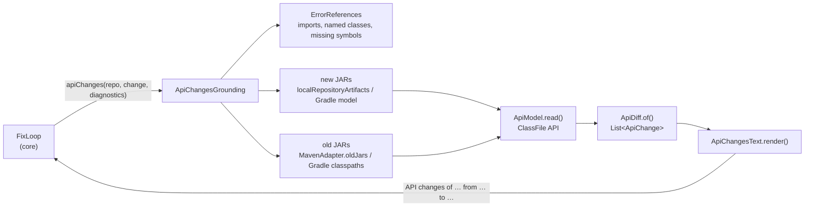
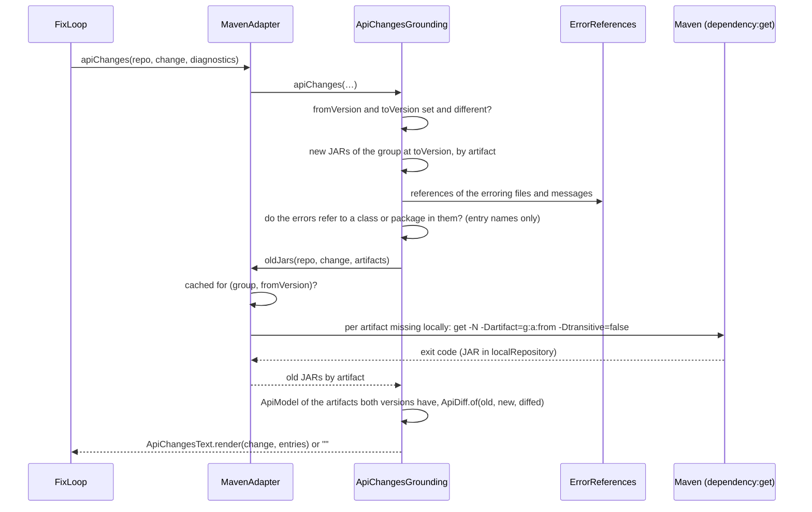

# Architecture – API changes

Milestone: [M10](../features.md#m10--api-diff-as-grounding-) · Spec: [`m10-api-diff-grounding/spec.md`](../../specs/done/m10-api-diff-grounding/spec.md) · Review: [`review.md`](../../specs/done/m10-api-diff-grounding/review.md)

> **Summary for agents**
>
> - For a JVM update, the model gets a deterministic list of what changed between the old and the new version's public API (moved classes and members, renamed packages, changed signatures, rename candidates, removed classes and members), before the full API from `javap`. The pieces live in `ecosystems:jvm`: `ApiModel.kt` (class files read with the JDK's ClassFile API), `ApiDiff.kt` (`ApiDiff`, the typed `ApiChange`, and `ApiChangesText`), `ApiChangesGrounding.kt` (selection and old-JAR lookup), `ErrorReferences.kt` (what the errors refer to, shared with `JavapGrounding`).
> - The port is `EcosystemAdapter.apiChanges(repo, change, diagnostics): String`, default `""`. `FixLoop` puts every change's API changes before every change's full API (`ground`), each distinct text once, so `Prompt`'s trimming cuts full APIs first. `MavenAdapter` and `GradleAdapter` implement it; the TypeScript adapter doesn't.
> - Old JARs: Maven takes them from `localRepository` or fetches each missing artifact once per run with `maven-dependency-plugin:get` (no dependencies, 2 min timeout, never into the repository); Gradle takes them from the compile classpath of any model read in the run (the base commit's), and starts no Gradle. The plugin version lives in `gradle/libs.versions.toml`.
> - Nothing here may fail the run: no old JARs, a failed or timed-out fetch, an unreadable JAR or class all give `""` and a log line, never a `ToolError`. The diff never calls an LLM (rule 2).
> - Easiest rules to break: anything ambiguous is "removed", never guessed (two candidates, an instance member, a field of another type); decide whether a change matters from the JARs' entry names before parsing any class (a PR can carry hundreds of changes); the typed diff keeps every entry, only the text is limited.

## Overview

The full API shows what exists in the new version, not what moved or disappeared. A 7B model guessed a moved class's import twice until the grounding named the new place. `apiChanges` compares the old and the new version's API for the classes the errors refer to and says it in a few plain lines. M13 is meant to turn the unambiguous entries into rewrite rules, so the diff is a typed value first and text second.



## Files

| File | Role |
|---|---|
| `core/…/EcosystemAdapter.kt` | `apiChanges(repo, change, diagnostics): String = ""`. Its KDoc allows fetching the old version through the project's own build tool, once per run. |
| `core/…/FixLoop.kt` | Builds `FixRequest.grounding`: `changes.map(apiChanges) + changes.map(ground)`, empty texts dropped, `distinct()`, joined by a blank line. |
| `ecosystems/jvm/…/ApiModel.kt` | `MemberKind`, `ApiMember(kind, name, parameters, static, returnType)` with `render(owner)` and `sameSignature(other)`, and `ApiModel(classes)` with `read(jars)`. |
| `ecosystems/jvm/…/ApiDiff.kt` | `ApiChangeKind` (heading, `unambiguous`), `ApiChange(kind, oldName, newName, oldMembers, newMembers)` with `render()`, `ApiDiff.of(old, new, diffed)`, and `ApiChangesText.render(change, entries)` with the limits. |
| `ecosystems/jvm/…/ApiChangesGrounding.kt` | `ApiChangesGrounding(newJars, oldJars)`: the version check, the relevance check, the diffed classes, a per-JAR model cache, and the failure handling. `DependencyChange.group()`. |
| `ecosystems/jvm/…/ErrorReferences.kt` | `ErrorReferences(repo, diagnostics)`: `all` (imports of the erroring files and qualified names in the messages), `cited` (what the errors themselves name), `symbols` (missing symbols, plus classes imported from a missing package), `classes(names, index)`; `prefixes`, `packageOf`, `simpleName`. |
| `ecosystems/jvm/…/JavapGrounding.kt` | `classNames(jar)` (top-level classes by entry name), `localRepositoryArtifacts(localRepository, group, version)` (JARs by artifact ID); `ground` now returns `""` on an unreadable JAR or a failing javap instead of throwing. |
| `ecosystems/jvm/…/MavenAdapter.kt` | `apiChanges`, `oldJars` (local, else `fetch`, cached in `oldJarsCache` by group and old version), `fetch`. |
| `ecosystems/jvm/…/GradleAdapter.kt` | `apiChanges`, `newJars` (the last model of the repository), `classpaths` (every model's classpath in the run), `classpathArtifacts`. |
| `llm/…/Prompt.kt` | The grounding's section is `## API` (was `## API of the new version`). |

## A run



Steps, in order; the first that fails gives `""`:

| Step | Rule |
|---|---|
| Versions | `fromVersion` and `toVersion` non-empty and different. |
| New JARs | Maven: every artifact of the group at `toVersion` in `localRepository` (no sources, Javadoc, or test JARs). Gradle: the group's JARs at `toVersion` on the compile classpaths of the repository's last model. |
| Relevance | The errors refer to the new JARs: a class the messages name or an import tied to a missing symbol or package (`cited`) is a class of the JARs or in one of their packages, or a class of the JARs is named like a missing symbol. A plain import of an erroring file doesn't count. Decided on `classNames()` of the JARs, without parsing a class (review F2). |
| Old JARs | `oldJars(repo, change, newArtifacts)`: the same artifacts at `fromVersion`, by artifact ID. |
| Artifacts | Only artifacts both versions have are diffed (a release that adds an artifact, like PDFBox 3's `pdfbox-io`, diffs the rest). |
| Diffed classes | Every class of the old or new index that `all` refers to (`a.b.C.m` from a static import is `a.b.C`), plus every class named like one of `symbols`. Wildcard imports and a package's other classes are not diffed. |

## Old JARs

| | Maven (`MavenAdapter`) | Gradle (`GradleAdapter`) |
|---|---|---|
| Source | `localRepository` (default `~/.m2/repository`), else one fetch per missing artifact | The compile classpaths of every model read in the run (`classpaths`), so the base commit's model from `resolvedVersions` in a PR |
| Command | `<mvnw or mvn> -B -fae [--settings <file>] org.apache.maven.plugins:maven-dependency-plugin:<v>:get -N -Dartifact=<group>:<artifact>:<from> -Dtransitive=false -Dmaven.repo.local=<localRepository>`, in the repository root, with the selected JDK, timeout `FETCH_TIMEOUT` (2 min) | none |
| Order | The change's own artifact first, then the rest sorted | — |
| Failure | Non-zero exit: that artifact is skipped (logged). `ToolError` (timeout, Maven can't run): the lookup stops, what was found is used | No model with the group at `fromVersion` (no `--base`, no upgrade): no old JARs |
| Once per run | `oldJarsCache[(group, fromVersion)]`, failures included | In-memory lookup, no process |

The Gradle classpaths are kept apart from `models`: `isBuildFile` reads the included builds of the last model per repository, and a base commit's included build must not become a build file of the head (T-C3).

## API model

`ApiModel.read(jars)` reads every `.class` entry outside `META-INF/`, except nested classes (`$` in the name), `module-info`, and `package-info`, with `ClassFile.of().parse()`.

| Part | Definition |
|---|---|
| Class | Public top-level classes, by fully qualified name. Non-public classes are left out. |
| Member | Public methods (`METHOD`), constructors (`CONSTRUCTOR`, name `<init>`), and fields (`FIELD`). Synthetic and bridge members, and names with `$`, are left out. Only declared members; inheritance is not followed. |
| Signature | Kind, name, the erased parameter types in order (varargs as an array, `a.B$C` as `a.B.C`), and `static`. The return type (a field's type) is kept for display; it decides only a moved field (below). |
| Kotlin | A file's top-level functions are the static methods of its `…Kt` class. |
| Errors | A file that isn't a ZIP throws an `IOException`, a broken or too new class file an `IllegalArgumentException`; `ApiChangesGrounding` catches both. |

## The diff

`ApiDiff.of(old, new, diffed)`: class changes for diffed classes gone from the new model, then member changes for diffed classes in both. Categories in decision order; the first that applies wins:

| `ApiChangeKind` | When | Unambiguous |
|---|---|---|
| `RENAMED_PACKAGE` | At least two diffed classes of one package are gone, all moved to the same other package, and the package has no class left in the new model. One entry for the package. | yes |
| `MOVED_CLASS` | A class is gone, and exactly one class with the same simple name is new in another package. | yes |
| `REMOVED_CLASS` | A class is gone, and neither applies. | no |
| `CHANGED_SIGNATURE` | A member name exists in both versions and at least one of its old signatures is gone: all old overloads → all new overloads, never paired. | no |
| `MOVED_MEMBER` | A static member whose name is gone from its class, and exactly one other class of the new model has a static member of the same kind, name, and parameters. A method's return type may differ (Guava's `toStringHelper`); a field's type must match (review F1). | yes |
| `RENAME_CANDIDATE` | In the same class, exactly one member is left gone and exactly one is new, with the same signature. | no |
| `REMOVED_MEMBER` | Anything else that is gone. | no |

The moved-member search looks at every class of the new model, not only the diffed ones. The list of `ApiChange` holds every entry; limits apply only to the text.

## The text

```
API changes of org.yaml:snakeyaml from 1.33 to 2.3

Changed signatures:
- org.yaml.snakeyaml.constructor.Constructor: (java.lang.Class), … → (java.lang.Class, org.yaml.snakeyaml.LoaderOptions), …
```

`ApiChangesText.render()`: the title `API changes of <package> from <from> to <to>`, then one block per kind with a non-empty list, in the order above, under its heading (`Renamed packages:`, `Moved classes:`, `Removed classes:`, `Changed signatures:`, `Moved members:`, `Rename candidates:`, `Removed members:`). One `- ` line per entry, sorted. An entry is `old → new` with fully qualified names; a member is `a.B.m(int)`, a constructor `a.B(int)`, a field `a.B.F`; a changed signature `a.B.m: (int) → (int, int)` (a field by its type, `static` in front where it applies). No JSON. An empty diff is `""`.

| Limit | Kinds, filled in this order |
|---|---|
| 15 | renamed packages, moved classes, removed classes |
| 15 | moved members, removed members |
| 10 | changed signatures |
| 10 | rename candidates |

What doesn't fit is the block's last line, `- … and N more`.

In the prompt, the text is part of `FixRequest.grounding` under `## API`, before every full API (`javap -public of <package> <version>:`). Trimming cuts the grounding from its end ([Fix loop](fix-loop.md#the-fix-request)).

## Tests

| Level | Task | What runs | Examples |
|---|---|---|---|
| Unit, `ecosystems:jvm` | `test` | Each category, the order, the limits and `… and N more`, sorting, the Kotlin case, an unrelated class, an empty diff, on JARs compiled in the test (`TestJars`) through `MavenAdapter.apiChanges` | `ApiChangesTest` (frozen, `tests.lock`), `ApiChangesSelectionTest` |
| | | Fetch command line, once per group and version, failure not retried, timeout, unreadable JAR, no fetch for unrelated errors or equal versions, nothing written into the repository; fetch order | `OldJarsTest` (frozen), `OldJarsOrderTest` |
| | | Gradle: old JARs from the base model, no Gradle run, base included builds kept out of `isBuildFile` | `GradleApiChangesTest` (frozen, on `FakeGradleTest`) |
| | | The model on class files built in the test and the real Kotlin stdlib; edge cases of the diff on hand-built models; `ground` and `apiChanges` on broken JARs and a javap timeout | `ApiModelTest`, `ApiDiffTest`, `GroundingFailuresTest` |
| Unit, `core` | `test` | API changes of all changes first, distinct texts once, an adapter without them unchanged | `FixLoopApiChangesTest` (frozen) |
| Unit, `llm` | `test` | `## API` heading; the full API cut before the API changes | `PromptTest` (frozen) |
| Integration | `:cli:integrationTest` (opt-in) | Real Maven on `fixtures/guava-update` with an empty local repository: verify resolves 21.0, `apiChanges` fetches 18.0 once, names `Objects.firstNonNull → MoreObjects.firstNonNull`, and leaves `git status` clean. Needs Maven and network. | `ApiChangesIntegrationTest` |

The real-model proof (PDFBox 2 → 3, SnakeYAML 1 → 2: red at the milestone base, green with M10) is recorded in the spec's `progress.md`; both cases are in the [benchmark](benchmark.md#the-corpus) corpus.

## Decisions and known limits

| Decision / limit | Reason | Revisit |
|---|---|---|
| Class files read in-process with `java.lang.classfile`, `javap` only for the full API | The moved-member search needs every class of the group; no new dependency (R3). | — |
| Both the diff and the full API in the prompt, the diff first | The diff says what moved, the full API gives the replacement's signatures; trimming keeps the diff (user decision, R13). | M6 benchmark |
| Maven fetches only the artifacts the new version has, without dependencies, into `localRepository` | Cheap on a CI runner, keeps rule 7 and the user's mirror (Q2, R7). An artifact only in a `pom.xml` repository resolves as Maven resolves it in the project. | — |
| Gradle has no diff without a model at the old version (`heal` without `--base`, the benchmark's fix-loop-only mode) | A second Gradle run or a detached configuration was ruled out (Q5). | When a Gradle case needs it |
| Public members only, no protected ones, no inherited ones, no nested classes | Matches `javap -public` and today's class selection (R10). A member pulled up into a supertype shows as removed. | If a real case needs it |
| A package replaced by a package of another group (kotlin-logging 3 → 5) is not diffed | Two changes, not one; the full API finds the moved classes by name. | — |
| TypeScript has no API changes | Its grounding works on `.d.ts` files (Q1). | A later milestone |
| How M13 gets the typed diff before the fix loop | The diff types stay in `ecosystems:jvm`; the port returns text. | M13 |
