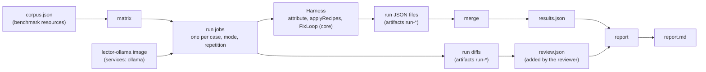
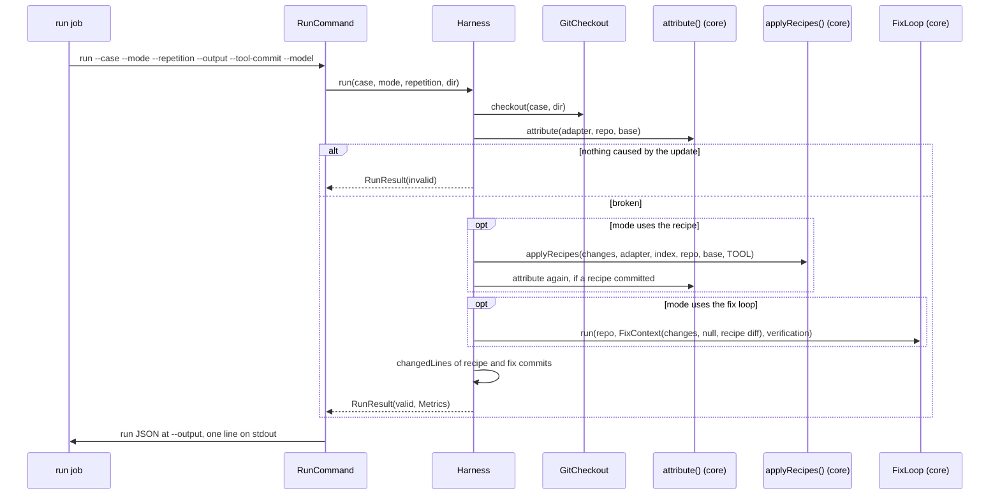

# Architecture – Benchmark

Milestones: [M6](../features.md#m6--benchmark-), [M11](../features.md#m11--fix-loop-yield-) · Spec: [`m6-benchmark/spec.md`](../../specs/done/m6-benchmark/spec.md) · Review: [`review.md`](../../specs/done/m6-benchmark/review.md)

> **Summary for agents**
>
> - The module `benchmark` runs the product's own code (`attribute`, `applyRecipes`, `FixLoop`, `MavenAdapter`, `TypeScriptAdapter` since M9, `OllamaClient`) on the cases in `corpus.json`, in three modes (one for an ecosystem without recipes), and turns the runs into `results.json` and `report.md`. It is never shipped: `cli` doesn't depend on it, and the tool image doesn't contain it.
> - Four commands (`BenchmarkCommand.kt`), run through `./gradlew :benchmark:run --args="…"`: `matrix` (the workflow's job matrix as JSON on stdout), `run` (one case, one mode, one repetition → one run JSON), `merge` (the run files → `results.json`), `report` (`report.md` from `results.json` and `review.json`). `.github/workflows/benchmark.yml` runs them on `workflow_dispatch` only.
> - The numbers come from `Stats.kt`: only valid runs of valid cases count (`counted`), a case with any `invalid` run is out (`invalidCases`), the green rate is per repetition and then mean and spread, and the 90/10 verdict is the mean recipe share of changed lines over green recipe + fix-loop runs, at `RECIPE_SHARE_THRESHOLD` (90) or more.
> - Extend it: a new case is an entry in `corpus.json` (full commit hashes, an https repository, a PR URL or `synthetic`), checked against a real checkout to have a failure caused by the update. A new metric is a field in `Metrics` (`RunResult.kt`), set in `Harness`, shown in `Report`, and added to the fixtures under `src/test/resources/fixtures/results/`.
> - Easiest rules to break: the benchmark measures the product as shipped, so no budgets, prompts, or options of its own (`FixLoop(adapter, llm, base)` takes the defaults); the fix loop gets no release notes, and the report says so (review F4); a run must always leave a result, so `Harness.run` turns every exception into an `error` run.

## Overview

The benchmark answers whether the JVM/Maven path works and which part does the work: the recipe or the fix loop; since M9 also how the fix loop does on TypeScript, reported apart ([concept section 11](../concept.md#11-success-measurement)). Each case is a real dependency update whose head commit breaks something. Each run starts from a fresh checkout of that head, verifies it against the base, and then runs one mode. The workflow runs one job per case, mode, and repetition, merges whatever the jobs left, and uploads the report. A reviewer checks a sample of green runs from their diffs and the results are committed under `benchmark/results/<date>[-<label>]/`. M11's runs are the first on record: `2026-10-26-7b-before`, `2026-10-26-7b-after`, `2026-10-26-14b-after`.

## Module and files

| File | Role |
|---|---|
| `Corpus.kt` | `Corpus`, `Case(id, origin, repository, base, head, changes, note, ecosystem)`, `Change(package, from, to)`; `MAVEN`, and `RECIPE_ECOSYSTEMS` (only `maven`: npm has no recipes). `Corpus.load()` reads `corpus.json` from the classpath; `parse()` rejects unknown and missing fields, IDs that aren't kebab-case, origins that are neither a GitHub PR URL nor `synthetic`, non-https repositories, short commit hashes, cases without changes, an ecosystem other than `maven` or `npm`, and duplicate IDs. |
| `Plan.kt` | `Mode` (`recipe-only`, `fix-loop-only`, `recipe-and-fix-loop`, with `usesRecipe`, `usesFixLoop`, and `repetitions`: 3 with the fix loop, else 1), `RunKey`, `plan(corpus, only)`: every case × mode × repetition, in corpus order, and `modes(ecosystem)`: every mode for `maven`, only `fix-loop-only` for an ecosystem without recipes (M9). |
| `Harness.kt` | `Harness.run(case, mode, repetition, dir): RunResult`; the ports `Checkout` and `ToolUnderTest(commit, model)`. A repository whose detected adapter's `ecosystem` isn't the case's is a `ToolError`. |
| `Git.kt` | `GitCheckout` (`git init`, `git fetch --depth=1 <repository> <head> <base>`, `checkout --detach <head>`) and `changedLines(repo, commit)` (added plus removed from `git show --numstat`; binary files count 0). |
| `RunResult.kt` | `RunResult` (case, mode, repetition, tool commit, model, `RunStatus`, reason, `Metrics`, the case's `ecosystem`), `RunStatus` (`valid`, `invalid`, `error`, `missing`), `Metrics`, `Stages`, `RecipeRecord`, `Runtime`. |
| `Results.kt` | `Results(toolCommit, model, runner, date, runs)`: `merge` (a missing run gets its case's ecosystem), JSON encoding and decoding of results and run files; `Review(reviewer, runs)` and `ReviewedRun(case, mode, repetition, acceptedUnchanged, reason)`. |
| `Stats.kt` | `counted`, `invalidCases`, `greenRate` (`Spread(mean, min, max)`), `verdict` (`Verdict(recipeShare, runs)`), `RECIPE_SHARE_THRESHOLD`. |
| `Report.kt` | `Report.render(results, review)`: the Markdown report. With more than one ecosystem, each gets its own numbers under a heading of its own (JVM for `maven`, TypeScript for `npm`), JVM first. |
| `BenchmarkCommand.kt` | The Clikt commands and `realHarness()`, the composition root: `MavenAdapter` with `installedJdks(environment)`, `TypeScriptAdapter` with `installedNodes(environment)` and `LECTOR_JEST_JUNIT` (M9), `BundledRecipeIndex.load()`, `OllamaClient`, `GitCheckout`. |
| `Main.kt` | `main()`, excluded from coverage like the CLI's. |
| `corpus.json` | The cases, in `src/main/resources/gmbh/vanella/lector/benchmark/`. |

`benchmark` depends on `core`, `recipes`, `llm`, `ecosystems:jvm`, and `ecosystems:typescript`, plus Clikt, kotlinx-serialization-json, and SLF4J. It is the only module with the Kotlin serialization compiler plugin (`org.jetbrains.kotlin.plugin.serialization`, on the `buildSrc` classpath). The `core` pieces it needs are shared with the product, not copied: `applyRecipes()` and `RecipeGroupResult` (`RecipeGroup.kt`, used by `PrPipeline` too), `installedJdks()` (`JdkSelection.kt`), and `FixLoopResult.requestsWithDiagnosticsLeftOut` ([Fix loop](fix-loop.md#the-fix-request)).

## The corpus

27 cases: 24 Maven (16 historical bot PRs, 12 Dependabot and 4 Renovate, and 8 synthetic bumps, two of them, `pdfbox-3` and `snakeyaml-2`, M10's proof cases for the [API changes](api-changes.md)) and, since M9, 3 TypeScript bot PRs (`ecosystem: npm`). A historical case's `base` and `head` are the PR's base and head commits. Where the PR is still open, or the bump is synthetic, `repository` is [`danvan86/lector-benchmark-corpus`](https://github.com/danvan86/lector-benchmark-corpus), which holds those heads. `note` says what breaks, for the curator. The harness doesn't trust the corpus: every run checks that its head has a failure caused by the update.

## A run

| Mode | Recipe | Fix loop | Repetitions |
|---|---|---|---|
| `recipe-only` | `applyRecipes`, commit by `lector` | — | 1 |
| `fix-loop-only` | — | `FixLoop` with default `Budgets`, no recipe diff | 3 |
| `recipe-and-fix-loop` | as above | `FixLoop` with the recipes' diff | 3 |

**Metrics** (`Metrics`, per valid run): `green` (nothing caused by the update left, and `testsRun > 0`); `before` and `after` as `Stages` (build errors, compile errors, test failures caused by the update); `recipes`, one `RecipeRecord` per change (recipe name or null, whether its commit was kept, the outcome or why not); `attempts`, `acceptedFixes`, `rejectionsPerRule`, `stopReason` (null without a fix loop); `runtime` in whole seconds (total after the checkout, first verification, recipe plus the verification after it, fix loop); `recipeLines` and `fixLines`; `preExisting`, `flaky`, `unattributed`, `testsRun`; `requestsWithDiagnosticsLeftOut`.

**Errors:** a `ToolError` (a fetch that fails, Maven that can't start, Ollama out of reach, no adapter detects the repository) and any other exception end the run as `error` with the message (for other exceptions, `<Type>: <message>`). The command still writes the run file and exits `0`; the job only fails if the JVM does.

## Results and report

`merge` reads every `*.json` under `--runs` (recursively), requires at least one, requires one tool commit and one model across them, rejects runs that aren't in the plan, and lists the runs in plan order. A planned run without a file becomes `missing` (`no result`): the job failed before writing, or ran out of time.

| Report section | Content |
|---|---|
| Header | Date, short tool commit, model, runner, cases and invalid cases; that the fix requests carry no release notes |
| 90/10 verdict | Only for an ecosystem with recipes; `npm` gets a `Recipe step` section that says there is none. `holds` or `doesn't hold`, the mean recipe share, the number of runs. Shares are taken per green `recipe-and-fix-loop` run that changed any line, averaged, rounded to one decimal, then compared with 90 |
| Green rate per mode | Runs, mean and spread of the per-repetition green rate, pre-existing / flaky / unattributed failures |
| Cases | Per case and mode `green/with result`, or `invalid`; green after recipe alone vs. after recipe + fix loop (once, always) |
| Fix loop | Mean attempts and accepted fixes, cut requests, stop reasons per fix-loop mode |
| Guardrail rejections | Per rule, with the rate over all fix-loop attempts |
| Runtime | Mean minutes per mode: total, first verify, recipe, fix loop |
| Manual review | From `review.json`, or "Not done yet". Every reviewed run must be a green run of a fix-loop mode, none twice, and at least `min(10, green fix-loop runs)` of them |
| Errors and missing runs | Every `error` and `missing` run with its reason; not counted |

## Commands

| Command | stdout | Fails with (stderr, exit `2`) |
|---|---|---|
| `matrix [--cases a,b]` | `{"include":[{"case":…,"mode":…,"repetition":…},…]}` | an unknown case |
| `run --case --mode --repetition --output --tool-commit --model [--ollama-url] [--work-dir] [--maven-settings]` | `<case> <mode> #<n>: valid`, or `invalid`/`error` with the reason | an unknown case, a repetition the mode doesn't have |
| `merge --runs --output --runner --date [--cases]` | `<n> runs in <output>` | no run file, malformed run, several tool commits or models, unplanned run |
| `report <dir>` | `Wrote <dir>/report.md` | missing `results.json`, malformed results or review, a review that breaks the rules above |

Invalid input from Clikt's own checks (an unknown option, a bad `--date`, a missing directory) exits `1`. Through Gradle, every non-zero exit becomes Gradle's `1` (review F6). `:benchmark:report -Presults=<dir>` is a shortcut for `run --args="report <dir>"`. Both `JavaExec` tasks run from the repository root with `--enable-native-access=ALL-UNNAMED`; neither is part of `build`.

## Workflow

`.github/workflows/benchmark.yml`, `workflow_dispatch` with two optional inputs: `cases` (passed through the environment) and, since M11, `model` (default `qwen2.5-coder:7b`, the workflow's `MODEL`):

| Job | What it does |
|---|---|
| `plan` | `matrix` → the job matrix |
| `ollama-image` | Builds `docker/ollama` with `MODEL` from the `model` input (M11, default `qwen2.5-coder:7b`) and pushes `ghcr.io/<owner>/lector-ollama:benchmark-<model, `:` as `-`>`: releases can't publish it before the MSAL check. The package needs Actions write access for the repository |
| `run` | Matrix, `fail-fast: false`, 120-minute timeout, the Ollama image as `services: ollama` on port 11434. JDKs 17, 21, and 25 from `setup-java` as `LECTOR_JDK_*`, Node 22 and 24 from `setup-node` as `LECTOR_NODE_*` with Corepack and `jest-junit` from `docker/lector/node` (M9), `MAVEN_OPTS=-Duser.language=en -Duser.country=US`, the runner's Maven. Checks the case out under `$RUNNER_TEMP/work` and saves what the tool committed on top of the head as `<case>-<mode>-<repetition>.diff` for the manual review. Uploads the run file and the diff as `run-<case>-<mode>-<repetition>` |
| `report` | `if: always()` after `plan` succeeded: downloads `run-*`, `merge` with the runner's description and today's date, `:benchmark:report`, uploads `benchmark-<date>` |

## Tests

| Level | Task | What runs | Examples |
|---|---|---|---|
| Unit | `:benchmark:test` | The harness on a temporary Git repository (fetched through `GitCheckout` with `uploadpack.allowAnySHA1InWant`), with a fake Maven-like adapter, a fake recipe index, a scripted `LlmClient` (whose `fits` can be set), and a `TestTimeSource`: every mode, invalid heads, errors, metrics, runtime per stage | `HarnessTest` |
| Unit | `:benchmark:test` | Corpus parsing and the shipped corpus's size and origins; the plan; merge and JSON round trips, every field of the fixtures required; green rate, verdict at 89 and 90 %, invalid cases; the report rendered on `fixtures/results/` and compared with `report.md` there; the commands through Clikt's `test()` | `CorpusTest`, `PlanTest`, `ResultsTest`, `StatsTest`, `ReportTest`, `BenchmarkCommandTest` |

No test runs Maven, Ollama, or the network. A change to the report changes `fixtures/results/report.md`: regenerate it with `:benchmark:report -Presults=<a copy of the fixture directory>` and read the diff.

## Decisions and known limits

| Decision / limit | Reason | Revisit |
|---|---|---|
| A Gradle module run through `JavaExec`, no start script, not in the image | Shares the product's code without shipping anything (spec Q6). | — |
| One job per run, merged at the end | Each job stays well within the job time limit; a lost job becomes `missing` instead of losing the report. | — |
| `qwen2.5-coder:7b` by default, standard runners; another model through the `model` input (M11) | The product default. M11 ran `qwen2.5-coder:14b` too: valid in 151 of 177 runs on a 4-CPU runner, so it fits, but 25 of its fix-loop runs stopped because the model didn't answer in time. | GPU runners |
| The reviewer judges each sampled run from its case and diff only | M11's review was blind to the milestone and to which run a sample came from, so a looser loop can't grade itself. | — |
| No release notes in the fix requests | The product reads none from Dependabot PRs before M8, and 12 of 16 PRs are Dependabot's; the report says so (review F4). | M8 |
| The runner's Maven, not the tool image's | The tool image isn't published before the MSAL check (review F5). | When releases publish it |
| Changed lines as the 90/10 measure | Language-neutral and straight from the commits (Q11). Green rates are reported, but aren't the verdict. | — |
| Results are committed by a person | The review is part of them. | — |
