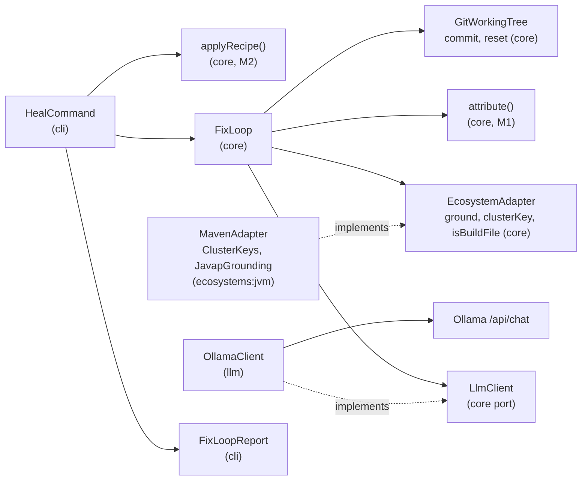
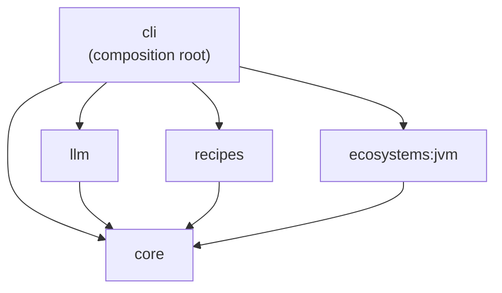
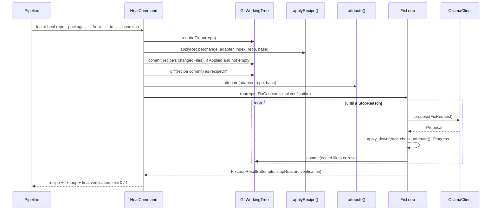
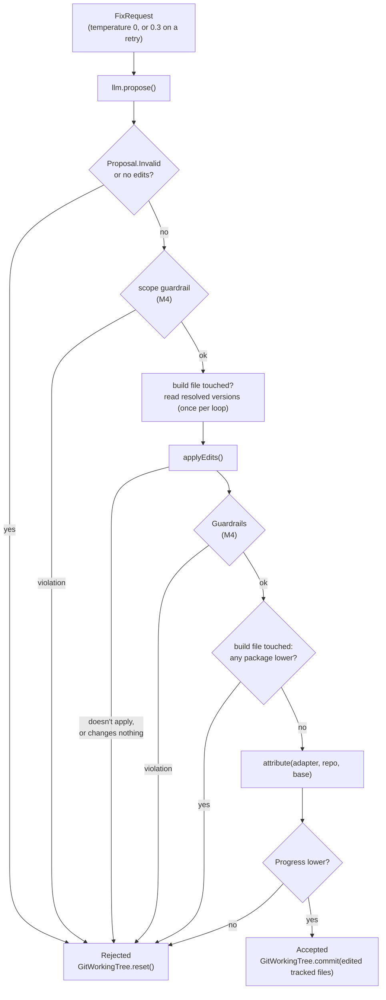

# Architecture – Fix loop

Milestone: [M3](../features.md#m3--fix-loop-cli-only-no-ci-yet-) · Spec: [`m3-fix-loop/spec.md`](../../specs/done/m3-fix-loop/spec.md) · Review: [`review.md`](../../specs/done/m3-fix-loop/review.md)

> **Summary for agents**
>
> - `lector heal <repo> --package … --from … --to …` runs M2's recipe step, commits the recipe's result, then runs `FixLoop` in `core`: one cluster of diagnostics caused by the update per attempt, a grounded `FixRequest` to the `LlmClient` port, search/replace `Edit`s back, applied, verified, and either committed or reset. The exit code follows the final verification, like `verify`.
> - Ports: `LlmClient.propose(FixRequest): Proposal` (`LlmClient.kt`), and on `EcosystemAdapter` `ground`, `clusterKey`, `isBuildFile`. The only implementations are `OllamaClient` in the new module `llm` and `MavenAdapter` (`ClusterKeys`, `JavapGrounding`). `core` knows no LLM vendor and no language.
> - An attempt is accepted only if `Progress` (build errors without a location, compile errors, test failures, compared in that order) gets lower. Accepted: one local commit by `lector` with the edited, tracked files only. Anything else: `GitWorkingTree.reset()`, also on any exception or error inside the attempt. Since M4, every attempt passes the [guardrails](guardrails.md) before it is verified.
> - The prompt's limits live in `Prompt` (`CONTEXT_TOKENS`, `ANSWER_TOKENS`, `MAX_CHARS`), the answer's structure in `FixSchema`, the budget defaults in `Budgets`, the default model in `DEFAULT_MODEL` (`HealCommand.kt`), and the Ollama image for the real-model test in `gradle/libs.versions.toml`.
> - Easiest rules to break: never send diagnostics that aren't `causedByUpdate` to the model; never trim the errors or the code in a request; never repair an edit that doesn't apply (rule 4); never stage more than the edited files in a fix commit (`git add --all` would take build output).

## Overview

The recipe covers the known migration patterns; the fix loop handles what is left. It gives a local model the errors the update caused, the code around them, and the real API of the new version, and only allows small edits that are verified one attempt at a time. Every accepted fix is a commit of its own, so a reviewer sees each step and a rejected attempt is undone by Git. It runs from the CLI only: no push or PR (M5). The [guardrails](guardrails.md) (M4) check every attempt before it is verified.



## Modules and files

| Module | File | Role |
|---|---|---|
| `core` | `Edit.kt` | `Edit(file, search, replace)` and `applyEdits(repo, edits)`: returns the rejection reason, or null when every edit applied. `repoFile()` keeps edits inside the repository and out of `.git`. |
| | `LlmClient.kt` | The port `LlmClient.propose(FixRequest): Proposal`; `FixRequest`, `PreviousAttempt`, `Proposal.Edits(edits, rationale)` and `Proposal.Invalid(reason)`. |
| | `EcosystemAdapter.kt` | Grew by `ground(repo, change, diagnostics)`, `clusterKey(diagnostic)`, and `isBuildFile(file)`. |
| | `Cluster.kt` | `Cluster(key, diagnostics)`, `clusters(diagnostics, adapter)` in fix order, and `Progress`, the stage tuple. |
| | `Snippet.kt` | `Snippet(file, firstLine, lastLine, text)` and `codeSnippets()`: ±40 lines per error, merged per file. |
| | `FixLoop.kt` | `FixLoop.run(repo, context, initial)`, `Budgets`, `FixContext`, `Attempt`, `AttemptOutcome` (`Accepted`, `Rejected`), `StopReason`, `FixLoopResult`. |
| | `GitWorkingTree.kt` | Grew by `trackedFiles`, `commit(repo, message, files)` with the identity `lector`, and `diff(repo, commit)`. |
| | `RecipeStep.kt` | `versionChanges()` and `downgrades()` are shared with the loop's downgrade check. |
| `llm` | `OllamaClient.kt` | The `LlmClient`: one `POST /api/chat` per attempt with the JDK `HttpClient`. Connect timeout 30 s, answer timeout 15 min. |
| | `Prompt.kt` | The system prompt, the user prompt with trimming, and the context limits. |
| | `FixSchema.kt` | The answer's JSON schema (`analysis`, `rationale`, `edits`) and `parse()`, which strips code fences and turns every mismatch into `Proposal.Invalid`. |
| `ecosystems:jvm` | `ClusterKeys.kt` | Cluster keys from javac, kotlinc, and Maven messages; `missingSymbol()` for grounding. |
| | `JavapGrounding.kt` | `javap -public` on the new version's JARs in the local Maven repository. |
| | `MavenAdapter.kt` | Wires both, and `isBuildFile`: `pom.xml` at any depth (since M4 also `mvnw`, `mvnw.cmd`, and `.mvn/…`). Takes `localRepository` (default `~/.m2/repository`). |
| `cli` | `HealCommand.kt` | The `heal` subcommand: clean check, recipe, recipe commit, fix loop, report. Ollama and budget options. |
| | `UpdateCommand.kt` | `--package`, `--from`, `--to`, and `change(adapter)`, shared by `migrate` and `heal`. Extends `RepositoryCommand`. |
| | `FixLoopReport.kt` | The fix-loop section in text and JSON; `SHORT_COMMIT`. |
| | `RootCommand.kt` | Wires `HealCommand` with `MavenAdapter` and `BundledRecipeIndex.load()`; the `LlmClient` factory defaults to `::OllamaClient`. |



`llm` depends on `core`, `kotlinx-serialization-json`, and the SLF4J API. No HTTP library: the JDK client is enough for one endpoint. Testcontainers (`testcontainers-ollama`, through its BOM) is a test dependency of `cli` only.

## Heal flow



The recipe commit's subject is `Apply recipe <recipe name>`, its body `For <package> <from> -> <to>.` It is made only when the recipe was `Applied` and changed files; it stages exactly `changedFiles` (a recipe can add files). `migrate` still leaves its result uncommitted.

## The fix loop

### Clusters and order

`clusters()` takes `verification.causedByUpdate` only: pre-existing, flaky, and unattributed diagnostics never reach the model. It groups by `adapter.clusterKey()`, else by file, else `(no location)`. Clusters with a build error come first (a diagnostic in a build file, or one with neither file nor test), then the largest. Clusters are rebuilt from the new verification after every accepted attempt, so the next attempt takes the first cluster that still has attempts left.

### One attempt



| Step | Rule | Rejection reason (also the retry's feedback) |
|---|---|---|
| Answer | `Proposal.Invalid` or an empty edit list | `the model's answer is invalid: …`, `the model proposed no edits` |
| Versions before | Read with `resolvedVersions` before the loop's first build-file edit, then kept | `the resolved versions can't be read, so a downgrade can't be ruled out: …` |
| Apply | Each `search` matches exactly once: first exactly, then line by line with whitespace ignored (indentation, trailing blanks, runs of spaces). The file must exist in the repository. Edits apply in order; if one fails, nothing is written. | `<file>: no such file in the repository`, `<file>: the search text is not in the file`, `… matches n times …`, `the edits change nothing` |
| Guardrails | Scope on the edits' paths before anything is read or written, the other rules on the written files. See [Guardrails](guardrails.md). | `the edits break the guardrails:` and one `- [rule] file:line: reason` line per violation |
| Downgrades | Only if an edit touched a build file. `downgrades(versionChanges(before, after))`, the PR's own package included. Removing a package is not a downgrade (review D2). | `the edits move packages to lower versions: …` |
| Verify | M1's `attribute()` with the base commit: compile stage first, tests only once compile is clean. | — |
| Progress | `Progress.of(after) < Progress.of(before)`, stage by stage. 1/0/0 → 0/50/0 is progress; 0/0/3 → 0/1/0 is not. | `no progress: <before> -> <after>` plus the first ten errors after the edits, with their whole message |
| Commit | Subject: the rationale's first non-blank line, else `Fix <cluster>`. Body: `Addresses:` and the cluster's diagnostics. Staged: the edited files that Git tracks (an edit to an ignored file is applied but not committed). | — |

Any `Throwable` inside `judge` (a Maven timeout, a failing `git`, a parser that doesn't load) resets the tree and is rethrown: `heal` exits `2`, and the commits made so far stay. A `ToolError` from `propose` (Ollama unreachable) happens before any edit.

### Budgets and stopping

`stopReason()` runs before every attempt, in this order:

| `StopReason` | When | Default | Option |
|---|---|---|---|
| `NOTHING_LEFT` | `causedByUpdate` is empty | — | — |
| `ATTEMPT_BUDGET` | Attempts in total reached | 20 | `--max-attempts` |
| `TIME_BUDGET` | Time since the loop started reached | 30 min | `--time-limit` (minutes) |
| `NO_PROGRESS` | Rejected attempts in a row reached; an accepted one resets the count | 2 | `--max-attempts-without-progress` |
| `CLUSTER_BUDGETS` | Every current cluster used its attempts | 3 per cluster | `--max-attempts-per-cluster` |

The time budget is checked between attempts only; one attempt can take up to 15 minutes for Ollama plus the Maven runs of `attribute()` (review D1). Every option must be at least `1`.

## The fix request

`FixRequest` carries the change, the cluster's diagnostics, `snippets`, `grounding`, `releaseNotes` (`--release-notes <file>`), `recipeDiff` (the recipe commit's diff), `previousAttempts` (the rejected attempts on this cluster with their reason), and the temperature: `0.0` on a cluster's first attempt, `0.3` on a retry, because the same prompt at temperature 0 gives the same answer.

**Snippets** (`codeSnippets`): ±40 lines around each error, overlapping windows in a file merged; an error without a line gets the first 81 lines. A build error without a location gets, from every tracked build file, the window around the first line that contains the new version. The enclosing method is not detected (that needs tree-sitter, M4).

**Prompt** (`Prompt.user`): intro, `## Errors`, `## Code`, then the optional parts `## API of the new version`, `## Release notes`, `## Changes the recipe already made` (a `diff` block), and last `## Earlier attempts that failed` with each attempt's edits as JSON. The budget is `MAX_CHARS = (CONTEXT_TOKENS − ANSWER_TOKENS) × 3` characters, minus the system prompt. The optional parts are trimmed in that order of priority and marked `[trimmed to fit the context]`; a part with less than 200 characters of room is left out. Errors, code, and earlier attempts are never trimmed. If they alone don't fit, `OllamaClient` logs a warning and sends the request anyway; Ollama then cuts it (review D3).

**Ollama request** (`OllamaClient`): `POST <url>/api/chat` with `model`, `stream: false`, `format` = `FixSchema.SCHEMA`, `options` `num_ctx` 16384, `num_predict` 3072, and the temperature, and two messages: `Prompt.SYSTEM` and the user prompt. A status other than 200, a timeout, or a connection error is a `ToolError`. A body without `message.content`, or content that doesn't match the schema, is `Proposal.Invalid`. The schema puts `analysis` first, so the model reasons before it writes edits; the loop ignores it.

## JVM adapter

| Capability | Implementation | Notes |
|---|---|---|
| `clusterKey` | `ClusterKeys.of()` | `artifact:<group>:<artifact>` from Maven's `Could not find artifact`; `package:<name>` from javac's `package … does not exist`; `symbol:<name>` from javac's `symbol:` line or kotlinc's `Unresolved reference` (2.x and 1.9). Test failures have no key. English messages only. |
| `ground` | `JavapGrounding.ground()` | JARs: every artifact of the package's group at `toVersion` under `localRepository` (no sources, Javadoc, or test JARs). Classes: the erroring files' imports and qualified names in the messages, plus classes in those packages or anywhere in the JARs that declare or are named like the missing symbol, at most 300, nested classes left out. One `javap -public -cp <jars> <classes>` run, 2 min timeout; a failure is logged and yields what was parsed. Nothing is downloaded. |
| `isBuildFile` | `MavenAdapter` | `pom.xml` or `*/pom.xml`, and since M4 `mvnw`, `mvnw.cmd`, and `.mvn/…` at the root: Maven reads them on every run, and they can set properties. |

Grounding is how `MoreObjects.firstNonNull` reaches the model for Guava's removed `Objects.firstNonNull`: the symbol `firstNonNull` is missing, and `MoreObjects` in the imported package declares it.

## CLI contract

`lector heal <repo> --package <package> --from <version> --to <version> [--base <git-ref>] [--release-notes <file>] [--format text|json] [--maven-settings <file>] [--ollama-url <url>] [--model <name>] [--max-attempts-per-cluster <n>] [--max-attempts <n>] [--time-limit <minutes>] [--max-attempts-without-progress <n>] [--max-changed-lines <n>]`

Defaults: `--ollama-url http://localhost:11434`, `--model qwen2.5-coder:7b`, budgets as above, `--max-changed-lines 50` (the [diff-size guardrail](guardrails.md#the-rules)). `heal --help` shows them.

| Situation | stdout | stderr | Exit |
|---|---|---|---|
| Nothing caused by the update left after the loop | Report | Logs | `0` |
| Something caused by the update left | Report | Logs | `1` |
| Ollama not reachable, answers non-200, or times out | empty | `Error: Ollama is not reachable at <url>: …` (or the status, or the timeout) | `2` |
| `--ollama-url` not `http`/`https` with a host, a budget below 1, `--release-notes` not a readable file | empty | Usage and `Error: invalid value for …` | `2` |
| Dirty working tree, and every other error as for [`migrate`](recipe-migration.md#cli-contract) | empty | `Error: …` | `2` |

Option errors are found while parsing, before the recipe or any build runs.

**Text report:** M2's recipe section (plus `  Commit: <short sha>` if the recipe was committed), an empty line, the fix-loop section, an empty line, M1's text report of the final verification.

```
Fix loop (2 attempts, 1 accepted; stopped: nothing caused by the update is left)
  Attempts (2):
    1. symbol:firstNonNull, 1 diagnostics: rejected: no progress: 0 build errors, 1 compile errors, 0 test failures -> …
       Errors after the edits:
       - [javac] …
    2. symbol:firstNonNull, 1 diagnostics: accepted: 0 build errors, 1 compile errors, 0 test failures -> 0 build errors, 0 compile errors, 0 test failures
  Fixes (1):
    - 3f2a1b9 Use MoreObjects.firstNonNull
  Rejections per guardrail (0):
    none
  Tests run in the final verify: unknown
```

**JSON report:** one line, `{"recipe": {...}, "recipeCommit": "<sha>" | null, "fixLoop": {...}, "verification": {...}}`. `fixLoop` has `stopReason` (`nothingLeft`, `attemptBudget`, `timeBudget`, `noProgress`, `clusterBudgets`) and `attempts`, each with `cluster`, `diagnostics`, `edits` (`file`, `search`, `replace`), `outcome` (`accepted` / `rejected`), `reason`, `violations` (M4), `commit`, and `rationale` (both `null` when rejected). Since M4, `fixLoop` also has `rejectionsPerGuardrail` and `testsRun` ([Guardrails](guardrails.md#report-and-cli)). `recipe` and `verification` are M2's and M1's.

## Git

| Operation | Command | Notes |
|---|---|---|
| Commit | `git add --all -- <files>`, then `git -c user.name=lector -c user.email=lector@localhost -c commit.gpgsign=false commit --no-verify --allow-empty -m …` | Hooks and signing are off: CI can't answer a prompt. M5 swaps the identity for the GitHub App's. |
| Reset | `git reset --hard`, `git clean -d --force` | Ignored files (build output) stay. Safe because `heal` starts on a clean tree. |
| Recipe diff | `git show --format= --no-color <commit>` | Goes into every request as `recipeDiff`. |

## Tests

| Level | Task | What runs | Examples |
|---|---|---|---|
| Unit, `core` | `test` | The loop with a fake `LlmClient` and a fake adapter on a temporary Git repository: accept and commit, reject and reset, downgrades, progress tuple, cluster order, every budget, temperatures, retry feedback, build output kept out of commits, reset on a `ToolError`. Edit application and snippets on temp files. | `FixLoopTest`, `ClusterTest`, `EditTest`, `SnippetTest`, `GitWorkingTreeTest` |
| Unit, `llm` | `test` | The client against a JDK `HttpServer`: endpoint, `format`, `num_ctx`, temperature, fences, invalid answers, status and connection errors. Prompt layout and trimming. | `OllamaClientTest`, `PromptTest` |
| Unit, `ecosystems:jvm` | `test` | Cluster keys on captured javac, kotlinc 2 and 1.9, and Maven output (`maven-output/*.log`); grounding with the real `javap` on JARs compiled in the test (`TestJars`). | `ClusterKeysTest`, `JavapGroundingTest` |
| Unit, `cli` | `test` | `heal` through Clikt's `test()` with a fake `LlmClient` factory: commit order, text and JSON reports, exit codes, options and their validation. | `HealCommandTest`, `FixLoopReportTest` |
| End-to-end | `endToEndTest` | The start script: `--help` lists `verify`, `migrate`, and `heal`; `heal` without `--package` exits `2`; a green project prints one JSON object without asking the model; an unreachable Ollama exits `2`. | `LectorEndToEndTest` |
| Real model | `:cli:realModelTest` (opt-in) | Tag `real-model`. Testcontainers starts `ollama/ollama` (image version from the catalog), pulls the model (`-Plector.model=<name>`, else `DEFAULT_MODEL`), and runs `heal` on `cli/src/test/resources/fixtures/guava-update` (Guava 18.0 → 21.0, no recipe): green, fixes by `lector`, tests untouched, the update kept. Sets `MAVEN_OPTS=-Duser.language=en`. Needs Docker, Maven, and network. | `RealModelTest` |

`tasks.test` excludes `e2e`, `integration`, and `real-model`; Kover's instrumentation is off for `integrationTest` and `realModelTest`, so neither runs in `build`. `.github/workflows/real-model.yml` runs `realModelTest` on `workflow_dispatch` (optional `model` input) and nightly, never on push or pull requests, with a 90-minute job timeout.

## Decisions and known limits

| Decision / limit | Reason | Revisit |
|---|---|---|
| Ollama's native `/api/chat` with a JSON schema as `format`, JDK `HttpClient` | Structured output keeps the model to edits (rule 3); one endpoint needs no HTTP library. | — |
| `num_ctx` fixed at 16k, answer capped at 3072 tokens, 3 characters per token | Predictable memory on the runner; the estimate is conservative for code. | M6 benchmark |
| `analysis` field first in the schema | Measured: without it, `qwen2.5-coder:7b` never added the import of a moved method's class. | M6 |
| Feedback after no progress names the errors after the edits | With only the counts, the model repeated its edit. | — |
| Clusters by the adapter's key, from English compiler messages | Error messages are language- and locale-specific. The container image must run Maven in English. | M5 image |
| Grounding reads `~/.m2/repository` only | A `localRepository` in the Maven settings is not followed. | When a user's setup needs it |
| Snippets are ±40 lines, not the enclosing method | Needs a parser; M4's `LanguageSupport` reports methods, but snippets don't use it yet. | Open |
| Time budget checked between attempts only | Needs a deadline for `verify` and `runTests` (review D1). | M5 |
| Removing the PR's own package is not a downgrade | Open decision (review D2); M4 left the rule as it is. | Open |
| Errors and code that don't fit are sent in full, with a warning | Open decision: send only as many diagnostics as fit (review D3). | M6 |
| Commits stay local, identity `lector` | No push, PR, or token before M5. | M5 |
