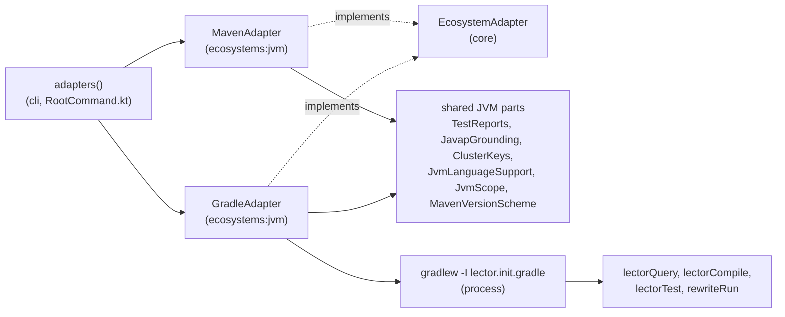
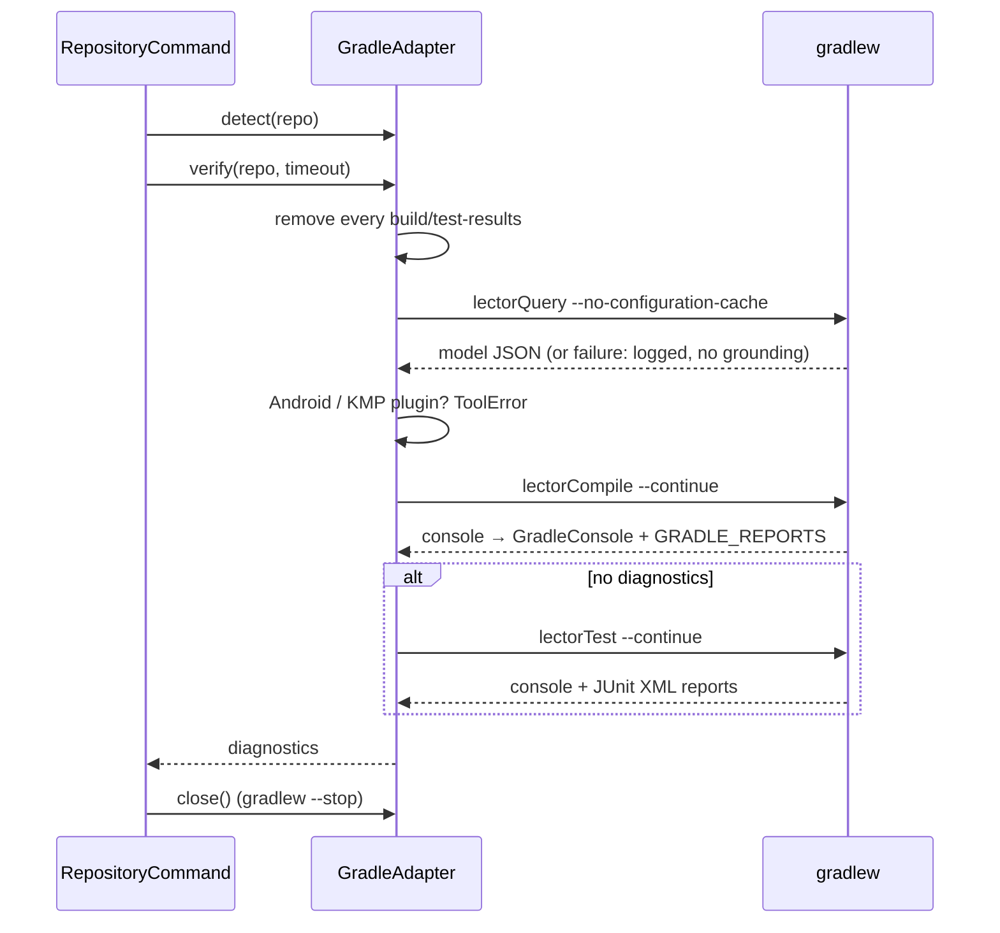
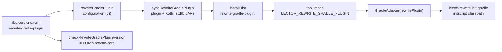

# Architecture – Gradle adapter

Milestone: [M7](../features.md#m7--gradle-) · Spec: [`m7-gradle/spec.md`](../../specs/done/m7-gradle/spec.md) · Review: [`review.md`](../../specs/done/m7-gradle/review.md)

> **Summary for agents**
>
> - `GradleAdapter` (`ecosystems/jvm/…/GradleAdapter.kt`) is the second `EcosystemAdapter` in `ecosystems:jvm`, next to `MavenAdapter`. `core` didn't change for it. `adapters()` in `RootCommand.kt` registers Gradle first, then Maven (then TypeScript, M9). Both share the javac parser, `TestReports`, `JavapGrounding`, `ClusterKeys`, `JvmLanguageSupport`, `JvmScope`, and the `maven` namespace with `MavenVersionScheme`.
> - Every Gradle run is `<repo>/gradlew -I <lector.init.gradle> [-I <--gradle-init>] --console=plain` plus the toolchain properties, on the JDK `DaemonJdk` picks. The tasks live in the init scripts under `ecosystems/jvm/src/main/resources/…/jvm/`: `lectorQuery` (the model as JSON), `lectorCompile` (verify stage 1), `lectorTest` (stage 2). Verify never runs `check` or `build`.
> - Tool errors (exit `2`): `pom.xml` next to the Gradle files, no `gradlew`, Gradle below 8, an Android or Kotlin Multiplatform plugin, a toolchain or daemon JVM that isn't installed. The OpenRewrite Gradle plugin's version is `rewrite-gradle-plugin` in `gradle/libs.versions.toml`; `:recipes:checkRewriteGradlePluginVersion` keeps it on the BOM's OpenRewrite. It ships as the distribution's `rewrite-gradle-plugin/` directory, found through `LECTOR_REWRITE_GRADLE_PLUGIN`.
> - To extend it: a new Gradle-side capability is a task or a hook in `lector.init.gradle` (Groovy, Gradle 8 API), a command-line test in `GradleAdapterTest` (fake Gradle from `FakeGradleTest`), and a test with real Gradle in `GradleIntegrationTest`. New output to parse is captured from a real run into `src/test/resources/gradle-output/`.
> - Easiest rules to break: the init scripts never change the repository or the project's configuration; the adapter is `AutoCloseable` and must be closed (`List<EcosystemAdapter>.use` in `cli`), or Gradle daemons outlive the run; `--stop` stops every daemon of a Gradle version in the Gradle user home, so tests use their own; a blocklist rule matches every spelling (`onlyIf`, `setOnlyIf`, `excludes`, closures); `isBuildFile` also covers every included build the query reported.

## Overview

M7 widens the pipeline from Maven to Gradle without touching `core`: detection, invocation, resolved versions, and the recipe runner are Gradle's own, the rest is shared with the Maven adapter. Gradle build scripts are code, so the adapter doesn't parse them. It asks Gradle through its own init script, and runs the project's wrapper so the project's Gradle version and distribution mirror apply.

## Files

| Module | File | Role |
|---|---|---|
| `ecosystems:jvm` | `GradleAdapter.kt` | Detection and tool errors, the command line, verify, `runTests`, the model, grounding, `close()`. |
| | `GradleWrapper.kt` | `GradleWrapper.version()` from `distributionUrl`, `GradleVersion` (major and minor), `DaemonJdk` and its table `NEWEST_JAVA`. |
| | `GradleInitScripts.kt` | Writes the two init scripts from the resources to a temporary directory on first use; `close()` removes it. |
| | `lector.init.gradle` | The tasks `lectorQuery`, `lectorCompile`, `lectorTest`, and `failOnNoMatchingTests = false` when `-Plector.runTests` is set. Groovy on the Gradle 8 API, so it runs unchanged on 8.0 to 9.x. |
| | `lector-rewrite.init.gradle` | Puts the plugin's JARs on the init script classpath, applies `RewritePlugin` to the root project, and clears `rewriteRun`'s task dependencies. |
| | `GradleModel.kt` | Parses the query's JSON into `GradleModel(versions, classpath, plugins, includedBuilds)`. |
| | `GradleConsole.kt` | Plain console output → javac, kotlinc, and build-failure diagnostics; `missingToolchain()`. |
| | `GradleGuardrails.kt` | `GradleScope` (`isEditable`, `isBuildFile`) and `GradleTestSkipping` (the build-file blocklist). |
| | `TestReports.kt` | `TestReports(buildTool, layout, tool)`, with the instances `MAVEN_REPORTS` and `GRADLE_REPORTS`. Reads the reports with `testCases()` from `ecosystems:shared` (M9). |
| | `JavapGrounding.kt` | Takes the JAR lookup as a function: `localRepositoryJars()` for Maven, the model's classpath for Gradle. `ApiChangesGrounding` (M10) takes the new and the old JARs the same way. |
| | `ClusterKeys.kt` | `artifact:<group>:<artifact>` also from Gradle's `Could not find <group>:<artifact>:<version>.` (tool `gradle`). |
| `recipes` | `IndexBuilder.kt` | Also reads `org.openrewrite.gradle.plugins.UpgradePluginVersion` leaves (`GRADLE_PLUGIN_LEAF`). |
| | `build.gradle.kts` | `checkRewriteGradlePluginVersion`, next to the Maven plugin's check. |
| `sources` | `RenovateSource.kt` | Package and datasource from the merge-confidence badge; `UNBADGED_DATASOURCES` for wrapper rows. |
| `cli` | `RootCommand.kt` | `adapters(config, environment)`: Gradle with the init script, the JDKs, the environment, and `LECTOR_REWRITE_GRADLE_PLUGIN`; then Maven. |
| | `RepositoryCommand.kt` | `BuildConfig(mavenSettings, gradleInit, npmrc, yarnrc)` (the last two since M9), `--gradle-init`, `SUPPORTED`, and `List<EcosystemAdapter>.use`, which closes the adapters after every run, failures and `Error`s included. |
| | `PrCommand.kt` | `--gradle-init` / `LECTOR_GRADLE_INIT`; runs the pipeline inside `use` too. |
| | `build.gradle.kts` | The `rewriteGradlePlugin` configuration and `syncRewriteGradlePlugin`, which put the plugin into the distribution. |
| — | `buildSrc/src/main/kotlin/GradleFixtures.kt` | `Test.gradleFixtures()`: what the integration tests with real Gradle need (see [Tests](#tests)). |
| — | `docker/lector/Dockerfile`, `action/action.yml` | `LECTOR_REWRITE_GRADLE_PLUGIN`; the `gradle-init` input and `GRADLE_USER_HOME`. |

`ecosystems:jvm` gained `kotlinx-serialization-json` for the model. No Gradle Tooling API, no Groovy grammar, no Android dependency.

## How Gradle runs

| Part | What | Where |
|---|---|---|
| Executable | `<repo>/gradlew`, always. The wrapper downloads the distribution its `distributionUrl` names. The image has no Gradle. | `command()` |
| Init scripts | `-I <lector.init.gradle>`, then `-I <absolute path>` of `--gradle-init` if given | `command()` |
| Console | `--console=plain` | `command()` |
| Toolchains | `org.gradle.java.installations.auto-detect=false`, `auto-download=false`, `paths=<installed JDKs>`, as `-D` from Gradle 9.1 on and `-P` before (`TOOLCHAINS_AS_GRADLE_PROPERTIES`) | `command()` |
| JDK that runs Gradle | `JAVA_HOME` from `DaemonJdk`: `toolchainVersion` in `gradle/gradle-daemon-jvm.properties` if present, else the newest installed JDK that the wrapper's Gradle runs on (`NEWEST_JAVA`, from Gradle's compatibility matrix; with the image's 17, 21, 25: Gradle 8.0 → 17, 8.5 → 21, 9.1 → 25). Without installed JDKs the environment's `JAVA_HOME` applies. | `DaemonJdk` |
| Environment | `runProcess`'s allowlist plus `JAVA_HOME` and the tool's `GRADLE_*` and `ORG_GRADLE_PROJECT_*` variables (`GRADLE_VARIABLES`): the Gradle user home, options, and credentials for the build and the init script. The filter is in the adapter, not in `core`. | `GradleAdapter` constructor |
| Configuration cache | `--no-configuration-cache` on the query and the recipe run only; verify and `runTests` use the project's settings | `NO_CONFIGURATION_CACHE` |
| Timeouts | The caller's `timeout`, never more than an hour (`GRADLE_TIMEOUT`); stage 2 gets what stage 1 left. `--stop` gets a minute. | `gradle()` |
| Daemon | On during the run, so the fix loop's builds start fast. `close()` runs `gradlew --stop` in every repository Gradle ran in that still has a wrapper, logs a failed stop, and removes the init scripts. A removed base worktree needs no stop: `--stop` stops every daemon of the same Gradle version. | `close()` |

A missing toolchain is recognized in any run's output (`No matching toolchains found` before Gradle 8.8, `Cannot find a Java installation on your machine` after) and becomes a `ToolError` naming the requested and the installed JDKs.

## A verify run

| Step | Command (after the common part) | Notes |
|---|---|---|
| Query | `-Plector.queryOutput=<temp file> lectorQuery --no-configuration-cache` | Resolves configurations, compiles nothing, so it works on a build that doesn't compile. Read before each verify; a failure there is logged and verify goes on. |
| Stage 1 | `lectorCompile --continue` | Depends on the `classes` task of every source set of every project with the Java base plugin, custom ones like `integrationTest` included. |
| Stage 2, only if stage 1 has no diagnostics | `lectorTest --continue` | Depends on every `Test` task of every project. Not `check`: linters wired into it would fail as build errors without a location (M7 Q17). |
| `runTests` | `-Plector.runTests <task> --tests <class> … <task> --tests <class> … --continue` | Whole classes, each in the `Test` task that reported it (the diagnostic's `tool`). A class that isn't there doesn't fail the run. |

Instead of Maven's `clean`, the adapter deletes every `build/test-results` directory before verify and `runTests`: only the next run's reports are read, and Gradle reruns a task whose reports are gone. A run that exits non-zero with no parsed diagnostic becomes one `gradle` diagnostic with the last 20 lines of output.

### Parsers

| Source | Recognized | Result |
|---|---|---|
| Console | `/path/File.java:<line>: error: <msg>`, then the source line, a caret for the column, and indented details | `javac`; details appended to the message |
| Console | `e: file:///path/File.kt:<line>:<col> <msg>` (Kotlin 1.9 and 2.x), also `.kts`, so Kotlin DSL script errors keep their location | `kotlinc` |
| Console | Each `* What went wrong:` block up to the next `* …` section, a `===` separator, or `BUILD FAILED`, with the `* Where:` line before it | `gradle`, no location. Dropped: `There were failing tests`, and compile summaries when compile errors were parsed |
| `<project>/build/test-results/<task>/TEST-*.xml` | As for Maven (shared `TestReports`) | `tool` = the task path (`:app:integrationTest`, `:test` at the root), `test` = `class#method()` as Gradle names it |

Paths are relative to the repository root, also in multi-project builds.

## The model

`lectorQuery` writes one JSON object; `GradleModel.parse()` reads it. A malformed model is a `ToolError`.

| Field | Content | Used by |
|---|---|---|
| `versions` | `group:artifact` → every version any resolvable configuration resolves to, buildscript classpaths included, in every project. Plugins appear under their marker coordinates `<id>:<id>.gradle.plugin`. The highest by `MavenVersionScheme` wins. | `resolvedVersions` (M2's downgrade rules) |
| `classpath` | `{module, version, file}` per JAR on each source set's compile classpath (external modules only, lenient) | Grounding: the JARs of the change's group at its new version, from the last model of the repository. Since M10 also the API changes' old JARs: the group's JARs at its old version from the classpath of any model read in the run, the base commit's included ([API changes](api-changes.md#old-jars)) |
| `plugins` | IDs of the applied plugins, from the `META-INF/gradle-plugins/<id>.properties` of their JARs | `com.android.*` or `org.jetbrains.kotlin.multiplatform` → `ToolError` |
| `includedBuilds` | Directories of the included builds inside the repository, relative to it | `isBuildFile` (review F3) |

`resolvedVersions` runs the query on its own (with the hour as timeout); a failure there is a `ToolError`, so the recipe step reports `versionsUnreadable`.

Every model read, by `verify` or `resolvedVersions`, in the head or the base commit's worktree, adds its `classpath` to `GradleAdapter.classpaths` (M10). That set is kept apart from `models`, the last model per repository: `models` feeds `isBuildFile` with its `includedBuilds`, and a base commit's included build must not become a build file of the head. `apiChanges` reads `classpaths` and starts no Gradle.

## Recipe runner

The command is `-I <lector-rewrite.init.gradle> -Plector.recipe=<name> -Plector.recipeArtifact=<artifact> rewriteRun --no-configuration-cache`. The init script applies `org.openrewrite.gradle.RewritePlugin` to the root project, sets the active recipe, and adds the recipe artifact to the `rewrite` configuration, so no build file is edited and Git captures only the recipe's changes. It clears `rewriteRun`'s dependencies, because the plugin makes it compile every source set first, which fails exactly when the update broke the build (M7 Q19). The recipe artifact and the OpenRewrite libraries resolve through the project's repositories; only the plugin ships.

The plugin is `org.openrewrite:plugin` from the Gradle Plugin Portal, declared as an `exclusiveContent` repository for that one module in `settings.gradle.kts`. Without `LECTOR_REWRITE_GRADLE_PLUGIN` (outside the image and the integration tests) the adapter has no `recipeRunner`, and the recipe step reports `noRecipeRunner`.

## Recipe index and Renovate

| Part | Gradle-specific behavior |
|---|---|
| Index leaves | `org.openrewrite.gradle.plugins.UpgradePluginVersion` with `pluginIdPattern` becomes an entry for `<id>:<id>.gradle.plugin`, ecosystem `maven`. The shipped index maps `org.springframework.boot:org.springframework.boot.gradle.plugin` `3.4.x` to `UpgradeSpringBoot_3_4`. |
| Renovate rows | The package and the datasource come from the merge-confidence badge URL (`/badges/<kind>/<datasource>/<package>/…`), because the table shows a plugin ID or a version catalog alias. The `maven` datasource names plugins by their marker coordinates. Without a badge, the table's package name is used. |
| Wrapper updates | A row for the package `gradle` without a badge, or with the `gradle-version` datasource, has no ecosystem and is skipped; a wrapper-only PR becomes `Skipped` with exit `0`. |

## Guardrails

The [guardrails](guardrails.md) in `core` are unchanged; the adapter answers their three questions.

| Capability | Implementation | Rule |
|---|---|---|
| `isEditable` | `GradleScope` | `JvmScope`, and not: `gradlew`, `gradlew.bat`, `gradle/wrapper/…`, anything under a `.gradle/` directory, `*.groovy` files (no Groovy grammar, so a deleted Groovy test would go unnoticed). Build scripts end in `.gradle`/`.gradle.kts` and stay editable. |
| `isBuildFile` | `GradleScope` + the model | `*.gradle`, `*.gradle.kts`, `gradle.properties` at any depth, `gradlew`, `gradlew.bat`, everything under `gradle/`, `buildSrc/`, `build-logic/`, and every file of an included build the last query reported. Also decides when the downgrade check runs. |
| `testDisablingConfig` | `GradleTestSkipping` | An added or changed line with `enabled = false` (also `isEnabled`, `enabled false`, `setEnabled(false)`), `onlyIf`/`setOnlyIf`, `ignoreFailures`, an `include…`/`exclude…` filter (`TestsMatching`, `Tags`, `Engines`, `Patterns`, `Categories`, `Groups`), or any `include`, `exclude`, `includes`, `excludes` except a dependency exclude (`group`, `module`) and a settings file's projects. |

## CLI and action contract

`--gradle-init <file>` on `verify`, `migrate`, `heal`, and `pr` (`pr` also reads `LECTOR_GRADLE_INIT`, empty means none). The action passes its `gradle-init` input that way and sets `GRADLE_USER_HOME=/github/home/.gradle`, so a workflow can cache it ([setup guide](../setup.md)).

| Situation | stderr | Exit |
|---|---|---|
| `--gradle-init` is not a file | `Error: Gradle init script <file> is not a file` | `2` |
| No Maven or Gradle build file at the root | `Error: No supported ecosystem in <repo>. Supported: Maven (pom.xml at the root) and Gradle (settings.gradle(.kts) or build.gradle(.kts) at the root).` | `2` |
| `pom.xml` and Gradle files at the root | `Error: <repo> has both a pom.xml and Gradle build files at the root. …` | `2` |
| No `gradlew` | `Error: <repo> has no Gradle wrapper (gradlew). …` | `2` |
| Gradle 7 or older | `Error: The wrapper runs Gradle 7.6.4. lector-ai supports Gradle 8 and newer.` | `2` |
| Android or Kotlin Multiplatform | `Error: The project applies the Gradle plugin <id>. …` | `2` |
| Toolchain or daemon JVM not installed | `Error: The project asks for a Java <n> toolchain, but only JDKs … are installed.` / `… runs Gradle on Java <n> (gradle/gradle-daemon-jvm.properties) …` | `2` |

stdout is empty on every row. Everything else follows the [verify contract](verify-pipeline.md#cli-contract).

## Tests

| Level | Task | What runs | Examples |
|---|---|---|---|
| Unit, adapter | `:ecosystems:jvm:test` | A fake Gradle (`FakeGradleTest`: the `run` function answers the query, compile, and test runs) on temporary repositories: detection and every tool error, the daemon JDK table, every command line (wrapper, init scripts, `--console=plain`, toolchains, `--no-configuration-cache`, no `check`), the environment filter, `close()` | `GradleAdapterTest`, `GradleModelTest` |
| Unit, parsers and guardrails | `:ecosystems:jvm:test` | Captured output in `gradle-output/` (javac, kotlinc, Groovy and Kotlin DSL script errors, dependency resolution, missing toolchains, test failures with their JUnit XML, read through the adapter); one test per blocklist spelling and scope route | `GradleConsoleTest`, `GradleModelTest`, `GradleGuardrailsTest` |
| Unit, elsewhere | `test` | The Gradle plugin leaf and the Spring Boot entry of the shipped index; captured Gradle Renovate PRs (plugin row, catalog alias, wrapper-only); `adapters()`, `--gradle-init`, and the wrapper-only skip | `IndexBuilderTest`, `GeneratedIndexTest`, `RenovateSourceTest`, `RootCommandTest`, `VerifyCommandTest`, `PrCommandTest` |
| Integration | `:ecosystems:jvm:integrationTest` (opt-in) | Real Gradle on the fixtures: the query on a build that doesn't compile, stage 1 with a compile error in `integrationTest`, stage 2 without the `lint` task bound to `check`, `runTests`, included builds as build files, a missing toolchain, no daemon left after `close()`. Needs network. | `GradleIntegrationTest` |
| Integration | `:cli:integrationTest` (opt-in) | Real Gradle through the commands: `verify` on a base/head fixture (one failure caused by the update, one pre-existing), `migrate` with `UpgradeSpringBoot_3_4` on a Spring Boot 3.3 → 3.4 plugin bump (the type-based rename happens, the build scripts get no plugin). Needs Maven and network. | `GradleIntegrationTest` |

Fixtures: `ecosystems/jvm/src/test/resources/fixtures/` has `gradle-groovy`, `gradle-kotlin-catalog` (Kotlin DSL, version catalog, doesn't compile), and `gradle-multi-project` (`lib`, `app` with an `integrationTest` source set, and the included build `conventions`); `cli/src/test/resources/fixtures/` has `gradle-dependency-update` and `gradle-spring-boot-upgrade` (`base/` and a `head/` overlay). The fixtures bring only `gradle-wrapper.properties`; the tests copy the tool's own wrapper in (`lector.gradleWrapper`).

`gradleFixtures()` in `buildSrc` sets up both `integrationTest` tasks the way the image runs: JDKs 21 and 25 as `LECTOR_JDK_<release>` from Gradle's toolchains, and a Gradle user home of their own (`build/gradle-test-home` at the root), because closing the adapter stops every daemon of a Gradle version in the user home, the one running the build included. `:cli:integrationTest` also syncs the plugin and sets `LECTOR_REWRITE_GRADLE_PLUGIN`. Both tasks are excluded from `test`, and Kover's instrumentation is off for them, so `build` never runs them.

## Decisions and known limits

| Decision / limit | Reason | Revisit |
|---|---|---|
| A second adapter in `ecosystems:jvm`, not a merged `JvmAdapter` or an `ecosystems:gradle` module | Only detection, invocation, versions, and the recipe runner differ (Q1). | M9 |
| A `pom.xml` next to Gradle files is a tool error; Gradle is asked first | The tool doesn't guess a build tool (Q2); Maven would take such a repository otherwise. | — |
| Gradle 8 and newer, wrapper only, no Gradle in the image | One init-script API level (Q3); the wrapper names the project's Gradle and its mirror (Q5). | — |
| Console parsing and an init script, no Tooling API | The M1 approach; most parsing is shared (Q8, Q9). | — |
| Verify runs every `Test` task, never `check` | Linters in `check` would block the last fix attempt (Q17). Maven's `verify` still has this problem (features.md, Later). | — |
| The OpenRewrite Gradle plugin ships, recipe JARs don't | An init script's classpath can't go through a user's mirror (Q7); recipe licences (M2 Q2). | MSAL check before a release |
| `rewriteRun` without compiling first | Test sources lose the types of their own `main` source set; types from dependency JARs still resolve (Q19). | If a recipe misses changes in tests |
| Test reports only in `<project dir>/build/test-results/<task>/` | Gradle's default layout. Another build directory makes a failing test an unexplained build failure, which counts as caused by the update (review F4). | A real repository with another build directory |
| No Android, no Kotlin Multiplatform, no Groovy edits, wrapper-only PRs skipped | No Android SDK in the image (Q15); no Groovy grammar (Q14); a wrapper bump needs human build-logic changes (Q18). | — |
| The end-to-end run on a real Renovate PR in a Gradle repository is open (AC45) | Needs a Gradle test repository on GitHub. M7 stays 🟨 until then. | Before M7 is ✅ |
