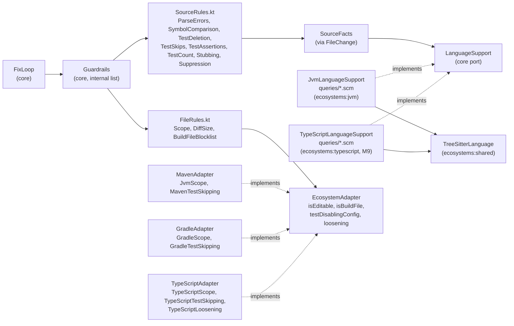
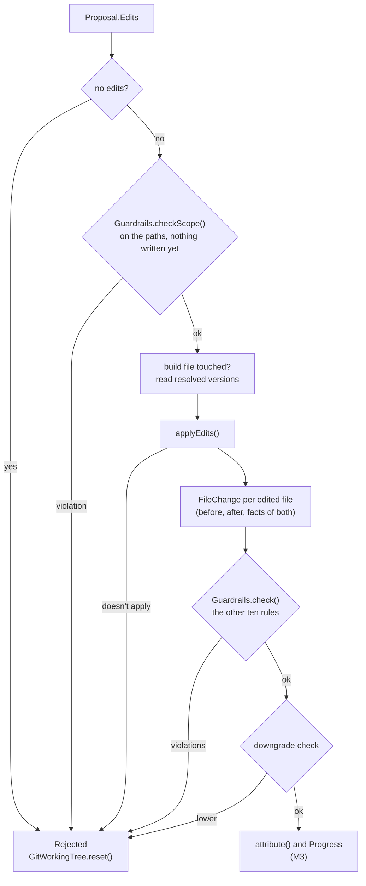

# Architecture – Guardrails

Milestone: [M4](../features.md#m4--guardrails-) · Spec: [`m4-guardrails/spec.md`](../../specs/done/m4-guardrails/spec.md) · Review: [`review.md`](../../specs/done/m4-guardrails/review.md)

> **Summary for agents**
>
> - Every attempt of the fix loop passes `Guardrails` (`core/…/Guardrails.kt`) before the downgrade check and the verify. A violation rejects the attempt: the tree is reset, the attempt counts against the budgets, and each `Violation(rule, file, line, reason)` goes into the retry request and the `heal` report (with a count per rule); the `pr` comment has the count per rule. Recipe output is never checked.
> - The rules are generic and live in `core`: `Scope`, `DiffSize`, `BuildFileBlocklist` in `FileRules.kt`, the rules on source facts in `SourceRules.kt`. They see only `FileChange`s (before = last commit, after = working tree), `SourceFacts`, and the diagnostics caused by the update. No tree-sitter, no Java, no Maven in `core`.
> - The language knowledge comes from the adapter: `EcosystemAdapter.languageSupport` (`LanguageSupport.facts(file, content): SourceFacts?`), `isEditable`, `isBuildFile`, `testDisablingConfig`, and, since M9, `loosening`. For the JVM: `JvmLanguageSupport` with the query files under `ecosystems/jvm/src/main/resources/…/queries/{java,kotlin}/`, run by `TreeSitterLanguage` in `ecosystems:shared`, plus `JvmScope` and `MavenTestSkipping` in `MavenGuardrails.kt`, and `GradleScope` and `GradleTestSkipping` in `GradleGuardrails.kt` (M7). For TypeScript (M9): see [TypeScript adapter](typescript-adapter.md#guardrails-for-typescript).
> - A new language is a grammar and seven query files in its adapter, not a new rule. A new rule is one more `Guardrail` in the list in `Guardrails`, with a rejecting and a passing test in `core` (on hand-made facts) and in the adapter (on real source).
> - Easiest rules to break: the scope check runs on the edits' paths *before* anything is written (a reset doesn't restore ignored files); stubs and suppressions count only if they are new in touched lines; every file the build tool reads its configuration from must be an `isBuildFile`, or the blocklist and the downgrade check don't see it.

## Overview

The easiest way for a model to make a build green is to delete code, skip tests, or turn them off in the build. The guardrails are deterministic checks on each attempt's edits that reject those moves before the build runs (concept [section 7](../concept.md#7-guardrails), rules 2, 4, and 5). They reject, they never repair, and they never call the LLM.



## Modules and files

| Module | File | Role |
|---|---|---|
| `core` | `LanguageSupport.kt` | The port `LanguageSupport.facts(file, content): SourceFacts?` (null: no language knows the file), and the facts: `SourceFacts` (`methods`, `tests`, `skips`, `suppressions`, `stubs`, `parseErrors`), `Method(type, name, lines, body)`, `TestMethod(type, name, lines, assertions)`, `Fragment(lines, text)`, `LineRange`. |
| | `Guardrail.kt` | `Guardrail.check(AttemptChanges): List<Violation>`, `AttemptChanges(files, diagnostics)`, `Violation`, `FileChange` (text before and after, facts of both, line hunks, `touches`, `replaced`), and `lineDiff()`, an LCS line diff with a table cap (`MAX_TABLE`) above which the change is one hunk. |
| | `Guardrails.kt` | The list of rules, `checkScope(repo, files)`, `check(changes, diagnostics)`, and `DEFAULT_MAX_CHANGED_LINES` (50). |
| | `FileRules.kt` | `Scope`, `DiffSize`, `BuildFileBlocklist`. |
| | `SourceRules.kt` | The rules on facts, and the helpers they share: `lost()` (items beyond the count left, by key), `normalized()` (whitespace runs as one space). |
| | `EcosystemAdapter.kt` | Grew by `languageSupport`, `isEditable(file)`, `testDisablingConfig(file, content, line)`, and `testsRun(repo)`; in M9 by `loosening(file, before, after)`. |
| | `FixLoop.kt` | Runs the guardrails per attempt; `AttemptOutcome.Rejected` carries `violations`; `Budgets.changedLinesPerAttempt`. |
| | `Verification.kt`, `Attribution.kt` | `Verification.testsRun`, read right after `verify`, before the reruns that run only some tests. |
| `ecosystems:shared` | `TreeSitterLanguage.kt` | `TreeSitterLanguage(name, grammar, resources)`, which runs the seven queries of a language from `queries/<name>/` next to the class `resources` and turns their captures into `SourceFacts`. Moved out of `ecosystems:jvm` in M9. |
| `ecosystems:jvm` | `JvmLanguageSupport.kt` | `JvmLanguageSupport` (by extension: `.java`, `.kt`, `.kts`; grammars load lazily). |
| | `queries/java/*.scm`, `queries/kotlin/*.scm` | `types`, `methods`, `tests`, `assertions`, `skips`, `suppressions`, `stubs`. All language knowledge is here. |
| | `MavenGuardrails.kt` | `JvmScope` (the editable scope) and `MavenTestSkipping` (the build-file blocklist). |
| | `MavenAdapter.kt` | Wires both, `languageSupport = JvmLanguageSupport`, `isBuildFile` (now also the wrapper and `.mvn/`), and `testsRun` via `MAVEN_REPORTS.count()`. |
| | `GradleGuardrails.kt` | `GradleScope` and `GradleTestSkipping`, wired by `GradleAdapter` (M7), see [Gradle adapter](gradle-adapter.md#guardrails). |
| `cli` | `FixLoopOptions.kt` | `--max-changed-lines`, for `heal` and `pr`. |
| | `FixLoopReport.kt` | Violations per attempt, rejections per rule, tests run, in text and JSON. |
| | `RepositoryCommand.kt` | Catches any `Throwable`, so a native library that doesn't load exits `2`, not `1`. `PrCommand` does the same through the shared `toolError()`. |

tree-sitter (`io.github.bonede:tree-sitter` and its grammars, versions in `gradle/libs.versions.toml`) is a dependency of the ecosystem modules only: `ecosystems:shared` (the runtime, as `api`), `ecosystems:jvm` (Java, Kotlin), `ecosystems:typescript` (TypeScript, TSX, JavaScript). Its JARs carry JNI libraries for glibc Linux, macOS, and Windows; there are none for musl, so the container image can't be Alpine. The test JVMs of these modules get `--enable-native-access=ALL-UNNAMED`, as the start script already does.

## One attempt



`FixLoop.apply` and `FixLoop.write` hold this order. A violated attempt's reason is `the edits break the guardrails:` followed by one `- [rule] file:line: reason` line per violation; that text is the retry's feedback. Every rule runs, so one attempt can break several. Any `Throwable` inside the attempt (a parser that doesn't load, a broken query) resets the tree and is rethrown; `heal` exits `2`.

## The rules

The rule names are the `Violation.rule` values in the report.

| Rule (`Violation.rule`) | Class | Rejects | Passes |
|---|---|---|---|
| `scope` | `Scope` | A path outside the repository, a path the adapter's `isEditable` refuses, a file Git doesn't track (ignored or untracked: at attempt time, that is build output) | Tracked, editable files |
| `diff-size` | `DiffSize` | More than `--max-changed-lines` (default 50) added plus removed lines over all files | Up to the limit |
| `build-file` | `BuildFileBlocklist` | An added or changed line of an `isBuildFile` file for which `testDisablingConfig` returns a reason; since M9, each reason `loosening(file, before, after)` returns for the file's whole change (no line) | Removing such config where the safe setting is the default (Maven, Gradle: `loosening` returns nothing); any other line |
| `parse-errors` | `ParseErrors` | A changed source file with more parse errors (`ERROR` or `MISSING` nodes) after than before | Same or fewer |
| `symbol-comparison` | `SymbolComparison` | A method (by type and name, overloads counted) that is gone after | A method a current diagnostic in *its own file* points into, if its body was empty or a method the attempt added (in any file) has the same body, whitespace ignored |
| `test-deletion` | `TestDeletion` | A deleted test method. No exception | — |
| `test-skip` | `TestSkips` | A new skip marker (counted by normalized text) | Existing ones |
| `test-assertions` | `TestAssertions` | Fewer assertions in a test method than before; a changed existing assertion that no current compile error (a diagnostic without `test`) in the file points into | A changed assertion with a compile error in it; new assertions |
| `test-count` | `TestCount` | Fewer test methods over the changed files | Same or more |
| `stubbing` | `Stubbing` | A stub in a touched line that the replaced lines didn't hold already | An existing stub in an unchanged line, or in a changed line that held it before (the `{}` of a no-op override whose signature changed) |
| `suppression` | `Suppression` | A suppression in a touched line that the replaced lines didn't hold already | As for stubbing |

The source rules see only files whose facts both sides report (`LanguageSupport.facts` not null). `lost()` compares by key and count, so reordering, overloads, re-indenting, and a skip that moves don't count as changes.

## JVM language support

`TreeSitterLanguage` reads the captures of each query; the query files decide what they mean.

| Query | Captures | Java | Kotlin |
|---|---|---|---|
| `types.scm` | `@type`, `@name` | class, interface, enum, record | class, object (companion objects belong to their class) |
| `methods.scm` | `@method`, `@name`, `@body` | `method_declaration` (no constructors) | `function_declaration`, top-level included; body is `{ … }` or `= expression` |
| `tests.scm` | `@test`, `@name` | `@Test`, `@ParameterizedTest`, `@RepeatedTest`, `@TestFactory`, `@TestTemplate` (JUnit 4, 5, TestNG) | the same annotations (JUnit, kotlin.test) |
| `assertions.scm` | `@assertion`, `@statement` | calls to `assert…`, `verify…`, `fail`, the `assert` statement | calls to `assert…`, `verify…`, `fail` |
| `skips.scm` | `@skip` | `@Disabled…`, `@Enabled…` conditions, `@Ignore`, `assume…`, `abort` | the same |
| `suppressions.scm` | `@suppression` | `@Suppress…` annotations, `noinspection`, `NOPMD`, `NOSONAR`, `CHECKSTYLE.OFF` comments | `@Suppress…`, `@file:Suppress`, `noinspection`, `NOSONAR`, `ktlint-disable`, `detekt:` comments |
| `stubs.scm` | `@stub` | `return null`, an empty method body, a `TODO` comment | `return null`, `{}` or `= null` as body, `TODO()`, a `TODO` comment |

A method's type is the chain of types around it (`Outer.Inner`). An assertion's text is the innermost `@statement` around the call, so `assertThat(x).isEqualTo(5)` includes the expected value. tree-sitter counts UTF-8 bytes; `Source.text` converts.

## Maven scope and blocklist

Gradle's scope, build files, and blocklist are in [Gradle adapter](gradle-adapter.md#guardrails).

| Capability | Implementation | Rule |
|---|---|---|
| `isEditable` | `JvmScope` | Not editable: a file under any directory named `generated…`, or under `target/` or `build/` outside `src/`. |
| `isBuildFile` | `MavenAdapter` | `pom.xml` at any depth, `mvnw`, `mvnw.cmd`, and `.mvn/…` at the root. Also decides when the downgrade check runs. |
| `testDisablingConfig` | `MavenTestSkipping` | Anywhere in a build file: `skipTests`, `skipITs`, `maven.test.skip`, `testFailureIgnore`, `maven.test.failure.ignore`. Inside the `<plugin>…</plugin>` block of `maven-surefire-plugin` or `maven-failsafe-plugin`, whatever the order of its children: `<exclude…>`, `<include…>`, `<skip…>`, `<test>`, `<groups>`. |

## Report and CLI

`heal` gains `--max-changed-lines <n>` (default 50, at least 1, validated while parsing); `pr` has it too. The exit code still follows the final verification: a lower runtime test count doesn't change it.

Text report, fix-loop section (after M3's attempts and fixes):

```
    1. symbol:broken, 0 diagnostics: rejected: the edits break the guardrails:
       - [stubbing] App.java:3: the edits add the placeholder `return null;` in place of logic
       - [stubbing] App.java:7: the edits add the placeholder `return null;` in place of logic
       - [test-deletion] AppTest.java:9: the edits delete the test `AppTest.total`
  …
  Rejections per guardrail (2):
    - stubbing: 2
    - test-deletion: 1
  Tests run in the final verify: 12
```

The count per rule is the number of attempts a rule rejected, rules sorted by name. `Tests run` comes from `Verification.testsRun` (JVM: the test cases in the surefire and failsafe reports, or in Gradle's `build/test-results/`), `unknown` if no report was left.

JSON: each attempt gains `violations` (`rule`, `file`, `line`, `reason`, empty unless the guardrails rejected it); `fixLoop` gains `rejectionsPerGuardrail` (rule → count) and `testsRun` (number or `null`).

## Tests

| Level | Task | What runs | Examples |
|---|---|---|---|
| Unit, `ecosystems:shared` | `test` | `TreeSitterLanguage` loading queries next to a class, with test queries for Java | `TreeSitterLanguageTest` |
| Unit, `core` | `test` | Each rule on hand-made `FileChange`s and facts (`EditableEverywhere` and fake `LanguageSupport`s): rejecting and passing cases. The line diff and `touches`/`replaced`. The fix loop with a fake `LlmClient`: a violating attempt is reset, never verified, counted, and its violations are in the retry; a real `.gitignore`d file is a scope violation; a parser that throws an `Error` leaves a clean tree; recipe output with a deleted method is kept. | `FileRulesTest`, `SourceRulesTest`, `FileChangeTest`, `SourceFactsTest`, `FixLoopTest`, `RecipeStepTest` |
| Unit, `ecosystems:jvm` | `test` | Every rule through `MavenAdapter` on real Java and Kotlin edits, rejecting and passing cases, with diagnostics pointing into the edited lines. The queries on `fixtures/language-facts/OrderTest.java` and `.kt`. The blocklist on POM, `.mvn/maven.config`, and plugin shapes, and on every Gradle spelling (M7). `TestReports.count`. | `JvmGuardrailsTest`, `JvmLanguageSupportTest`, `MavenGuardrailsTest`, `GradleGuardrailsTest`, `TestReportsTest` |
| Unit, `cli` | `test` | Report text and JSON with violations, counts, and tests run; `--max-changed-lines` and its validation; an `Error` (`UnsatisfiedLinkError`) in a command exits `2`. | `FixLoopReportTest`, `HealCommandTest`, `VerifyCommandTest` |
| End-to-end | `endToEndTest` | `heal` through the start script against a fake Ollama that proposes `return null`: the bundled grammar parses the Java file, the report lists the `stubbing` violation, stderr has no JNI warning, exit `1`. | `LectorEndToEndTest` |

## Decisions and known limits

| Decision / limit | Reason | Revisit |
|---|---|---|
| `tree-sitter-ng` with prebuilt grammars, in the ecosystem modules | No native build step; `core` gets no native dependency (spec Q1). M9 moved `TreeSitterLanguage` to `ecosystems:shared` and added the TypeScript, TSX, and JavaScript grammars. | — |
| Guardrails before verify, per attempt | A bad edit never costs a build (Q2). | — |
| Static test count enforced, runtime count only reported | Works when the build is red from the start (Q4). | M6 |
| Untracked files are out of scope, not only ignored ones | An untracked file at attempt time is build output. | — |
| Any new assumption call is a skip | "Always skips" isn't decidable. | — |
| A rename or move that also changes the body is rejected | A diagnostic says a method must change, not that its logic may go (review F5). | M6 measures rejections per rule |
| The blocklist matches lines, not parsed XML | Build files get no grammar (spec "What not to do"). A plugin is the `<plugin>…</plugin>` block around the line. | When a real case slips through |
| Native libraries for glibc only | tree-sitter-ng ships no musl build. The tool image is Ubuntu (`eclipse-temurin:…-noble`), so glibc. | — |
| Loaded on macOS arm64 and Linux x86-64 (CI) so far | The build workflow's end-to-end test parses Java with the bundled grammar on `ubuntu-latest`. Linux arm64 and Windows are untested. | When a runner needs them |
