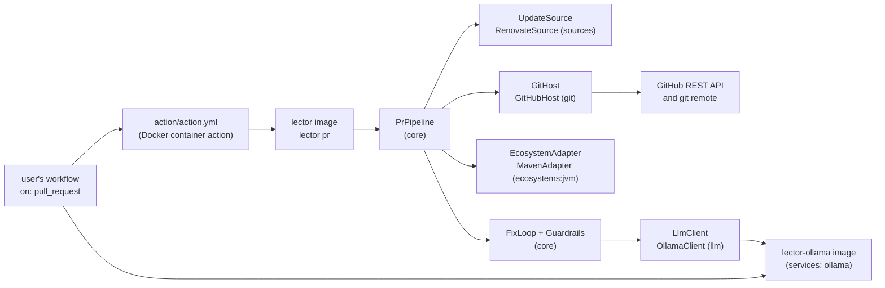
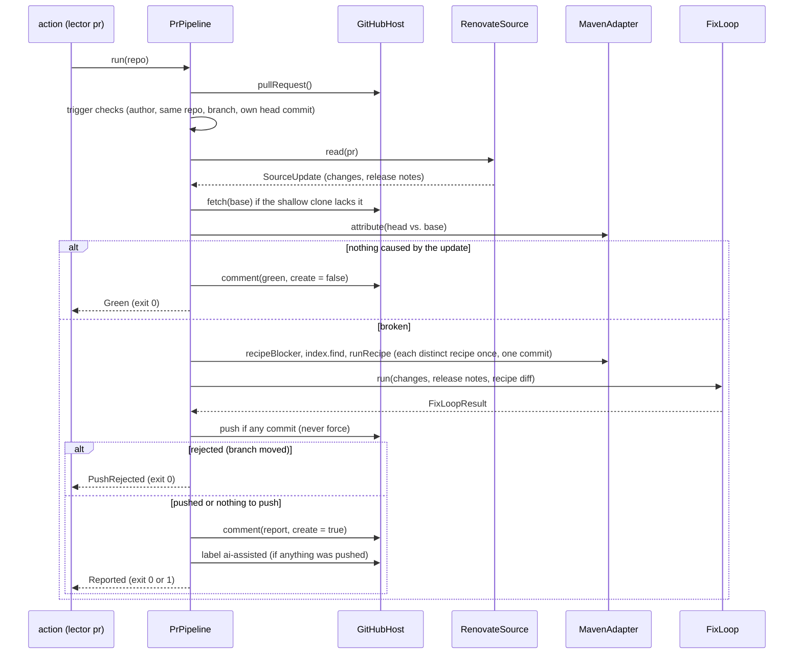

# Architecture – PR pipeline

Milestone: [M5](../features.md#m5--renovate-in-ci-first-end-to-end-release-) · Spec: [`m5-renovate-ci/spec.md`](../../specs/done/m5-renovate-ci/spec.md) · Review: [`review.md`](../../specs/done/m5-renovate-ci/review.md)

> **Summary for agents**
>
> - `lector pr [<repo>]` (`PrCommand.kt`) runs `PrPipeline` in `core` on one dependency PR: trigger checks, verify first, each distinct recipe once, the [fix loop](fix-loop.md), push, report comment, `ai-assisted` label. The GitHub Action in `action/action.yml` runs it inside the tool image `docker/lector/Dockerfile`; the model runs in the Ollama image `docker/ollama/Dockerfile` as a `services:` sidecar.
> - Two new ports in `core`: `UpdateSource` (`UpdateSource.kt`, implemented by `RenovateSource` in `sources`) and `GitHost` (`GitHost.kt`, implemented by `GitHubHost` in `git`). `core` has no Renovate or GitHub code; `cli` wires both in `rootCommand()`.
> - Exit codes of `pr`: `0` for a skipped run, a green PR, and a rejected push; `1` only when a run that worked on the PR leaves diagnostics caused by the update; `2` for any tool error. The tool's own head commit is a skip, so after a push the PR's latest check is green and the comment shows what is left.
> - `GitHubHost` is the only holder of the token (`LECTOR_GITHUB_TOKEN`, never on a command line). `git` gets it through `GIT_CONFIG_*` environment variables. Every other process gets the allowlisted environment of `runProcess` (`Processes.kt`): no token, no `INPUT_*`.
> - The action's image tag must equal `version` in `gradle.properties` (`checkActionImage` in `build.gradle.kts`, part of `check`). A version tag publishes the images only after `docs/licensing.md` says `**MSAL check:** done` (`.github/workflows/release.yml`).
> - Easiest rules to break: never push with force or touch the bot's own commit; the report comment is the marked comment *by the bot's login*, not any marked comment; a green verify changes nothing and creates no comment; the trigger checks use the PR author from the event, never `github.actor`.

## Overview

M5 moves the tool from a CLI into the place where dependency PRs show up. The user's workflow runs on `pull_request`, checks out the PR's head, starts the Ollama sidecar, creates an installation token for its GitHub App, and calls the action. The action runs `lector pr` in the tool image. Fixes land as commits on the Renovate branch, and one sticky comment reports what happened. The concept is in [section 8](../concept.md#8-cicd-integration-and-git-output), the user setup in [`docs/setup.md`](../setup.md).

## Modules and files

| Module | File | Role |
|---|---|---|
| `core` | `PrPipeline.kt` | `PrPipeline.run(repo): PrOutcome` (`Skipped`, `Green`, `PushRejected`, `Reported`), `PrSettings` (bot logins, `CommitIdentity`, `Budgets`), `PrReport`, the label `AI_ASSISTED`. |
| | `RecipeGroup.kt` | `applyRecipes(changes, adapter, index, repo, base, identity)` (M6, moved out of `PrPipeline` so the benchmark runs the same step): rules 1 and 2 per change, each distinct recipe once in the changes' order, one commit per recipe that changed files. `RecipeGroupResult` (`withoutRecipe`, `applications`, `commits`, `diff(repo)`), `RecipeApplication`. |
| | `UpdateSource.kt` | The port `UpdateSource` (`recognizes(pr)`, `read(pr): SourceUpdate`), and `PullRequest`, `PackageUpdate`, `SourceUpdate`, `BranchPolicy` (only `IN_PLACE`). |
| | `GitHost.kt` | The port `GitHost`: `pullRequest()`, `fetch`, `push` (false if rejected), `comment(pr, body, create)`, `label`. |
| | `PrComment.kt` | The report comment in Markdown: `render(report)` and `green(verification, commit)`. At most 50 diagnostics per list. |
| | `RecipeStep.kt` | Split for the pipeline: `recipeBlocker` (rules 1 and 2), `runRecipe` (rule 3), `RecipeOutcome.reason`. |
| | `GitWorkingTree.kt` | `CommitIdentity` (`TOOL` = `lector` for the CLI), `commit(…, identity)`, `head`, `authorEmail`, `hasCommit`, `SHORT_COMMIT`. |
| | `Processes.kt` | `runProcess` starts every process with only the allowlisted variables (`ALLOWED_VARIABLES`, prefixes `LC_` and `MAVEN_`) plus the ones the caller adds. |
| `sources` | `RenovateSource.kt` | Recognizes the `renovate/` branch prefix; reads every row of the PR body's update table and the release notes. |
| `git` | `GitHubHost.kt` | The PR from the `pull_request` event file, comment and label over REST with the JDK `HttpClient`, fetch and push with the `git` CLI. |
| `ecosystems:jvm` | `JdkSelection.kt` | Picks the smallest installed JDK that the root POM's `maven.compiler.release`, else `java.version`, needs (default 21). `MavenAdapter` sets `JAVA_HOME` per Maven run. `installedJdks(environment)` reads the installed JDKs from `LECTOR_JDK_<release>` variables, for `cli` and the benchmark. |
| `cli` | `PrCommand.kt` | `lector pr`: options, the token from the environment, the exit code, the comment text on stdout. |
| | `FixLoopOptions.kt` | The options `heal` and `pr` share: `--ollama-url`, `--model` (`DEFAULT_MODEL`), the five budgets; `httpUrl()`. |
| | `RootCommand.kt` | Wires `RenovateSource` into `PrCommand`, and `MavenAdapter` with the JDKs of `installedJdks()` (`JdkSelection.kt` in `ecosystems:jvm`, since M6), which reads `LECTOR_JDK_<release>`. |
| — | `action/action.yml` | Docker container action on `ghcr.io/danvan86/lector:<version>`: inputs → `pr` options; token and Maven settings through the environment. |
| — | `docker/lector/Dockerfile` | Tool image: `eclipse-temurin` 25 base, JDK 17 and 21 stages copied in, Maven, `git`, the installed distribution. No model, no recipe JARs. |
| — | `docker/ollama/Dockerfile` | Ollama image: `ARG MODEL`, pulled at build time, `OLLAMA_KEEP_ALIVE=-1`. Its `FROM` is also the real-model test's Ollama. |
| — | `.github/workflows/release.yml` | On a `v*` tag: `check` (tag = version, MSAL check done), then `tool-image` and the `ollama-image` matrix (7B, 30B). |

`sources` and `git` depend on `core` only; `cli` depends on both.

## A run

| Step | What happens | Where |
|---|---|---|
| Trigger checks | The PR's author (`pull_request.user.login`) is in `--bot-logins`, head repository = base repository, a source recognizes the branch, and the head commit's author email isn't the bot's. Otherwise `Skipped`: no comment. The tree must be clean and on the PR's head, or it's a tool error. | `PrPipeline.skipReason`, `ownCommit` |
| Changes | Each `PackageUpdate` whose ecosystem is null or the detected adapter's becomes a `DependencyChange`; the update type comes from the adapter's `versionScheme`. None left → `Skipped`. | `PrPipeline.run` |
| Verify first | The base commit is fetched if missing, then `attribute`. Green → the existing comment (if any) is updated to say so, nothing else. | `verifyFirst` |
| Recipes | Per change: downgrade rules, then the index. Changes are grouped by recipe in the PR's order; each recipe runs once and its changed files become one commit by the bot. | `heal`, `apply` |
| Fix loop | `FixLoop` with the bot's identity, over every change, the release notes, and the recipe diff. Each build and test run gets the time budget left as its timeout. | [Fix loop](fix-loop.md) |
| Push | Only if a commit was made. `git push <remote> HEAD:refs/heads/<branch>`, never `--force`. `[rejected]` → `PushRejected`, no comment, no label. | `GitHubHost.push` |
| Report | Sticky comment (created if missing), then the `ai-assisted` label if anything was pushed. | `PrComment.render`, `GitHubHost.comment`, `label` |

## Contract

### `lector pr`

| Input | Source |
|---|---|
| Repository | Argument `<repo>`, default `.` (the action's workspace). Must be the PR's head commit, clean. |
| Event | `--event`, default `GITHUB_EVENT_PATH`. Must exist; a non-`pull_request` event is a tool error. |
| API and server URL | `--github-api-url` / `GITHUB_API_URL`, `--github-server-url` / `GITHUB_SERVER_URL`; http(s) with a host. |
| Token | `LECTOR_GITHUB_TOKEN` only. Missing or blank → exit `2`. |
| Bot identity | `--bot-name` (commit author and the login of the report comment), `--bot-email` (commit email, and the own-commit check). |
| Bot logins | `--bot-logins`, comma-separated, trimmed, default `renovate[bot]`. |
| Maven settings | `--maven-settings` / `LECTOR_MAVEN_SETTINGS`; empty means none. |
| Fix loop | `--ollama-url`, `--model`, the budgets (`FixLoopOptions`). |

| Outcome | stdout | Exit |
|---|---|---|
| `Skipped` | `Skipped: <reason>` | `0` |
| `Green` | `Verify is green …` and the text report | `0` |
| `PushRejected` | `The push was rejected …` | `0` |
| `Reported`, nothing caused by the update left | The comment's Markdown | `0` |
| `Reported`, diagnostics caused by the update left | The comment's Markdown | `1` |
| Usage error, `ToolError`, any other `Throwable` | stderr `Error: …` | `2` |

### Renovate PR body

`RenovateSource` reads the table after `This PR contains the following updates:`. Columns are found by header name (`Package`, `Change`, optional `Update`). A row is a change when `Change` has `` `from` → `to` `` (or `->`), the update type isn't `digest`, `pinDigest`, `pin`, or `lockFileMaintenance`, and the versions aren't both commit hashes. The ecosystem comes from the datasource in the merge-confidence badge URL (`maven`, `npm`, `pypi` in `ECOSYSTEMS`); a row without a badge is the repository's, a row with an unknown datasource is left out. Release notes are the text after `### Release Notes`, up to Renovate's configuration section or footer.

### GitHub

| Call | Endpoint or command |
|---|---|
| Read the PR | The event file: `number`, `user.login`, `head.ref`, `head.sha`, `head.repo.full_name` (null for a deleted fork), `base.repo.full_name`, `base.sha`, `body` |
| Find the report | `GET /repos/{repo}/issues/{n}/comments`, page by page (100), the first comment by `--bot-name` whose body starts with `<!-- lector-ai -->` |
| Write the report | `PATCH …/issues/comments/{id}`, or `POST …/issues/{n}/comments` |
| Label | `POST …/issues/{n}/labels` |
| Fetch the base | `git fetch --quiet --no-tags --depth=1 <server>/<repo>.git <sha>` |
| Push | `git push --quiet <server>/<repo>.git HEAD:refs/heads/<branch>` |

`git` authenticates with an `http.<server>/.extraheader` set through `GIT_CONFIG_COUNT`/`KEY`/`VALUE`: first empty (drops the header `actions/checkout` left), then the token. `GIT_TERMINAL_PROMPT=0`. A non-2xx answer or an unreachable API is a `ToolError`. There is no merge, approve, or review call.

### Images and release

| Artifact | Contents | Published as |
|---|---|---|
| Tool image | lector on JDK 25; JDKs 17, 21, 25 as `LECTOR_JDK_17/21/25`; Maven; `git` with `safe.directory '*'`; `.dockerignore` admits only `cli/build/install/lector` | `ghcr.io/<owner>/lector:<version>` |
| Ollama image | `ollama/ollama` with one model pulled at build time | `ghcr.io/<owner>/lector-ollama:<model-tag>` and `:<version>-<model-tag>` (`qwen2.5-coder-7b`, `qwen3-coder-30b`) |

Dependabot watches both Dockerfiles; major updates of `eclipse-temurin` are ignored so each JDK stage stays on its release.

## Tests

| Level | Task | What runs | Examples |
|---|---|---|---|
| Unit, pipeline | `test` | `PrPipeline` on a real shallow clone with fake host, source, adapter, and model: every trigger check, green stop, recipe grouping and order, push, rejected push, label, time budget | `PrPipelineTest` |
| Unit, comment | `test` | Rendered Markdown for every section and the green comment | `PrCommentTest` |
| Unit, Renovate | `test` | Captured PR bodies under `sources/src/test/resources/renovate/` (single, monorepo and Maven groups, digest, pin, lock-file maintenance) | `RenovateSourceTest` |
| Unit, GitHub | `test` | A local `HttpServer` as the REST API, a real bare remote for push and fetch | `GitHubHostTest` |
| Unit, JDK and env | `test` | JDK choice from the POM; a child process sees no token or `INPUT_*` | `JdkSelectionTest`, `ProcessesTest` |
| Unit, CLI | `test` | Options, exit codes, stdout and stderr of `pr`; a red-to-green flow through the real adapters with local fakes for GitHub and Ollama and a scripted `mvnw` | `PrCommandTest`, `PrFlowTest` |
| End-to-end | `:cli:endToEndTest` | The installed start script: skip, missing token, a green Renovate PR with a scripted `mvnw` against a local GitHub fake | `LectorEndToEndTest` |
| Gate | `check` | `checkActionImage`: the action's image tag is the tool's version | `build.gradle.kts` |

The real end-to-end run (a Renovate PR in a test repository on GitHub, published images) is outside the build and still open ([`progress.md`](../../specs/done/m5-renovate-ci/progress.md)).

## Decisions and known limits

| Decision / limit | Reason | Revisit |
|---|---|---|
| The tool's own head commit is a skip with exit `0`, so the PR's latest check is green even when something is left | A verify-only run per push costs a full build; state in comments was decided against (review F4) | If users miss the red check |
| `UpdateSource` returns `PackageUpdate`s; the pipeline builds `DependencyChange`s | The update type depends on the ecosystem's version scheme, which the source doesn't know | — |
| Ecosystem from Renovate's datasource badge, not its manager | The PR body names no manager | Self-hosted Renovate without badges |
| Only in-place commits, unsigned | Simplest; Renovate branches are usually unprotected | M8 (companion PRs) |
| Fetch uses the token too | A private repository's base commit needs it | — |
| Builds run in the same container and as the same user as the tool | Builds don't see the token in their environment, but could read it from `/proc` | A separate user or container for builds |
| The 30B Ollama image has a single ~19 GB layer, GHCR takes up to 10 GB | Built in its own matrix job with `fail-fast: false`, so the 7B image doesn't depend on it | First release |
| Only Renovate, GitHub, Maven | M5 scope | M7, M8, Later |
