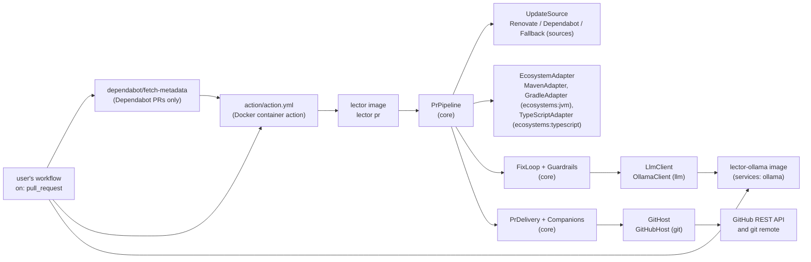
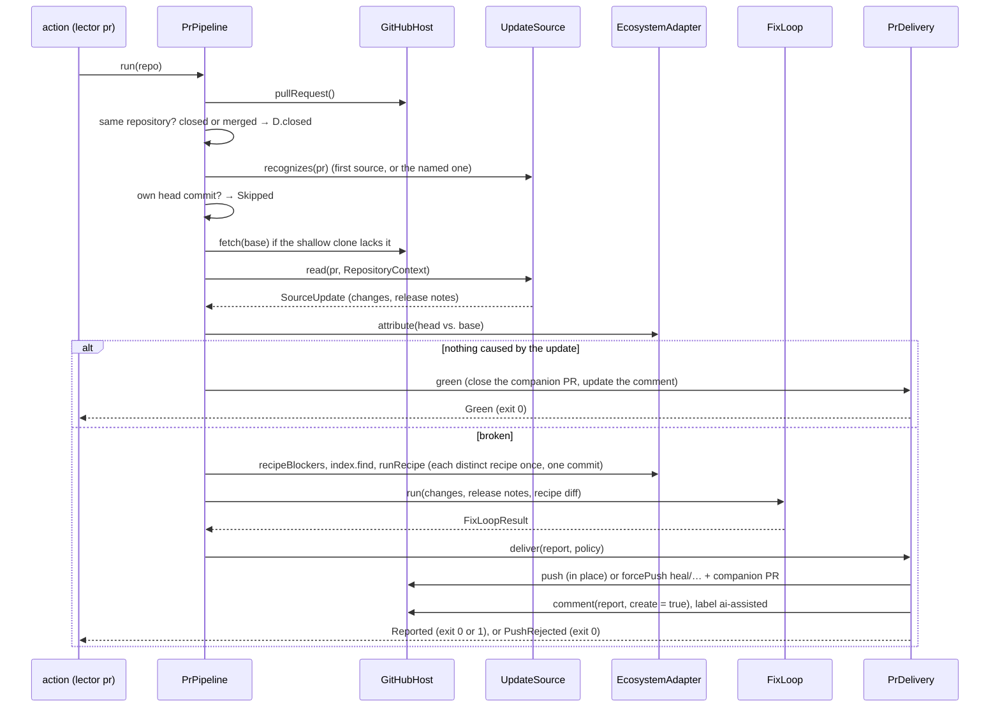
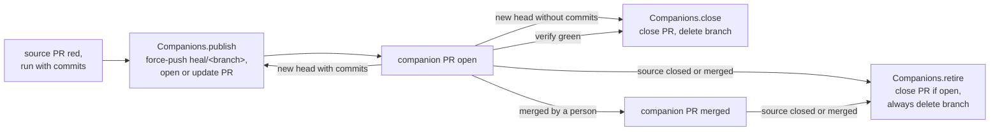

# Architecture – PR pipeline

Milestones: [M5](../features.md#m5--renovate-in-ci-first-end-to-end-release-) · [M8](../features.md#m8--dependabot-and-fallback-) · Specs: [`m5-renovate-ci`](../../specs/done/m5-renovate-ci/spec.md), [`m8-dependabot-fallback`](../../specs/done/m8-dependabot-fallback/spec.md) · Reviews: [M5](../../specs/done/m5-renovate-ci/review.md), [M8](../../specs/done/m8-dependabot-fallback/review.md)

> **Summary for agents**
>
> - `lector pr [<repo>]` (`PrCommand.kt`) runs `PrPipeline` in `core` on one dependency PR: trigger checks, verify first, each distinct recipe once, the [fix loop](fix-loop.md), then `PrDelivery` pushes the commits in place or into a companion PR, writes the report comment, and labels `ai-assisted`. The GitHub Action in `action/action.yml` runs it inside the tool image `docker/lector/Dockerfile`; the model runs in the Ollama image `docker/ollama/Dockerfile` as a `services:` sidecar.
> - Two ports in `core`: `UpdateSource` (`UpdateSource.kt`; `RenovateSource`, `DependabotSource`, `FallbackSource` in `sources`) and `GitHost` (`GitHost.kt`; `GitHubHost` in `git`). Each source owns its trigger (`recognizes`) and its default `BranchPolicy`. `core` has no Renovate, Dependabot, or GitHub code; `cli` wires them in `sources()` and `rootCommand()`, tried in the order Renovate, Dependabot, fallback.
> - Exit codes of `pr`: `0` for a skipped run, a green PR, a closed PR, and a rejected push; `1` only when a run that worked on the PR leaves diagnostics caused by the update; `2` for any tool error, including a Dependabot PR without its metadata and a labelled PR whose resolved versions can't be read.
> - Companion PRs: the commits go onto `heal/<source branch>` (`COMPANION_PREFIX`), rebuilt from the source head and force-pushed every run, with one PR into the source branch. `GitHubHost` refuses to force-push or delete any branch outside `heal/`. The companion PR is closed and its branch deleted when the source PR is closed or merged, found green, or gets a new head without fixes.
> - `GitHubHost` is the only holder of the token (`LECTOR_GITHUB_TOKEN`, never on a command line). The report comment and a companion PR are the tool's only if the bot's login wrote them, not by marker or branch name alone.
> - Easiest rules to break: never force-push or delete a branch outside `heal/`; never push to a source branch by force; a green verify creates no comment; the trigger checks use the PR author and labels from the event, never `github.actor`; a cleanup must not assume the companion PR is still open (a person may have merged it).

## Overview

M5 moved the tool into the place where dependency PRs show up; M8 made it indifferent to who opened the PR. The user's workflow runs on `pull_request`, checks out the PR's head, starts the Ollama sidecar, creates an installation token for its GitHub App, runs `dependabot/fetch-metadata` on Dependabot's PRs, and calls the action. The action runs `lector pr` in the tool image. Fixes land as commits on the PR's branch (Renovate) or in a stacked companion PR (Dependabot, labelled PRs), and one sticky comment on the source PR reports what happened. The concept is in [section 3](../concept.md#3-update-source-adapters) and [section 8](../concept.md#8-cicd-integration-and-git-output), the user setup in [`docs/setup.md`](../setup.md).

## Modules and files

| Module | File | Role |
|---|---|---|
| `core` | `PrPipeline.kt` | `PrPipeline.run(repo): PrOutcome` (`Skipped`, `Green`, `Closed`, `PushRejected`, `Reported`), `PrSettings` (`CommitIdentity`, `Budgets`, the `source` that must take the PR, the `mode`), `PrReport` (with the `companion` PR the commits went to and a `closedCompanion`), `RecipeApplication`, the label `AI_ASSISTED`. |
| | `PrDelivery.kt` | The end of a run on the host: `deliver` (in place, companion, or only the comment), `green`, `closed`. |
| | `Companions.kt` | `publish` (force-push `heal/<branch>`, open or update the companion PR, label it), `close` (the open companion PR and its branch), `retire` (`close`, and the branch also when its PR is gone). |
| | `UpdateSource.kt` | The port `UpdateSource` (`name`, `branchPolicy`, `recognizes(pr)`, `read(pr, context): SourceUpdate`), `SourceContext` (the repository's ecosystem, `baseVersions()`, `headVersions()`), `PullRequest` (with `labels` and `state`), `PrState`, `BranchPolicy` (`IN_PLACE`, `COMPANION`), `PackageUpdate`, `SourceUpdate`. |
| | `RepositoryContext.kt` | The run's `SourceContext`: the head in the checkout, the base in a worktree of `BaseCommit`, read with the adapter's `resolvedVersions`. Keeps the base's versions after the first read. |
| | `GitHost.kt` | The port `GitHost`: `pullRequest()`, `fetch`, `push` (false if rejected), `comment(pr, body, create)`, `label(number, label)`, `forcePush(repo, branch)`, `findPullRequest`, `createPullRequest`, `updatePullRequest`, `closePullRequest`, `deleteBranch`. `COMPANION_PREFIX = "heal/"`. |
| | `PrComment.kt` | The report comment in Markdown: `render(report)`, `green(…)`, `unreadable(reason)`, `note(text)`, `companionClosed(number, reason)`, `companionDescription(report, source)`. At most 50 diagnostics per list and 10 changes without a recipe. |
| | `RecipeGroup.kt` | `applyRecipes(changes, adapter, index, repo, baseVersions, identity)` (M6, moved out of `PrPipeline` so the benchmark runs the same step): rules 1 and 2 for every change with the base's versions read once (`recipeBlockers`; `baseVersions(adapter, base)` for callers without a source context), each distinct recipe once in the changes' order, one commit per recipe that changed files. `RecipeGroupResult` (`withoutRecipe`, `applications`, `commits`, `diff(repo)`), `RecipeApplication`. |
| | `RecipeStep.kt` | `recipeBlocker` and `recipeBlockers(changes, versions, baseVersions)` (rules 1 and 2), `runRecipe` (rule 3), `versionChanges`, `RecipeOutcome.reason`. A new or removed package (an empty version) is no upgrade. |
| | `GitWorkingTree.kt` | `CommitIdentity` (`TOOL` = `lector` for the CLI), `commit(…, identity)`, `head`, `authorEmail`, `hasCommit`, `SHORT_COMMIT`. |
| | `Processes.kt` | `runProcess` starts every process with only the allowlisted variables (`ALLOWED_VARIABLES`, prefixes `LC_` and `MAVEN_`) plus the ones the caller adds. |
| `sources` | `RenovateSource.kt` | Author in the bot logins and the `renovate/` prefix; every row of the PR body's update table, and the release notes; the package and datasource from the row's badge (M7), so Gradle plugin and version catalog rows work; `npm` rows (M9), and Node rows (`node-version`) that map to no ecosystem. In place. |
| | `DependabotSource.kt` | Author in the bot logins and the `dependabot/` prefix; every entry of `fetch-metadata`'s `updated-dependencies-json` (`parseMetadata`), and the release notes and changelog sections of the PR body. Companion. |
| | `FallbackSource.kt` | The opt-in label; every package whose resolved version differs between base and head. No release notes. Companion. |
| `git` | `GitHubHost.kt` | The PR from the `pull_request` event file; comment, label, and PRs over REST; fetch, push, and force-push with the `git` CLI. |
| | `GitHubApi.kt` | The JDK `HttpClient` with the token, the API version header, and the timeouts; `send` (JSON, error status → `ToolError`), `request`, `check`. |
| `ecosystems:jvm` | `JdkSelection.kt` | Picks the smallest installed JDK that the root POM's `maven.compiler.release`, else `java.version`, needs (default 21). `MavenAdapter` sets `JAVA_HOME` per Maven run. Gradle picks its JDK differently (`DaemonJdk` and toolchains, M7, see [Gradle adapter](gradle-adapter.md#how-gradle-runs)). `installedJdks(environment)` reads the installed JDKs from `LECTOR_JDK_<release>` variables, for `cli` and the benchmark (M6). |
| `ecosystems:typescript` | `NodeSelection.kt` | Picks the Node for a TypeScript project (M9): `.nvmrc` / `.node-version`, else `engines.node`, else the newest LTS. `installedNodes(environment)` reads `LECTOR_NODE_<major>`. See [TypeScript adapter](typescript-adapter.md#detection-and-tool-errors). |
| `cli` | `PrCommand.kt` | `lector pr`: options, the token from the environment, `SourceOptions` for the sources, the exit code, the text on stdout. |
| | `FixLoopOptions.kt` | The options `heal` and `pr` share: `--ollama-url`, `--model` (`DEFAULT_MODEL`), the five budgets; `httpUrl()`. |
| | `RootCommand.kt` | `sources(options)` builds the three sources in their order; `adapters()` builds `GradleAdapter` and `MavenAdapter` with the JDKs `installedJdks()` (`JdkSelection.kt`) reads from `LECTOR_JDK_<release>`, then `TypeScriptAdapter` with `installedNodes()`, `LECTOR_JEST_JUNIT`, and `--npmrc` / `--yarnrc` (M9). |
| — | `action/action.yml` | Docker container action on `ghcr.io/danvan86/lector:<version>`: inputs → `pr` options; token, Maven settings, Gradle init script, npmrc and yarnrc (M9), and Dependabot metadata through the environment; `GRADLE_USER_HOME=/github/home/.gradle`, so a workflow can cache it. |
| — | `docker/lector/Dockerfile` | Tool image: `eclipse-temurin` 25 base, JDK 17 and 21 stages copied in, Maven, `git`, the installed distribution with the OpenRewrite Gradle plugin (`LECTOR_REWRITE_GRADLE_PLUGIN`), and since M9 Node 22 and 24, Corepack with pre-cached pnpm and Yarn, and `jest-junit`, pinned in `docker/lector/node/package.json`. No model, no recipe JARs, no Gradle, no OpenRewrite JavaScript. |
| — | `docker/ollama/Dockerfile` | Ollama image: `ARG MODEL`, pulled at build time, `OLLAMA_KEEP_ALIVE=-1`. Its `FROM` is also the real-model test's Ollama. |
| — | `.github/workflows/release.yml` | On a `v*` tag: `check` (tag = version, MSAL check done), then `tool-image` and the `ollama-image` matrix (7B, 30B). |

`sources` and `git` depend on `core` only (plus `kotlinx-serialization-json` and the SLF4J API); `cli` depends on both.

## A run

| Step | What happens | Where |
|---|---|---|
| Same repository | Head repository ≠ base repository → `Skipped`, no comment. Checked first, for every state. | `PrPipeline.run` |
| Closed or merged | No build: the companion PR is closed and `heal/<branch>` deleted, also when the companion PR is gone already; the comment says why if a PR was closed. `Closed`, exit `0`. | `PrDelivery.closed`, `Companions.retire` |
| Source | Without `--source`: the first source in `sources()` that recognizes the PR. With it: that source, if it recognizes the PR, else `Skipped`. Unknown name → tool error. | `PrPipeline.source` |
| Own commit | The tree must be clean and on the PR's head (else tool error); a head commit with the bot's email → `Skipped`. | `ownCommit` |
| Changes | `source.read` with the run's `RepositoryContext`. A `ToolError` there (missing metadata, unreadable versions) writes `PrComment.unreadable` to the PR and exits `2`. Each `PackageUpdate` whose ecosystem is null or the adapter's becomes a `DependencyChange`, the update type from the adapter's `versionScheme`. None left → `Skipped`. | `read` |
| Verify first | `attribute`. Green → `PrDelivery.green`: an open companion PR is closed, the existing comment (if any) updated. | `verifyFirst` |
| Recipes | `recipeBlockers` (rules 1 and 2, the base's versions from the context), then the index. Changes grouped by recipe in the PR's order; each recipe runs once, its changed files one commit by the bot. | `heal`, `applyRecipes` |
| Fix loop | `FixLoop` with the bot's identity, over every change, the release notes, and the recipe diff. | [Fix loop](fix-loop.md) |
| Deliver | Policy = `--mode`, else the source's `branchPolicy`. See below. | `PrDelivery.deliver` |

### Delivery and companion PRs

| Commits? | Policy | What happens | `ai-assisted` on |
|---|---|---|---|
| yes | `IN_PLACE` | `push` to the PR's branch, never by force. `[rejected]` → `PushRejected`, no comment, no label. | the source PR |
| yes | `COMPANION` | `forcePush` to `heal/<branch>`; the bot's open PR from it into the source branch is updated, or a new one created (`lector-ai fixes for #<n>`, description `companionDescription`). The comment names the companion PR and the merge order. | the companion PR |
| no | `COMPANION` | An open companion PR (on an earlier head) is closed and its branch deleted; the comment says so. | — |
| no | `IN_PLACE` | Only the comment. | — |

## Contract

### `lector pr`

| Input | Source |
|---|---|
| Repository | Argument `<repo>`, default `.` (the action's workspace). Must be the PR's head commit, clean, unless the PR is closed. |
| Event | `--event`, default `GITHUB_EVENT_PATH`. Must exist; a non-`pull_request` event is a tool error. |
| API and server URL | `--github-api-url` / `GITHUB_API_URL`, `--github-server-url` / `GITHUB_SERVER_URL`; http(s) with a host. |
| Token | `LECTOR_GITHUB_TOKEN` only. Missing or blank → exit `2`. |
| Bot identity | `--bot-name` (commit author, and the login of the report comment and companion PRs), `--bot-email` (commit email, and the own-commit check). |
| Bot logins | `--bot-logins`, comma-separated, trimmed, default `renovate[bot],dependabot[bot]`. Renovate and Dependabot sources both check them. |
| Source | `--source`: `renovate`, `dependabot`, `fallback`, or empty for automatic. |
| Mode | `--mode`: `in-place`, `companion`, or empty for the source's policy (Renovate in place, the others companion). |
| Fallback label | `--fallback-label`, default `lector`, not blank. |
| Dependabot metadata | `--dependabot-metadata` / `LECTOR_DEPENDABOT_METADATA`: the JSON itself, validated when parsed; empty means none. |
| Maven settings | `--maven-settings` / `LECTOR_MAVEN_SETTINGS`; empty means none. |
| Gradle init script | `--gradle-init` / `LECTOR_GRADLE_INIT`; empty means none (M7). |
| npm and Yarn Berry config | `--npmrc` / `LECTOR_NPMRC`, `--yarnrc` / `LECTOR_YARNRC`: user-level `.npmrc` and `.yarnrc.yml`; empty means none (M9). |
| Fix loop | `--ollama-url`, `--model`, the budgets (`FixLoopOptions`). |

| Outcome | stdout | Exit |
|---|---|---|
| `Skipped` | `Skipped: <reason>` | `0` |
| `Green` | `Verify is green …` (with the closed companion PR, if any) and the text report | `0` |
| `Closed` | `The PR is <closed\|merged>: closed the companion PR #<n>.` or `… It has no companion PR.` | `0` |
| `PushRejected` | `The push was rejected …` | `0` |
| `Reported`, nothing caused by the update left | The comment's Markdown, then every change if there are several | `0` |
| `Reported`, diagnostics caused by the update left | Same | `1` |
| Usage error, `ToolError`, any other `Throwable` | stderr `Error: …` | `2` |

### Update sources

| Source | Recognizes | Changes | Release notes | Policy |
|---|---|---|---|---|
| `RenovateSource` | author in bot logins, branch `renovate/…` | The PR body's table after `This PR contains the following updates:` (columns by header name; digest, pin, and lock-file rows left out; ecosystem and, since M7, package from the merge-confidence badge, `ECOSYSTEMS`; a Gradle wrapper row and, since M9, a Node row (nvm, nodenv, engines) have no ecosystem) | After `### Release Notes`, up to Renovate's configuration section or footer | in place |
| `DependabotSource` | author in bot logins, branch `dependabot/…` | Every entry of the metadata: `dependencyName`, `packageEcosystem` (`maven`, `gradle` → `maven`; `npm_and_yarn`, `npm` → `npm`, M9; others left out), `prevVersion`, `newVersion`. A Gradle name without `:` is a plugin → `<id>:<id>.gradle.plugin`; `gradle-wrapper` is left out. Dependabot's `updateType` is never read. No metadata → `ToolError` naming `docs/setup.md`, section 3. | Each `
` with summary `Release notes` or `Changelog`, headed by the `Bumps …` / ``Updates `…` `` line before it | companion |
| `FallbackSource` | the label in `PullRequest.labels`, any author | `versionChanges(baseVersions, headVersions)`: every differing package, transitive, added (empty from), and removed (empty to) ones included. Unreadable on either side → `ToolError` that names the side. | none | companion |

### GitHub

| Call | Endpoint or command |
|---|---|
| Read the PR | The event file: `number`, `state`, `merged`, `labels[].name`, `user.login`, `head.ref`, `head.sha`, `head.repo.full_name` (null for a deleted fork), `base.repo.full_name`, `base.sha`, `body` |
| Find the report | `GET /repos/{repo}/issues/{n}/comments`, page by page (100), the first comment by `--bot-name` whose body starts with `<!-- lector-ai -->` |
| Write the report | `PATCH …/issues/comments/{id}`, or `POST …/issues/{n}/comments` |
| Label | `POST …/issues/{n}/labels` (the source PR or the companion PR) |
| Find the companion PR | `GET …/pulls?state=open&head={owner}:heal/{branch}&base={branch}`, the first by `--bot-name` |
| Create, update, close it | `POST …/pulls`; `PATCH …/pulls/{n}` with `body`, or with `state: closed` |
| Delete the companion branch | `DELETE …/git/refs/heads/heal/{branch}`; `422` (already gone) is no error |
| Fetch the base | `git fetch --quiet --no-tags --depth=1 <server>/<repo>.git <sha>` |
| Push | `git push --quiet <server>/<repo>.git HEAD:refs/heads/<branch>` |
| Force-push | `git push --quiet --force <server>/<repo>.git HEAD:refs/heads/heal/<branch>`; any other branch → `ToolError` before `git` runs |

`git` authenticates with an `http.<server>/.extraheader` set through `GIT_CONFIG_COUNT`/`KEY`/`VALUE`: first empty (drops the header `actions/checkout` left), then the token. `GIT_TERMINAL_PROMPT=0`. A non-2xx answer or an unreachable API is a `ToolError`. There is no merge, approve, or review call.

### Workflow

The documented workflow ([`docs/setup.md`](../setup.md), section 3) listens to `opened`, `synchronize`, `reopened`, `labeled`, and `closed`. Its `heal` job runs for bot PRs and PRs with the label, from the same repository; `fetch-metadata` runs only on Dependabot's PRs, with `continue-on-error: true`, and the lector-ai step only if it didn't fail (it refuses a head commit that isn't Dependabot's). Its `cleanup` job runs `lector pr` on `closed` without the model and without a checkout. One concurrency group per PR; the bot's own events and other labels don't cancel a run.

### Images and release

| Artifact | Contents | Published as |
|---|---|---|
| Tool image | lector on JDK 25; JDKs 17, 21, 25 as `LECTOR_JDK_17/21/25`; Maven; the OpenRewrite Gradle plugin in `/opt/lector/rewrite-gradle-plugin`; Node 22 and 24 as `LECTOR_NODE_22/24`, Corepack (`/opt/corepack`), `jest-junit` as `LECTOR_JEST_JUNIT` (M9); `git` with `safe.directory '*'`; `.dockerignore` admits only `cli/build/install/lector` and `docker/lector/node/package{,-lock}.json` | `ghcr.io/<owner>/lector:<version>` |
| Ollama image | `ollama/ollama` with one model pulled at build time | `ghcr.io/<owner>/lector-ollama:<model-tag>` and `:<version>-<model-tag>` (`qwen2.5-coder-7b`, `qwen3-coder-30b`) |

Dependabot watches both Dockerfiles and `docker/lector/node` (npm); major updates of `eclipse-temurin` and `node` are ignored so each JDK and Node stage stays on its release line.

## Tests

| Level | Task | What runs | Examples |
|---|---|---|---|
| Unit, pipeline | `test` | `PrPipeline` on a real shallow clone with fake host, sources, adapter, and model: source order and override, every trigger check, the source context and its worktree, green stop, recipe grouping, push, rejected push, companion create, update, close (green, closed, merged, merged first, no commits), labels | `PrPipelineTest` |
| Unit, comment and recipe rules | `test` | Rendered Markdown, the cut lists; `recipeBlockers` reading the base once | `PrCommentTest`, `RecipeStepTest` |
| Unit, sources | `test` | Captured Renovate bodies (`sources/src/test/resources/renovate/`, with Gradle plugin, catalog alias, and wrapper PRs since M7, a Node PR since M9); captured Dependabot PRs with the `updated-dependencies-json` `fetch-metadata`'s parser made (`…/dependabot/`); the fallback against a fake `SourceContext` | `RenovateSourceTest`, `DependabotSourceTest`, `FallbackSourceTest` |
| Unit, GitHub | `test` | A local `HttpServer` as the REST API, a real bare remote for push, force-push, and fetch | `GitHubHostTest` |
| Unit, JDK and env | `test` | JDK choice from the POM; a child process sees no token or `INPUT_*` | `JdkSelectionTest`, `ProcessesTest` |
| Unit, CLI | `test` | Options, exit codes, stdout and stderr of `pr`; red-to-green flows through the real adapters (in place, and a labelled PR in a companion PR) with local fakes for GitHub and Ollama and a scripted `mvnw` | `PrCommandTest`, `PrFlowTest` |
| End-to-end | `:cli:endToEndTest` | The installed start script: skip, missing token, invalid Dependabot metadata, a closed PR, a green Renovate PR against a local GitHub fake | `LectorEndToEndTest` |
| Gate | `check` | `checkActionImage`: the action's image tag is the tool's version | `build.gradle.kts` |

The real runs on GitHub (a Renovate PR for M5; a Dependabot PR and a labelled manual PR for M8, with published images) are outside the build and still open.

## Decisions and known limits

| Decision / limit | Reason | Revisit |
|---|---|---|
| The tool's own head commit is a skip with exit `0`, so the PR's latest check is green even when something is left | A verify-only run per push costs a full build; state in comments was decided against (M5 review F4) | If users miss the red check |
| `UpdateSource` returns `PackageUpdate`s; the pipeline builds `DependencyChange`s | The update type depends on the ecosystem's version scheme, which the source doesn't know | — |
| Sources own their trigger checks; the same-repo and own-commit checks stay in the pipeline | They hold for every source (concept 8.1, 8.2) | — |
| Dependabot's metadata from `fetch-metadata`, passed as JSON, not a file | A Docker container action can't write a file before the CLI runs | — |
| The fallback compares resolved versions, every difference a change | Catches properties, BOMs, parents, plugins; no "declared vs. transitive" data needed (M8 Q5, Q10). The comment and the prompt name the first ten | If the fix loop suffers from long change lists |
| The fallback runs only on labelled PRs | No commits on feature PRs nobody asked for; only writers can label (M8 Q11) | — |
| The companion PR is force-pushed and kept, stacked on the source branch | Review discussion stays in one place; Dependabot keeps its PR (M8 Q3, Q4) | — |
| Ecosystem and package from Renovate's datasource badge, not its manager | The PR body names no manager; the table names Gradle plugins by ID and catalog entries by alias | Self-hosted Renovate without badges |
| Unsigned commits | Simplest | If users require signed commits |
| Fetch uses the token too | A private repository's base commit needs it | — |
| Builds run in the same container and as the same user as the tool | Builds don't see the token in their environment, but could read it from `/proc` | A separate user or container for builds |
| The 30B Ollama image has a single ~19 GB layer, GHCR takes up to 10 GB | Built in its own matrix job with `fail-fast: false` | First release |
| Only GitHub; Maven, Gradle since M7, and TypeScript since M9 | Scope | Later |
