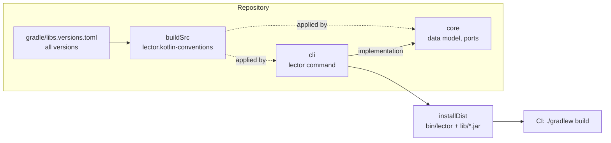
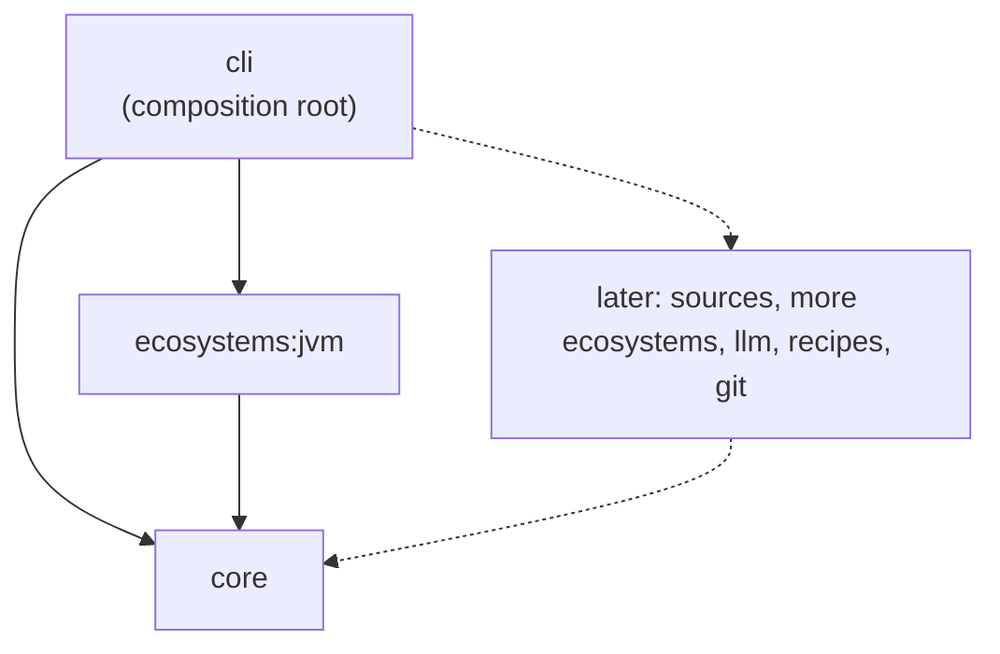
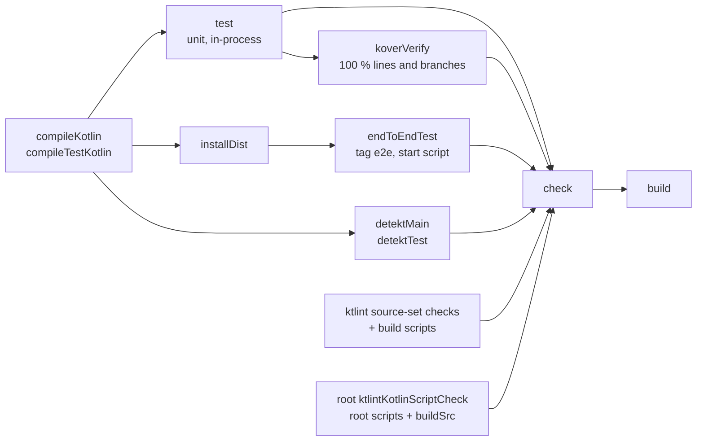
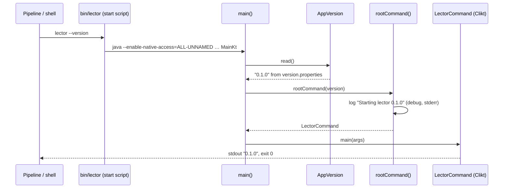
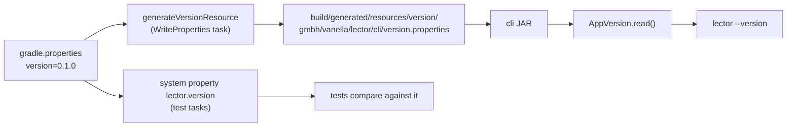
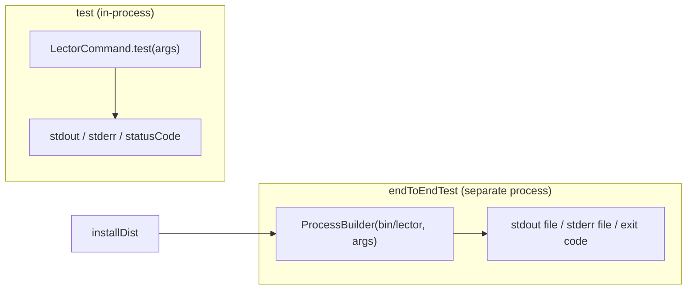

# Architecture – Project skeleton

Milestone: [M0](../features.md#m0--project-skeleton-) · Spec: [`m0-project-skeleton/spec.md`](../../specs/done/m0-project-skeleton/spec.md) · Review: [`review.md`](../../specs/done/m0-project-skeleton/review.md)

> **Summary for agents**
>
> - Three modules: `core` (data model and ports, depends on nothing), `ecosystems:jvm` (Maven adapter, depends on `core`), and `cli` (the `lector` command, depends on both). Every module applies the convention plugin `lector.kotlin-conventions` from `buildSrc`. Every version is in `gradle/libs.versions.toml`.
> - `./gradlew build` is the single gate: compile, unit tests, end-to-end tests, ktlint, detekt, Kover. It fails on any finding.
> - The CLI contract: stdout carries only command output, logs go to stderr through SLF4J, and `LectorCommand.execute()` sets the exit code (`0` for success, help, and version; `2` for invalid usage, because `1` means "caused by the update").
> - The version is defined once, in `gradle.properties`. The build writes it into a resource, and `AppVersion` reads it at runtime.
> - `RootCommand.kt` is the composition root. `rootCommand()` builds the command tree and wires the adapters into the subcommands (`verify` since M1, see [Verify pipeline](verify-pipeline.md)).
> - A new module: add it to `settings.gradle.kts`, apply `id("lector.kotlin-conventions")`, depend only on `core`, and register it in `cli`. A new subcommand: add it in `rootCommand()`, with unit tests for every exit path and an `e2e` test for the start script.

## Overview

M0 is the foundation that every later milestone builds on. It contains no product logic. It provides the module layout, the shared build conventions, a CLI that prints its version, the quality gates, and CI.

## Modules

| Module | Contents | Depends on |
|---|---|---|
| `core` | Data model, ports, attribution, process runner (M1). Will also hold the pipeline, fix loop, and guardrails. | Nothing, by construction: its build file has no `project(…)` dependency. |
| `ecosystems:jvm` | The Maven adapter (M1). | `core`. |
| `cli` | `lector` command, version lookup, logging setup. The composition root. | `core`, `ecosystems:jvm`, Clikt, kotlinx-serialization-json, SLF4J API (`slf4j-simple` at runtime). |
| `buildSrc` | The convention plugin. Not a product module. | Kotlin, ktlint, detekt, and Kover Gradle plugins. |

The dependency direction from the [concept](../concept.md#21-ports-and-adapters) holds: `cli → ecosystems:jvm → core` and `cli → core`, never the other way. New adapter modules join the same way.

## Build conventions

Shared build logic lives in one place, so modules can't drift apart.

| What | Where | Notes |
|---|---|---|
| Versions of libraries and plugins | `gradle/libs.versions.toml` | Also the JUnit BOM, so transitive JUnit artifacts are pinned. The only exception is the foojay plugin in `settings.gradle.kts`, because a settings `plugins {}` block can't read the catalog. |
| Kotlin, JDK toolchain, tests, quality gates | `buildSrc/src/main/kotlin/lector.kotlin-conventions.gradle.kts` | Applied by every module with `id("lector.kotlin-conventions")`. |
| JDK 25 | `jvmToolchain(25)` in the convention plugin | The foojay resolver downloads the JDK if it's missing. |
| Tool version | `version` in `gradle.properties` | The only place it is written. |
| Root and `buildSrc` script linting | `build.gradle.kts` at the root | Applies `base`, so the root project has a `check` task, and ktlint covers `buildSrc/**/*.kts`. |
| Gradle daemon memory | `org.gradle.jvmargs` in `gradle.properties` | 2 GB. The default 512 MB runs out with detekt type resolution and Kotlin compilation in one daemon. |
| Formatting rules | `.editorconfig` | `ktlint_official`, no overrides. |
| detekt deviations | `config/detekt/detekt.yml` | Only the deviations from the defaults, each with a reason. |

## Build pipeline

`./gradlew build` runs `check` in every project. Each gate is wired into `check`, so a finding anywhere fails the build.

### Quality gates

| Gate | Task in `check` | Covers | Project rules |
|---|---|---|---|
| ktlint | `ktlint*SourceSetCheck`, `ktlintKotlinScriptCheck` | `*.kt` in every source set, `*.kts` in every module, the root, and `buildSrc` | `ktlint_official` from `.editorconfig`. Fix with `./gradlew ktlintFormat`. |
| detekt 2.x | `detektMain`, `detektTest` (type resolution) | Kotlin sources | `warningsAsErrors`. Forbidden: `print`/`println` (also `System.out`, including `printf`, `format`, `append`, `write`), process exit outside `main`, `else` on sealed types. The plain `detekt` task is disabled because it only repeats the findings. |
| Kover | `koverVerify` | In-process tests per module | 100 % lines and branches. `MainKt` is excluded because `main` exits the process; the end-to-end tests run it. |
| Tests | `test`, `endToEndTest` | Unit and end-to-end. The opt-in `:cli:integrationTest` is not part of `check`. | Every test must pass. |

There are no baselines, no `ignoreFailures`, and no coverage exclusions besides `MainKt`. Each gate was shown to fail the build on a deliberate violation (see the spec's acceptance criteria and the review).

## CLI

### Runtime flow

The `application` plugin builds a distribution: the start script `bin/lector` and the JARs in `lib/`. This is the layout the container image will use in M5.

| File | Role |
|---|---|
| `Main.kt` | `main()` reads the version and calls `execute()` on the root command. Nothing else, because it is excluded from coverage. |
| `RootCommand.kt` | `rootCommand()` is the composition root and logs the start. |
| `LectorCommand.kt` | The Clikt root command (a `NoOpCliktCommand`): `--version`, help on no arguments. Its subcommands are added in `rootCommand()`. `execute()` runs it like Clikt's `main`, but usage errors exit with `TOOL_ERROR` (`2`). |
| `AppVersion.kt` | Reads `version.properties` from the classpath. Fails with a clear message if the resource or its `version` key is missing. |

### Contract with the pipeline

The pipeline reads stdout and the exit code, so both are fixed and tested on every path.

| Invocation | stdout | stderr | Exit code |
|---|---|---|---|
| `lector --version` | `0.1.0` | empty | `0` |
| `lector` (no arguments) | Help text | empty | `0` |
| `lector --help` | Help text | empty | `0` |
| `lector --bogus` | empty | Usage and `Error: no such option --bogus` | `2` |
| `lector foo` | empty | Usage and `Error: no such subcommand foo` | `2` |
| `lector verify …` | See [Verify pipeline](verify-pipeline.md#cli-contract) | | `0`, `1`, or `2` |

Output goes through Clikt's `echo`. Logs go through SLF4J to stderr (`slf4j-simple`, level `info` by default, `debug` with `JAVA_OPTS=-Dorg.slf4j.simpleLogger.defaultLogLevel=debug`). Libraries added later (OpenRewrite, HTTP clients) log through SLF4J too, so their output can't leak into stdout.

### Version flow

No Kotlin file contains the version literal. Tests compare against the same property, so a version bump needs no test change.

## Tests

| Level | Task | What runs | Examples |
|---|---|---|---|
| Unit | `test` | In-process, excludes the `e2e` and `integration` tags. Clikt's `test()` helper captures stdout, stderr, and the status code of a command. Exit codes that `LectorCommand.execute()` sets (usage errors) are tested with `executeInProcess()` (`Execution.kt`), which captures output and exit without ending the JVM. | `LectorCommandTest`, `AppVersionTest`, `RootCommandTest` |
| Integration | `:cli:integrationTest` | Tag `integration`. Real Maven on a fixture repository; opt-in, not in `check`. See [Verify pipeline](verify-pipeline.md#tests). | `VerifyIntegrationTest` |
| End-to-end | `endToEndTest` | Tag `e2e`. Runs `bin/lector` from `installDist` as a separate process with `JAVA_HOME` pinned. Streams go to files, with a 30 s timeout. | `LectorEndToEndTest` |

`./gradlew test` stays fast and doesn't build the distribution. `endToEndTest` depends on `installDist` and finds the start script through the `lector.bin` system property, which is derived from `installDist` and `applicationName`. Test fixtures live under `src/test/resources/` of each module (for example a version resource without a `version` key in `cli`, Maven fixture repos in `ecosystems:jvm`).

## CI and dependency updates

| What | Where | Behavior |
|---|---|---|
| Build workflow | `.github/workflows/build.yml` | On every pull request and on pushes to `main`: JDK 25 via `actions/setup-java`, Gradle via `gradle/actions/setup-gradle`, then `./gradlew build`. This builds our own tool; it is not the product pipeline. |
| Dependabot | `.github/dependabot.yml` | Weekly updates for the `gradle` and `github-actions` ecosystems. Gradle updates come through the version catalog. |
| License | `LICENSE` | Apache 2.0. |

## Decisions and known limits

| Decision / limit | Reason | Revisit |
|---|---|---|
| `installDist` instead of a fat JAR or a native image | Maps directly to the container image and avoids JAR merging and reflection problems. | M5 |
| Full `clikt` artifact, not `clikt-core` | `clikt-core` exits with `0` and prints errors to stdout unless `main` wires streams and exit codes by hand. The full artifact pulls in Mordant with JNA and needs `--enable-native-access=ALL-UNNAMED` in the start script and test JVMs. | With the container image in M5 |
| detekt 2.x alpha | detekt 1.x can't analyze Kotlin 2.4. | When 2.0 is stable |
| foojay version in `settings.gradle.kts` | A settings `plugins {}` block can't read the version catalog. | — |
| Domain types and ports arrive with the milestones that need them | M1 added `Diagnostic`, `Verification`, and `EcosystemAdapter`. No type ahead of its first use. | Each milestone |
