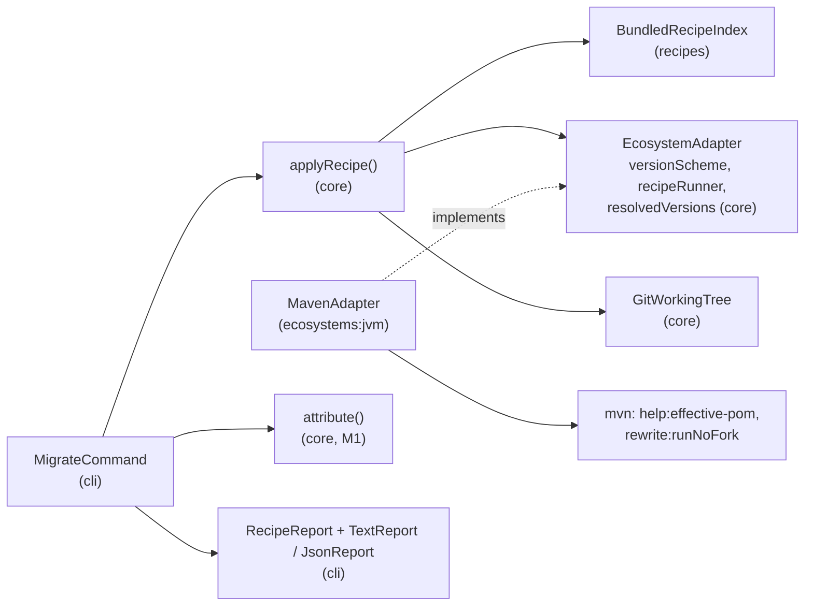
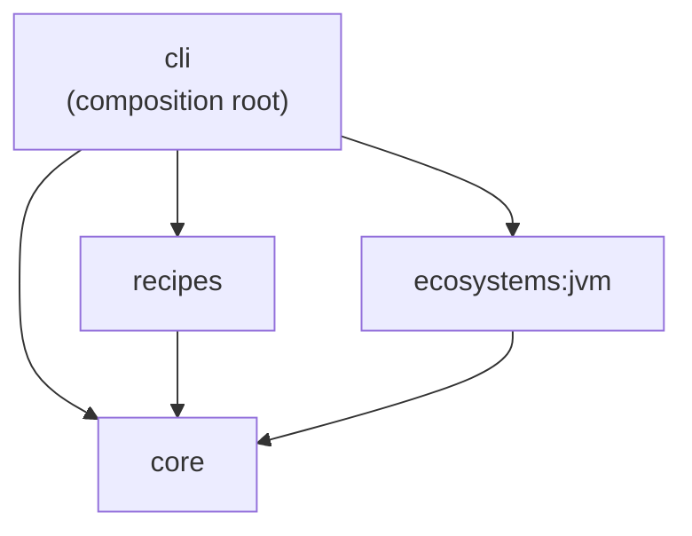
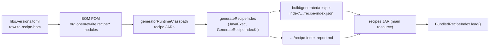
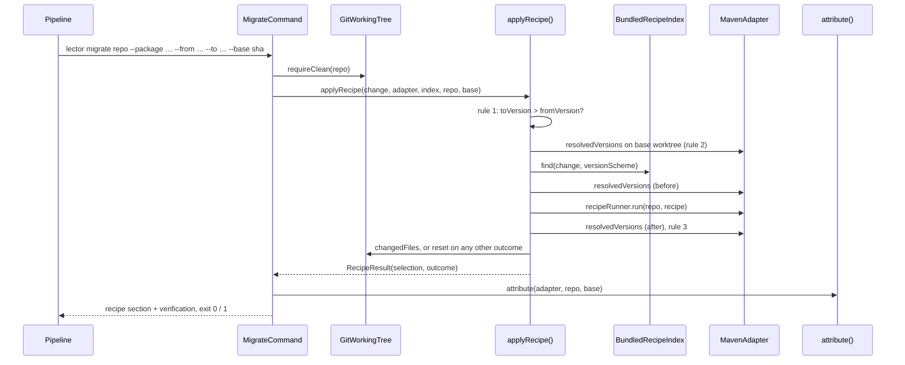

# Architecture – Recipe migration

Milestone: [M2](../features.md#m2--recipe-index-and-openrewrite-run-) · Spec: [`m2-recipe-index/spec.md`](../../specs/done/m2-recipe-index/spec.md) · Review: [`review.md`](../../specs/done/m2-recipe-index/review.md)

> **Summary for agents**
>
> - `lector migrate <repo> --package … --from … --to …` builds a `DependencyChange`, lets `applyRecipe()` in `core` find and apply an OpenRewrite recipe, then runs M1's `attribute()`. The recipe is optional: its outcome never decides the exit code.
> - The recipe index is generated at build time by `:recipes:generateRecipeIndex` from `rewrite-recipe-bom` and ships as the resource `recipe-index.json`. OpenRewrite is only on the `generator` source set's classpath, never in the distribution. Versions of the BOM and of the Maven plugins live in `gradle/libs.versions.toml`; `:recipes:checkRewritePluginVersion` fails the build if the rewrite plugin and the BOM drift apart.
> - Every version and selector question goes through the adapter's `VersionScheme` (`MavenVersionScheme` for Maven). `core` and `recipes` contain no version syntax and no Maven terms; `ecosystem` is the package namespace (`maven`), not the build tool.
> - A new ecosystem gets recipes by implementing `versionScheme`, `recipeRunner`, and `resolvedVersions` in its adapter and adding index entries for its namespace. No change to `core`.
> - Easiest rule to break: the working tree must be clean before the recipe, and every outcome other than `Applied` resets it with `GitWorkingTree.reset()`. Never edit the target's `pom.xml` to run a recipe, and never use the plugin's `run` goal: `runNoFork` by coordinates only.

## Overview

M2 does the deterministic part of a migration before any LLM is involved. The index maps a package and a target version to the OpenRewrite recipe that is *about* that upgrade. Three downgrade rules make sure an outdated PR or a recipe can never move a dependency back. Whatever happens with the recipe, the result is verified exactly like `lector verify`.



## Modules and files

| Module | File | Role |
|---|---|---|
| `core` | `DependencyChange.kt` | `DependencyChange(ecosystem, package, fromVersion, toVersion, updateType)` and `UpdateType` (`MAJOR`, `MINOR`, `PATCH`, `OTHER`). `package` is an opaque string. |
| | `VersionScheme.kt` | The port for version syntax: `compare`, `contains(selector, version)`, `compareSelectors`, `updateType`. |
| | `Recipe.kt` | `Recipe(name, artifact, license)`, `RecipeMatch`, `RecipeSelection(chosen, alternatives)`, and the ports `RecipeIndex`, `RecipeRunner` (returns `RecipeRun.Applied` or `Failed`), `ResolvedVersions` (`package → version`). |
| | `EcosystemAdapter.kt` | Grew by `ecosystem`, `versionScheme` (required), `recipeRunner` and `resolvedVersions` (nullable). |
| | `RecipeStep.kt` | `applyRecipe(change, adapter, index, repo, base)`: the three downgrade rules, the run, and `RecipeOutcome`. Since M5 in two parts that `lector pr` also calls: `recipeBlocker()` (rules 1 and 2) and `runRecipe()` (the run and rule 3). `RecipeOutcome.reason(change)` is the reason text of every outcome but `Applied`. |
| | `GitWorkingTree.kt` | `requireClean`, `changedFiles`, `reset` (`git reset --hard` + `git clean -d --force`). Ignored files are kept. M3 added `commit` and `diff` for `heal`, M5 the commit identity and `head`, `authorEmail`, `hasCommit` for `pr`. |
| `recipes` | `BundledRecipeIndex.kt` | The `RecipeIndex` that ships: `load()` reads `recipe-index.json` from the classpath; `find()` selects and ranks. |
| | `IndexFormat.kt` | `IndexEntry` and the JSON format `{"entries": [...]}`. |
| | `IndexBuilder.kt` | Build-time logic: walks `RecipeTree`s, collects the version leaves, counts skipped ones. No OpenRewrite types. |
| | `IndexReport.kt` | The Markdown report: counts, skipped leaves by reason, artifacts with license. |
| | `generator/GenerateRecipeIndex.kt` | The `generator` source set: a thin adapter that scans the OpenRewrite JARs and calls `IndexBuilder`. `skipReason()` uses OpenRewrite's `Semver`. |
| `ecosystems:jvm` | `MavenVersionScheme.kt` | `ComparableVersion` ordering, exact versions and X-ranges (`3.4.x`, `3.x`, `3.*`). |
| | `MavenAdapter.kt` | `recipeRunner` (`runNoFork`) and `resolvedVersions` (`help:effective-pom`). |
| | `EffectivePom.kt` | Parses the effective POM into `group:artifact → version`. |
| | `MavenPlugins.kt` | Reads `maven-plugins.properties`, generated by `generateMavenPluginsResource` from the catalog's `rewrite-maven-plugin` and `maven-help-plugin`. |
| | `XmlDocumentBuilder.kt` | The hardened XML parser (no DOCTYPE, errors off stderr) shared by `EffectivePom` and `TestReports`. |
| `cli` | `MigrateCommand.kt` | The `migrate` subcommand: clean check, change, recipe, verify, report. |
| | `UpdateCommand.kt` | `--package`, `--from`, `--to`, and the `DependencyChange`, shared with `heal` (M3). |
| | `RepositoryCommand.kt` | What `verify`, `migrate`, and `heal` share (`pr` has its own options): `<repo>`, `--base`, `--format`, `--maven-settings`, adapter detection, exit codes. |
| | `RecipeReport.kt` | The recipe section in text and JSON, with the reason from `RecipeOutcome.reason()`. |
| | `RootCommand.kt` | Wires `MigrateCommand` with `MavenAdapter` and `BundledRecipeIndex.load()`. |



`recipes` depends on `core`, `kotlinx-serialization-json`, and the SLF4J API. `maven-artifact` (for `ComparableVersion`) is in `ecosystems:jvm`, not in `recipes`.

## Recipe index

### Generation at build time



| Step | Where | Notes |
|---|---|---|
| Recipe modules | `recipeModules()` in `recipes/build.gradle.kts` | Every `org.openrewrite.recipe` dependency the BOM names is added to `generatorImplementation`, so a new module is indexed without a build change. |
| Artifact coordinates | `generateRecipeIndex` arguments | `<jar path>=<group>:<name>:<version>` from Gradle's resolution, not from the manifest (some manifests name a snapshot). |
| License | `License-Name` in the JAR manifest | `unknown` if missing. `rewrite-spring` and most recipe modules are under the Moderne Source Available License. |
| Recipes per JAR | `Environment.builder().scanJar(jar, others, …)` | One environment per JAR tells which artifact a recipe comes from. The other JARs resolve included recipes. |
| Leaves | `VERSION_LEAVES` in `IndexBuilder.kt` | `org.openrewrite.maven.UpgradeDependencyVersion`, `org.openrewrite.java.dependencies.UpgradeDependencyVersion`, `org.openrewrite.maven.UpgradeParentVersion`, `org.openrewrite.maven.UpgradePluginVersion`, at any depth. A recipe is not its own leaf. |
| Selectors | `skipReason()` in `GenerateRecipeIndex.kt` | Exact versions and X-ranges are kept. Skipped and counted: OpenRewrite's type name for anything else (`LatestRelease`, `SetRange`, `HyphenRange`, `ExactVersionWithPattern`, …), `XRange with versionPattern`, `invalid selector`, and `missing option` (no `groupId`, `artifactId`, or `newVersion`). |
| Entries | `IndexBuilder.entries()` | Sorted by recipe name; one entry per package pattern and selector per recipe, at its shallowest depth. Ecosystem is always `maven`. |

The index is a build output, not committed. Building it needs network access to Maven Central, like any other dependency resolution. Regenerate it with `./gradlew :recipes:generateRecipeIndex`; the counts and licenses are in `recipe-index-report.md` next to it.

### Format

`{"entries": [{"ecosystem", "package", "selector", "recipe", "depth", "artifact", "license"}, …]}`. The field names are generic on purpose (`IndexFormatTest`): no `groupId`, `artifactId`, or `pom`. `package` is a glob where `*` matches any text and everything else is literal. `artifact` is what the runner fetches (`org.openrewrite.recipe:rewrite-spring:<version>`).

### Selection

`BundledRecipeIndex.find(change, versions)`:

1. Keep entries of the change's ecosystem whose package pattern matches the whole package.
2. Per recipe, take its **target**: the highest selector (by `compareSelectors`), then the shallowest leaf.
3. Keep the recipes whose target `contains` the change's `toVersion`. So `UpgradeSpringBoot_3_4` (direct leaf `3.4.x`, nested `3.3.x`) never matches a change to 3.3.
4. Rank: tightest selector, then shallowest depth, then recipe name. The first is `chosen`, the rest are `alternatives`.

An unknown ecosystem or package simply finds nothing.

## Migration flow



`RecipeOutcome` has one case per result. Every case except `Applied` leaves the working tree as it was before the step.

| Outcome | When | JSON `outcome` |
|---|---|---|
| `Applied(changedFiles, versionChanges)` | The run succeeded and no package went down. Changes stay uncommitted. | `applied` |
| `NotAnUpgrade` | Rule 1: `toVersion` is not higher than `fromVersion`. Nothing else runs. | `notAnUpgrade` |
| `PrOutdated(baseVersion, toVersion)` | Rule 2: the base commit already resolves the package higher than `toVersion`. | `prOutdated` |
| `NoMatch` | The index has no recipe for the change. | `noMatch` |
| `NoRecipeRunner` | The adapter has no `recipeRunner`. | `noRecipeRunner` |
| `VersionsUnreadable(reason)` | `resolvedVersions` is missing or throws a `ToolError`, on the base, before, or after the run. | `versionsUnreadable` |
| `RunFailed(reason)` | The runner returned `Failed` or threw a `ToolError`. Tree reset. | `runFailed` |
| `DowngradeDetected(downgrades)` | Rule 3: a package resolves lower after the run. Tree reset. | `downgradeDetected` |

The order is fixed by the spec: rule 1, rule 2, find, versions before, run, rule 3. Rule 2 therefore reads the base versions in a temporary worktree (`BaseCommit.checkout`, removed afterwards) even when no recipe matches. `versionChanges` lists every package whose resolved version differs before and after, including the PR's own package if the recipe moved it to a newer patch, and packages added or removed.

## Maven adapter

| Capability | Command (plus `-B -fae` and `--settings` as in M1) | Notes |
|---|---|---|
| `versionScheme` | — | `MavenVersionScheme`: `ComparableVersion` (`3.2.0-RC1 < 3.2.0`). An X-range contains versions whose leading numbers equal its prefix. `compareSelectors` orders by upper bound, `3.4.1 < 3.4.x < 3.x`. `updateType` compares the first three numbers, a missing one counts as `0`. |
| `resolvedVersions` | `org.apache.maven.plugins:maven-help-plugin:<v>:effective-pom -Doutput=<temp file>` | Parents, dependencies, and build plugins of every module, without compiling. `dependencyManagement`, `pluginManagement`, the build's own modules, and transitive dependencies are left out. The highest version wins if modules disagree. A failed run or unreadable XML is a `ToolError`. |
| `recipeRunner` | `org.openrewrite.maven:rewrite-maven-plugin:<v>:runNoFork -Drewrite.recipeArtifactCoordinates=<artifact> -Drewrite.activeRecipes=<recipe>` | By coordinates, so `pom.xml` is never touched for the run. `runNoFork` skips the forked lifecycle that would compile first, which fails exactly when the update broke the build. The user's Maven fetches the recipe JAR through its configured mirror. Runs on the PR head as it is. |

The plugin versions come from the catalog through `generateMavenPluginsResource` (`ecosystems/jvm/build.gradle.kts`) into `maven-plugins.properties`, read by `MavenPlugins.load()`. The rewrite plugin must be built on the BOM's OpenRewrite version; `:recipes:checkRewritePluginVersion` (in `check`) compares the plugin POM's `rewrite.version` with the `rewrite-core` the BOM resolves to.

## CLI contract

`lector migrate <repo> --package <package> --from <version> --to <version> [--base <git-ref>] [--format text|json] [--maven-settings <file>]`

`ecosystem` comes from the detected adapter, `updateType` from its version scheme.

| Situation | stdout | stderr | Exit |
|---|---|---|---|
| Recipe applied, skipped, or failed; nothing caused by the update | Report | Logs | `0` |
| At least one diagnostic caused by the update | Report | Logs | `1` |
| Working tree has uncommitted changes, or isn't a Git working tree | empty | `Error: <repo> has uncommitted changes. Commit or stash them first: <files>` / `Error: git status failed …` | `2` |
| Missing `--package`, `--from`, or `--to`, or other invalid usage | empty | Usage and `Error: …` | `2` |
| Not a directory, no supported ecosystem, invalid `--base`, `--maven-settings` not a file, Maven or Git can't start | empty | `Error: …`, as for [`verify`](verify-pipeline.md#cli-contract) | `2` |

The clean check runs after adapter detection and `--base` resolution, before anything else.

**Text report:** the recipe section, an empty line, then M1's text report.

```
Recipe (applied)
  Change: org.springframework.boot:spring-boot-starter-parent 3.3.5 -> 3.4.1 (maven, minor)
  Recipe: org.openrewrite.java.spring.boot3.UpgradeSpringBoot_3_4, leaf 3.4.x at depth 1
  Artifact: org.openrewrite.recipe:rewrite-spring:<version> (Moderne Source Available License)
  Alternatives (0):
    none
  Changed files (2):
    - pom.xml
    - src/main/java/com/example/Clients.java
  Version changes (n):
    - org.springframework.boot:spring-boot-starter-parent 3.4.1 -> 3.4.13
    …
```

`Recipe (not applied)` adds a `Reason:` line. `Recipe`, `Artifact`, and `Alternatives` appear whenever a recipe was chosen; `Changed files` only for `Applied`; the list of version changes is titled `Version changes` for `Applied` and `Downgrades` for `DowngradeDetected`. A missing version shows as `added` or `removed`.

**JSON report:** one line, `{"recipe": {...}, "verification": {...}}`. `recipe` has `change` (`ecosystem`, `package`, `fromVersion`, `toVersion`, `updateType` in lowercase), `outcome`, `reason` (`null` when applied), `chosen` (`null` or `name`, `artifact`, `license`, `selector`, `depth`), `alternatives`, `changedFiles`, `versionChanges` (`package`, `before`, `after`). `verification` is M1's JSON report.

## Tests

| Level | Task | What runs | Examples |
|---|---|---|---|
| Unit | `test` | Selection and ranking on a hand-written index; index building, format, and report on fake `RecipeTree`s; the downgrade rules with a fake adapter on a temporary Git repo; Maven version scheme; effective-POM parsing on captured output; runner command lines with a fake process runner; the command through Clikt's `test()` | `BundledRecipeIndexTest`, `IndexBuilderTest`, `IndexFormatTest`, `IndexReportTest`, `RecipeStepTest`, `GitWorkingTreeTest`, `MavenVersionSchemeTest`, `EffectivePomTest`, `MavenAdapterTest`, `MavenPluginsTest`, `MigrateCommandTest`, `RecipeReportsTest` |
| Unit, generator | `:recipes:test` | The `generator` source set with OpenRewrite on the test classpath: `skipReason()`, scanning real recipe JARs. `GeneratedIndexTest` checks the index as it ships (`UpgradeSpringBoot_3_4`, `3.4.x`, depth 1, `rewrite-spring`, MSAL). | `GenerateRecipeIndexTest`, `GeneratedIndexTest` |
| End-to-end | `endToEndTest` | The start script: `--help` lists exactly `verify`, `migrate`, `heal`, and `pr`; missing `--package` and a dirty tree exit `2`; the bundled index finds `UpgradeSpringBoot_3_4` and calls the plugin through a fake `mvnw`; `--format json` is one object with `recipe` and `verification` | `LectorEndToEndTest` |
| Integration | `:cli:integrationTest` (opt-in) | Real Maven on `cli/src/test/resources/fixtures/spring-boot-upgrade` (base 3.3.5, head bumps the parent to 3.4.1): the recipe is chosen and applied, the type-based rename `setConnectTimeout` → `connectTimeout` happens, verify passes, `pom.xml` has no plugin, `HEAD` is unchanged, one worktree is left. Needs `mvn` and network. | `MigrateIntegrationTest` |

Fixtures: `recipes/src/test/resources/.../test-recipe-index.json` (hand-written), `ecosystems/jvm/src/test/resources/maven-output/effective-pom-*.xml` (captured, cut down; see `fixtures/README.md`), `cli/src/test/resources/fixtures/spring-boot-upgrade/` (`base/` and the `head/` overlay, committed by `FixtureRepository`).

Gates: the `generator` source set has its own ktlint and detekt tasks (`detektGenerator` is added to `check` in `recipes/build.gradle.kts`) and counts toward the module's 100 % Kover coverage.

## Decisions and known limits

| Decision / limit | Reason | Revisit |
|---|---|---|
| Index generated at build time, from the official BOM only | Runtime stays small, offline for the index, and deterministic per tool version. A BOM bump rebuilds it. | — |
| Recipe JARs are not shipped; the user's Maven fetches them | Keeps the license question manageable and uses the configured mirror. | M5, legal check of the MSAL |
| Only the three leaf types, exact versions, and X-ranges | They cover what bots bump in Maven projects. `latest.*` and ranges are unbounded or need OpenRewrite at run time. | When a skipped count matters |
| Recipe runs on the PR head as it is | Simpler than resetting manifests. The integration test's type-based rename proves type information survives. | If the integration test loses the rename |
| Version changes beyond the PR are kept and reported | Framework recipes move managed dependencies on purpose. Only downgrades are rejected. | — |
| Resolved versions keep the highest per package across modules | The port is `package → version`. A downgrade in one module can hide behind a higher version in another (review F4). | M7, or a multi-module fixture that shows it |
| Only a `ToolError` from the runner resets the tree | Any other exception exits `2`; CI throws the checkout away (review F6). | M5, when the run commits the result |
| One change per `migrate` run, from explicit options | Easy to test and benchmark. `lector pr` (M5) takes every change of a grouped PR from the source adapter and runs each distinct recipe once ([PR pipeline](pr-pipeline.md)). Diff detection for PRs without a source adapter comes later. | M8 |
