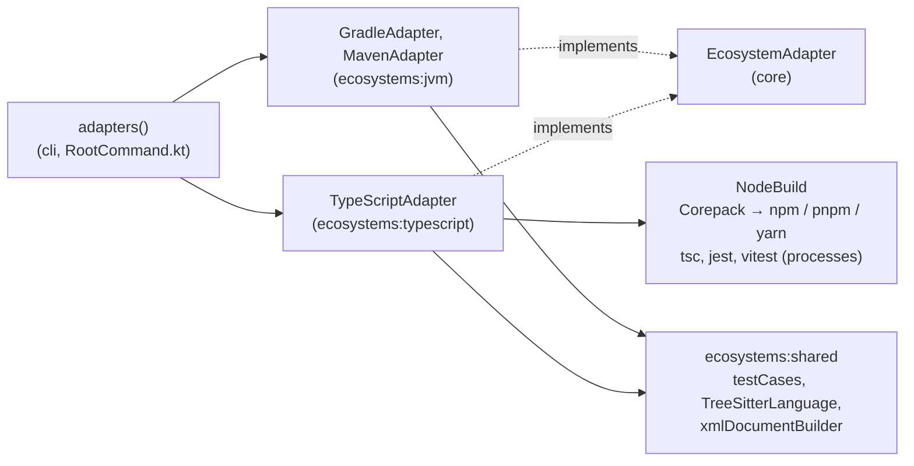
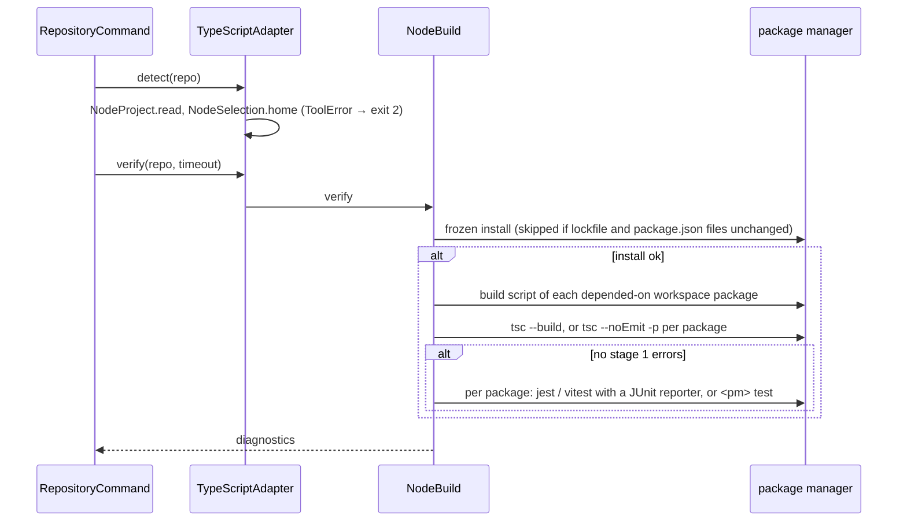
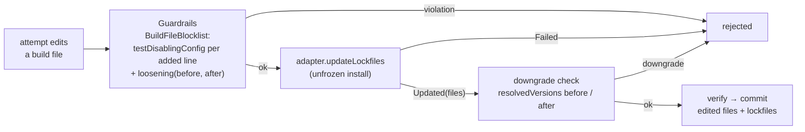
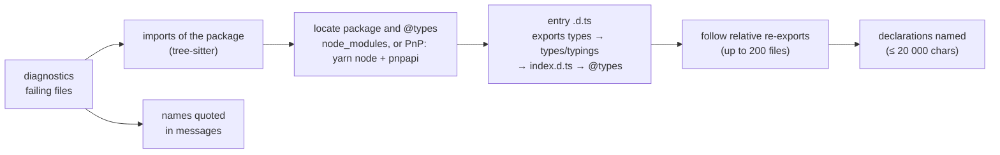

# Architecture – TypeScript adapter

Milestone: [M9](../features.md#m9--second-ecosystem-typescript-) · Spec: [`m9-typescript/spec.md`](../../specs/open/m9-typescript/spec.md) · Review: [`review.md`](../../specs/open/m9-typescript/review.md)

> **Summary for agents**
>
> - `TypeScriptAdapter` (`ecosystems/typescript/…/TypeScriptAdapter.kt`) is the second ecosystem: npm, pnpm, Yarn classic, and Yarn Berry (Plug'n'Play included), with or without workspaces. It speaks for the `npm` namespace (`SemverScheme`), has **no recipe runner** (OpenRewrite JavaScript is MSAL, concept section 9), and is registered last in `adapters()` (`RootCommand.kt`): a JVM repository may carry a `package.json`.
> - What it shares with the JVM adapters lives in `ecosystems:shared` (JUnit XML `testCases()`, `TreeSitterLanguage`, `xmlDocumentBuilder()`), not in `core`. M9 grew two `core` ports: `updateLockfiles` (the lockfile follows a build-file edit and goes into its commit) and `loosening` (the build-file blocklist sees a build file's whole change). Maven and Gradle implement both as no-ops.
> - Every Node process runs through `NodeBuild`: on the Node `NodeSelection` picks (`LECTOR_NODE_<major>`), through the package manager and Corepack, with `CI=true`, the package managers' variables (`NPM_CONFIG_*`, `YARN_*`, `COREPACK_*`, `NODE_AUTH_TOKEN`, `NPM_TOKEN`), and `--npmrc` / `--yarnrc` as user-level config. Tool versions of the image are in `docker/lector/node/package.json`; Node in the `FROM` lines of `docker/lector/Dockerfile`.
> - To extend it: a new tool output gets a captured sample under `src/test/resources/outputs/` and a parser test; a new command line a test in `CommandsTest` or `NodeBuildTest` (fake process runner); behaviour with real toolchains a case in `TypeScriptIntegrationTest` on a fixture. A new guardrail spelling gets a test in `TypeScriptGuardrailsTest`, which runs through `core`'s `Guardrails`.
> - Easiest rules to break: after `detect`, an unreadable project is a `Diagnostic` (or a failed lockfile update, or no grounding), never a `ToolError`; the repository is never changed to run verify (`jest-junit` comes from the image, not the project); a blocklist rule matches every spelling (`test:*`, `pretest`, a new entry in a multi-line list) and removals are `loosening`'s; `isBuildFile` must name every file the tools read config from, or the blocklist and the downgrade check don't see it.

## Overview

M9 tests the concept's central claim: a new ecosystem is a new adapter. The TypeScript adapter runs the project's own toolchain (its package manager, `tsc`, Jest or Vitest) as processes and parses their output, reads lockfiles and declaration files itself, and reads sources with tree-sitter. Without recipes, a PR goes from verify straight to the fix loop.

## Files

| Module | File | Role |
|---|---|---|
| `ecosystems:typescript` | `TypeScriptAdapter.kt` | The port: detection, delegation to `NodeBuild` and `DeclarationGrounding`, `recipeRunner = null`, `resolvedVersions` from the lockfile, `close()`. `executable()` finds a program on the child's `PATH`. |
| | `NodeProject.kt` | `NodeProject.read`: the package manager from the lockfile, the workspace packages, and every tool error (see [Detection](#detection-and-tool-errors)). `NodePackage` is one package (`dir` empty for the root). |
| | `PackageManager.kt` | `NPM`, `PNPM`, `YARN_CLASSIC`, `YARN_BERRY`, each with its command and lockfile. |
| | `PackageJson.kt`, `Yaml.kt` | Reading `package.json` (name, dependencies, scripts, workspaces, `engines`, `packageManager`) and YAML 1.2 (`snakeyaml-engine`). |
| | `NodeSelection.kt` | `NodeSelection.home`: the Node a project runs on; `installedNodes(environment)` from `LECTOR_NODE_<major>`. |
| | `Commands.kt` | The command lines per package manager: install (frozen or not), scripts, `test`, `exec` of a tool. |
| | `NodeBuild.kt` | Install, stage 1, stage 2, `runTests`, `updateLockfiles`, the Plug'n'Play lookup (`PNP_SCRIPT`), the environment of every process, and failures as diagnostics. |
| | `BuildOrder.kt` | `dependencyBuilds`: the workspace packages whose `build` script runs before the type check. |
| | `Tsconfig.kt` | `references` and `compilesNothing` of a `tsconfig.json` (JSON with comments). |
| | `TscOutput.kt` | `tsc --pretty false` lines → `Diagnostic`s, also behind pnpm's lifecycle-script prefix. |
| | `TestScripts.kt` | Finds `jest` or `vitest` in a `test` script, behind launchers like `npx` or `cross-env`, with its variables and arguments. |
| | `NodeTestReports.kt` | jest-junit and Vitest JUnit reports → test failures named `<file>#<describe > … > name>`. |
| | `TypeScriptClusterKeys.kt` | Root causes of `tsc` errors. |
| | `DeclarationGrounding.kt`, `PackageFiles.kt` | Grounding from `.d.ts` files, in `node_modules` or in Yarn's zip archives. |
| | `Lockfiles.kt` | Resolved versions from `package-lock.json`, `pnpm-lock.yaml`, and both `yarn.lock` formats. |
| | `Semver.kt` | `SemverScheme` (the `VersionScheme`), `Semver`, `NpmRange`. |
| | `TypeScriptLanguageSupport.kt`, `queries/typescript/*.scm`, `queries/javascript/*.scm` | `LanguageSupport` for TypeScript, TSX, and JavaScript. |
| | `TypeScriptScope.kt` | `TypeScriptScope` (`isEditable`, `isBuildFile`) and `TypeScriptTestSkipping` (the line blocklist). |
| | `TypeScriptLoosening.kt` | What a build file's whole change loosens. |
| `ecosystems:shared` | `JUnitReports.kt`, `TreeSitterLanguage.kt`, `XmlDocumentBuilder.kt` | Moved out of `ecosystems:jvm` in M9 so both adapters use them. Knows no ecosystem. |
| `core` | `EcosystemAdapter.kt`, `FixLoop.kt`, `FileRules.kt` | `updateLockfiles` with `LockfileUpdate` and `loosening`; the loop and `BuildFileBlocklist` call them. |
| `cli` | `RootCommand.kt`, `RepositoryCommand.kt`, `PrCommand.kt` | Registration; `BuildConfig(…, npmrc, yarnrc)`; `--npmrc`, `--yarnrc` (`LECTOR_NPMRC`, `LECTOR_YARNRC` on `pr`). |
| `sources` | `RenovateSource.kt`, `DependabotSource.kt` | `npm` rows; Node rows (`node-version`) map to nothing; `npm_and_yarn` and `npm` → `npm`. |
| `benchmark` | `Corpus.kt`, `Plan.kt`, `Report.kt` | A case's `ecosystem`; `npm` cases run only the fix loop and are reported apart. See [Benchmark](benchmark.md). |
| — | `docker/lector/Dockerfile`, `docker/lector/node/`, `action/action.yml` | Node 22 and 24, Corepack, pre-cached pnpm and Yarn, `jest-junit`; the `npmrc` and `yarnrc` inputs. |

New libraries (versions in `gradle/libs.versions.toml`): `tree-sitter-typescript` and `tree-sitter-tsx` (one version key), `tree-sitter-javascript`, `snakeyaml-engine`. `ecosystems:typescript` depends on `core` and `ecosystems:shared`, on no other adapter.

## Detection and tool errors

`detect` is true with `package.json` and `tsconfig.json` at the root. It then reads the project and picks the Node, so a repository the adapter can't build fails before any build with exit `2`:

| Tool error | Where |
|---|---|
| No lockfile, or more than one of `package-lock.json`, `pnpm-lock.yaml`, `yarn.lock` | `NodeProject.manager` |
| `packageManager` names another manager than the lockfile's | `checkPinned` |
| A lockfile older than the maintained majors: npm `lockfileVersion` < 2, pnpm < `9.0`, Yarn Berry `__metadata.version` < 8 (Yarn 3 and older) | `checkNpm`, `checkPnpm`, `yarn` |
| A Yarn Berry lockfile without `packageManager` or `yarnPath`: Corepack's default is classic | `yarn` |
| A package with a `tsconfig.json` whose own and the root's dependencies lack `typescript` | `requireTypeScript` |
| A Node that isn't installed, or a version file or `engines.node` that can't be read | `NodeSelection` |

Yarn classic and Berry are told apart by the lockfile (`# yarn lockfile v1`). Workspaces come from `workspaces` in `package.json` (a list, or Yarn classic's `{ packages }`) or from `pnpm-workspace.yaml`. Globs are matched like the package managers do: `!` excludes, and `node_modules` and dot directories are never entered.

**Node selection:** `.nvmrc` or `.node-version` (a version, a major, `lts/*`, or an LTS codename), else the highest installed Node `engines.node` allows (its version is read from `include/node/node_version.h`), else the newest LTS (highest even major). Without `LECTOR_NODE_*` nothing is picked and the `PATH`'s `node` runs, as on a developer's machine in the tests.

## How Node runs

| Part | What | Where |
|---|---|---|
| Executable | Resolved on the child's `PATH`, not the tool's | `executable()` |
| Node | `<LECTOR_NODE_n>/bin` first on `PATH` | `NodeBuild.environmentOf` |
| Package manager | The bare `npm`, `pnpm`, or `yarn`, found on that `PATH`: npm is the selected Node's own; `pnpm` and `yarn` are Corepack's shims (`/opt/corepack/bin` in the image), which run the version `packageManager` pins and fetch an unknown one from the registry | `Commands` |
| Tools | The project's own, through the package manager: `npm exec --no -- <bin>`, `pnpm exec <bin>`, `yarn run <bin>` (classic), `yarn run [-T] <bin>` (Berry; `-T` when only the root depends on it). Under Plug'n'Play this is what makes `tsc` and the runners work | `Commands.exec` |
| Environment | `runProcess`'s allowlist, plus `NPM_CONFIG_*`, `npm_config_*`, `YARN_*`, `COREPACK_*`, `NODE_AUTH_TOKEN`, `NPM_TOKEN`; `COREPACK_ENABLE_DOWNLOAD_PROMPT=0`; `CI=true` unless set | `VARIABLE_PREFIXES`, `VARIABLE_NAMES` |
| Registry config | `--npmrc` → `NPM_CONFIG_USERCONFIG` on every process. `--yarnrc` (Berry only) → a temporary `HOME` holding it, with `YARN_GLOBAL_FOLDER` kept at the real home's cache | `environmentOf` |
| pnpm store | `npm_config_store_dir=$HOME/.local/share/pnpm/store` unless set: otherwise pnpm puts it on the repository's file system | `environmentOf` |
| Timeouts | The caller's deadline, never more than an hour per process (`NODE_TIMEOUT`); the PnP lookup two minutes (`PNP_TIMEOUT`) | `Session.run` |
| Failures | A process that fails without a parsed error becomes one `Diagnostic` without a location: the command, the exit code, and the first and last 10 lines of output (`OUTPUT_LINES`) | `failure()` |

## A verify run

| Step | Command | Notes |
|---|---|---|
| Install | `npm ci` · `pnpm install --frozen-lockfile` · `yarn install --frozen-lockfile` (classic) · `yarn install --immutable` (Berry) | Lifecycle scripts run. Skipped if the SHA-256 of the lockfile and every `package.json` matches the last install in that working tree. A failure yields the `tsc` errors its scripts printed, else one diagnostic. |
| Stage 1a | `<pm> run build` in each workspace package another one depends on, dependencies first (`dependencyBuilds`) | Packages linked through their `dist/` would otherwise fail to type-check. Nobody depended on → not built. |
| Stage 1b | `tsc --build --pretty false` if the root `tsconfig.json` has `references`; else `tsc --noEmit --pretty false -p tsconfig.json` in the root and every package with a `tsconfig.json` | Skips a tsconfig that `compilesNothing` (empty `files`, no `include`, no `extends`). |
| Stage 2, only without stage 1 errors | Per package with a `test` script: Jest → `<exec> jest <files> <script args> --ci --reporters=default --reporters=<jest-junit> [-t …]`; Vitest → `<exec> vitest run <files> <script args> --reporter=default --reporter=junit --outputFile.junit=<report> [-t …]`; anything else, or Jest without `LECTOR_JEST_JUNIT` → `<pm> test` | The script is only read (`TestScripts`) to find the runner, its variables, and arguments. Reports go to the adapter's temp directory. |
| `runTests` | Stage 2 for the given tests only, each in the package whose runner ran it: files plus `-t "^(?:name|…)$"` | A base worktree is installed and built first. A whole-package failure reruns the package's whole run. |
| `updateLockfiles` | `npm install` · `pnpm install --no-frozen-lockfile` · `yarn install` · `yarn install --no-immutable` | Returns the lockfile as changed if its text changed, or `Failed` with the error. |

### Diagnostics

| Source | Recognized | Result |
|---|---|---|
| `tsc --pretty false` | `file(line,col): error TSnnnn: message`, indented continuation lines, pnpm's `<dir> <script>: ` prefix, and global `error TSnnnn: …` | `tool` = `tsc`, `code` = `TSnnnn`, path relative to the repository root. Same format in TypeScript 5.9 and 7. |
| jest-junit report | Describe blocks as class name, file as attribute (`JEST_JUNIT_*` variables set by the adapter) | `tool` = `jest`, `test` = `<file>#<describe > … > name>`, line and column from the first place in the failure inside the test file |
| Vitest JUnit report | File as class name, full name as name | `tool` = `vitest`, same naming |
| Runner fails without a report, or an unknown runner fails | — | One diagnostic named `<pkg>/package.json#<runner>`: a test failure of the whole package, so it is rerun and checked on the base like any other |

**Cluster keys** (`TypeScriptClusterKeys`): `TS2307` → `module:<name>`; `TS2305`, `TS2614`, `TS2724` → `export:<module>:<symbol>`; `TS2339` → `property:<name>`; any other code → `<code>:<file>`. Test failures and diagnostics without a code get none.

**Tests run** (`testsRun`) is the sum of the report counts; null if a package ran `<pm> test`, whose count is unknown.

## Fix loop: lockfiles and build files

The fix loop may edit `package.json` and the other build files. M9 added two steps to `core`'s handling of a build-file edit:

`FixLoop.afterBuildFileEdit` runs the lockfile update before the downgrade check, so the check reads the versions the lockfile now resolves. The changed lockfile goes into the attempt's commit; a rejection resets the tree as for any attempt.

### Guardrails for TypeScript

| Port | Implementation | What |
|---|---|---|
| `languageSupport` | `TypeScriptLanguageSupport` | `.tsx` → TSX grammar; `.ts`, `.mts`, `.cts` → TypeScript; `.js`, `.jsx`, `.mjs`, `.cjs` → JavaScript. TypeScript and TSX share `queries/typescript/`. Skip markers include `.skip`, `.todo`, `.only`, `x*`/`f*` forms, `.failing`, `.fails`, `.skipIf`, `.runIf`, chained forms; suppressions include `@ts-ignore`, `@ts-expect-error`, `@ts-nocheck`, `eslint-disable*`, and `declare module "x";` without a body. `as any` is not a suppression. |
| `isEditable` | `TypeScriptScope` | Not under `node_modules`, `.yarn`, `dist`, `build`, `out`, `coverage`, `.next`, `generated`, `__generated__`; not a lockfile, `.npmrc`, `.yarnrc`, `.yarnrc.yml`; not `*.generated.*`, `*.gen.ts`, `.pnp.*`. `core` adds "tracked by Git and not ignored". |
| `isBuildFile` | `TypeScriptScope` | Every `package.json`, `tsconfig*.json`, `pnpm-workspace.yaml`, `.pnpmfile.*`, and the runners' config: `jest*.config.*`, `vitest*.config.*`, `vite*.config.*`, `vitest.workspace.*`, `jest.preset.*`, `jest[.-]*.json`. |
| `testDisablingConfig` | `TypeScriptTestSkipping` | Per added line. `tsconfig*`: `strict*` or `noImplicit*` set to `false`, `skipLibCheck: true`, `noCheck`, `checkJs: false`, a new `exclude` entry. `package.json`: any test script line (`test`, `test:*`, `pretest`, `posttest`). `package.json` and runner configs: `passWithNoTests`, new `testPathIgnorePatterns`, `modulePathIgnorePatterns`, `exclude` entries; `testMatch`, `testRegex`, `roots`, `testNamePattern`; Vitest's `include` and `dir` only inside `test: {…}`. Keys quoted or not, on their line or as a new entry of the list they open. |
| `loosening` | `TypeScriptLoosening` | Per whole change of a JSON or YAML build file: a removed test script; a removed checking option that was `true`; a removed `extends`; a new or narrowed `include`/`files`; a removed `references` entry; a dropped workspace glob or a new `!` exclusion. A file that can't be parsed before or after reports nothing. |

Editing build files stays allowed, so real fixes like `"moduleResolution": "bundler"` or a split-out `@types` package pass.

## Grounding

`DeclarationGrounding.ground` returns the declarations of the updated package that the errors need, read from the installed tree; nothing is downloaded and no Node script runs except the Plug'n'Play lookup.

- A package is looked up only if a failing file imports it or a message quotes its name, so a PR with hundreds of changes doesn't start hundreds of lookups.
- Under Plug'n'Play (`.pnp.cjs` at the root), one `yarn node -e PNP_SCRIPT` call returns each package's location, often inside a zip archive. `PackageFiles` reads entries from the zip with the JDK and resolves Yarn's `__virtual__` paths. A failed or timed-out lookup is logged and means no grounding.
- The result is prefixed `Type declarations of <name> <version>:` and each block names its file.

## Resolved versions and the version scheme

`resolvedVersions` reads the lockfile, without an install, on the head and the base alike: the version each package's direct dependencies resolve to; across packages, the highest wins. Workspace links and local files resolve to none.

| Lockfile | Read from |
|---|---|
| `package-lock.json` 2, 3 | `packages["<dir>/node_modules/<name>"]`, then `packages["node_modules/<name>"]` |
| `pnpm-lock.yaml` 9.0 | `importers[<dir> or .]` dependencies; peer suffixes and aliases stripped. The last YAML document (pnpm 12 writes the manager's own first) |
| `yarn.lock` classic | Entries keyed by `name@range` descriptors |
| `yarn.lock` Berry | Each workspace entry's dependency descriptors, then that descriptor's entry |

`SemverScheme` is semver 2.0 (pre-releases before their release, build metadata ignored, at most nine digits per number); selectors are npm ranges (`^`, `~`, `x`, hyphen, `||`). The generated recipe index has no `npm` entries.

## Tests

| Level | Task | What runs | Examples |
|---|---|---|---|
| Unit, `ecosystems:typescript` | `test` | Parsers on captured output (`src/test/resources/outputs/`) and real lockfiles (`lockfiles/`, pnpm 10 and 12 included); command lines and environments with a fake process runner on the fixtures; guardrails through `core`'s `Guardrails`; queries on TS, TSX, and JS samples (`language-facts/`) | `NodeProjectTest`, `NodeSelectionTest`, `CommandsTest`, `NodeBuildTest`, `TscOutputTest`, `NodeTestReportsTest`, `LockfilesTest`, `SemverTest`, `DeclarationGroundingTest`, `TypeScriptGuardrailsTest`, `TypeScriptLanguageSupportTest` |
| Unit, `ecosystems:shared` | `test` | The JUnit parser and the query loader | `JUnitReportsTest`, `TreeSitterLanguageTest` |
| Unit, `core` | `test` | A build-file edit with a fake adapter: lockfile in the commit, failed update rejected, downgrade after the update | `FixLoopBuildFileTest` |
| Integration (tag `integration`) | `:ecosystems:typescript:integrationTest`, opt-in | Real npm, pnpm, Yarn 1 and 4, `tsc`, Jest, Vitest on the four fixtures; attribution on a base/head repository; grounding from Yarn's zip; a fix loop whose `package.json` edit commits the lockfile. Needs Node 22+ and network | `TypeScriptIntegrationTest` |

The integration task depends on `installNodeToolchain`, which installs `docker/lector/node` into `build/node-toolchain` (Corepack shims and `jest-junit`, as in the image) and passes `LECTOR_JEST_JUNIT`. Kover doesn't instrument it, so `check` never runs it.

Fixtures (`src/test/resources/fixtures/`, see its `README.md`): `npm-jest`, `pnpm-workspace` (`app` imports `lib` through `dist/`, Vitest), `yarn-classic` (`node --test`, no per-test runner), `yarn-berry-pnp` (Plug'n'Play, Jest).

## Image, action, and sources

| Where | What |
|---|---|
| `docker/lector/Dockerfile` | `node:22` and `node:24` stages; only `node`, npm, and the headers are copied to `/opt/node/<major>` (not the images' Yarn, which would hide Corepack's). Corepack's shims in `/opt/corepack/bin` first on `PATH`, its cache in `COREPACK_HOME=/opt/corepack/cache` (outside `HOME`, which the action changes). Sets `LECTOR_NODE_22`, `LECTOR_NODE_24`, `LECTOR_JEST_JUNIT`. |
| `docker/lector/node/package.json` | `corepack` and `jest-junit` as dependencies; `pnpm`, `yarn`, `@yarnpkg/cli-dist` as never-installed devDependencies that pin the pre-cached versions, so Dependabot updates them (`.github/dependabot.yml`, with a major-update `ignore` for the `node` base image). |
| `action/action.yml` | `npmrc` and `yarnrc` inputs → `LECTOR_NPMRC`, `LECTOR_YARNRC`. |
| `RenovateSource` | Manager `npm` → `npm`. Rows without badges whose package is `node` (nvm, nodenv, engines) get the `node-version` datasource, which maps to no ecosystem: a Node-only PR is skipped with exit `0`, like a Gradle wrapper PR. |
| `DependabotSource` | `npm_and_yarn` (what fetch-metadata reports) and `npm` → `npm`. |
| `.github/workflows/benchmark.yml` | Sets up Node 22 and 24, Corepack, and `jest-junit` as the image has them, for the TypeScript cases. |

## Decisions and known limits

| Decision / limit | Reason | Revisit |
|---|---|---|
| No recipe step for `npm` | OpenRewrite JavaScript is MSAL, runs only in the Moderne CLI, and has no migration recipes (spec Q10, `docs/licensing.md`) | When the licence or catalog changes |
| Plug'n'Play is supported, not forced off | It is Berry's default; forcing `node-modules` would make the build differ from the project's CI (Q11) | — |
| Lifecycle scripts run on install | Skipping them skips the project's codegen, and the errors would be blamed on the update (Q14) | — |
| The token never reaches a Node process | Lifecycle scripts and tests run dependency code (Q14) | — |
| Only Jest and Vitest report per test; other runners count as one package-level test | Calling the runner directly gives control over the reporter and reruns (Q15) | A third common runner |
| Nx, Turborepo, Lerna task graphs aren't used; a root `test` that fans out runs the workspace tests twice (review F16) | Out of scope; the cost is time, not a wrong result | If the benchmark shows it |
| `.nvmrc` and `.node-version` are editable and no build files (F23) | Moving the Node major can be the right fix; a Node the image lacks is a rejected attempt | — |
| Grounding misses subpath `@types` and `exports` patterns (F25) | The spec's order covers most packages; a miss means no grounding | If the benchmark shows a miss |
| A tsconfig base not named `tsconfig*` (e.g. `typescript-config/base.json`) isn't a build file; JavaScript configs are checked per line only, not by `loosening` | `isBuildFile` sees only the path; JS configs aren't parsed | — |
| No CI job checks the image's Node toolchain (D2) | The release is blocked by the MSAL check; the toolchain is checked when the release is built | When releases start |
| Node version bump PRs are skipped | Like Gradle wrapper PRs (M7) | — |
