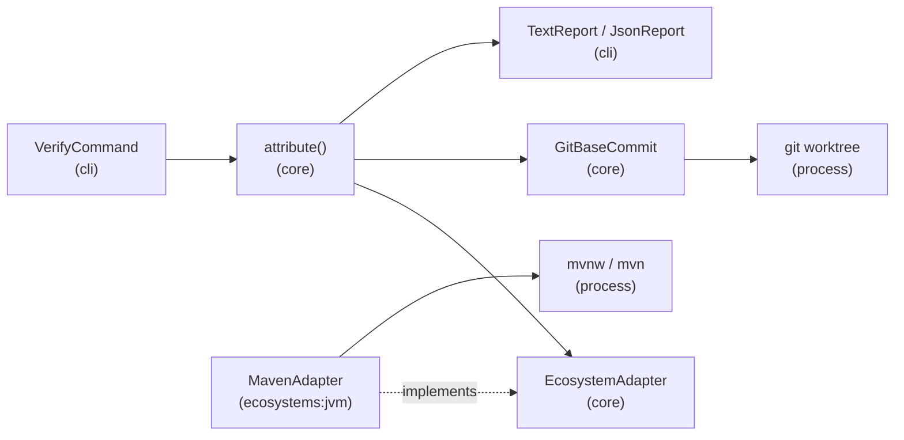
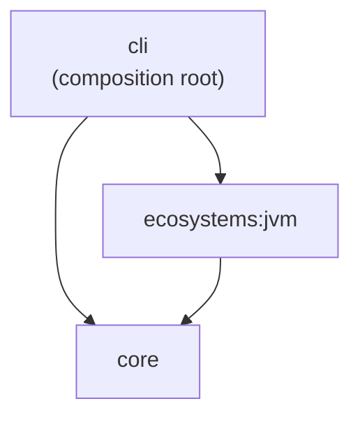
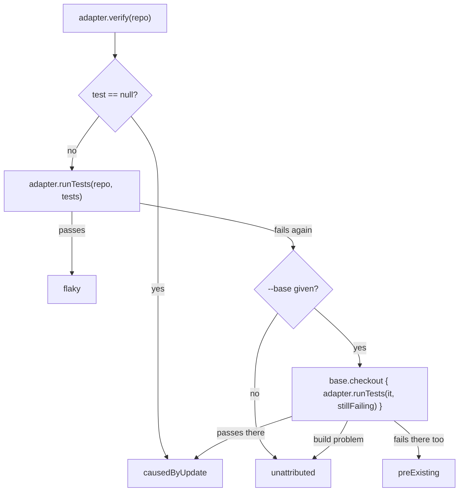
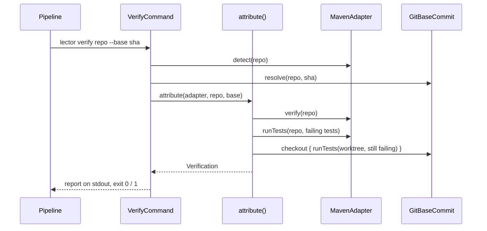

# Architecture – Verify pipeline

Milestone: [M1](../features.md#m1--verify-and-report-jvmmaven-no-ai-) · Spec: [`m1-verify-and-report/spec.md`](../../specs/done/m1-verify-and-report/spec.md) · Progress: [`progress.md`](../../specs/done/m1-verify-and-report/progress.md)

> **Summary for agents**
>
> - `lector verify <repo>` builds and tests a repository through an `EcosystemAdapter`, then `attribute()` in `core` sorts every `Diagnostic` into the four lists of a `Verification`: caused by the update, pre-existing, flaky, unattributed.
> - The contract: the report goes to stdout (text, or one line of JSON with `--format json`), logs go to stderr. Exit `0` when nothing is caused by the update, `1` when something is, `2` on a tool error.
> - `core` knows no build tool: it holds the data model, the port, attribution, the process runner, and the Git worktree for the base commit. Everything Maven-specific is in `ecosystems:jvm`. Only `cli` (`RootCommand.kt`) knows `MavenAdapter`.
> - A new ecosystem is a new `ecosystems:*` module that implements `EcosystemAdapter` (`detect`, `verify`, `runTests`), registered in the adapter list in `rootCommand()`. Its parsers are tested on output captured from real runs.
> - Easiest rule to break: test failures carry `Diagnostic.test`, everything else has `test == null`, and attribution relies on it. A run with any `test == null` diagnostic says nothing about the tests. Never skip or filter tests in `verify`; `-Dtest` belongs in `runTests` only.

## Overview

M1 answers one question for a dependency-update PR: did the update break the build or the tests, and where? Compile and build errors always count. A failing test only counts if it fails again on a rerun and passes on the base commit, so flaky and pre-existing failures never fail the job.

## Modules and files

| Module | File | Role |
|---|---|---|
| `core` | `Diagnostic.kt` | `Diagnostic(file, line, column, code, message, severity, tool, test)`. `file` is relative to the repository root with `/`. `file`, `line`, `column`, `code`, and `test` are nullable. `Severity` has only `ERROR`: warnings aren't collected. |
| | `Verification.kt` | The four lists. No classification lives on `Diagnostic`. |
| | `EcosystemAdapter.kt` | The port: `detect(repo)`, `verify(repo)`, `runTests(repo, tests: List<Diagnostic>)`. |
| | `Attribution.kt` | `attribute(adapter, repo, base)` and the `BaseCommit` fun interface. |
| | `Processes.kt` | `runProcess(command, workDir, timeout)` and `ToolError`. |
| | `GitBaseCommit.kt` | `GitBaseCommit.resolve(repo, ref)` and `checkout { }` in a temporary worktree. |
| `ecosystems:jvm` | `MavenAdapter.kt` | Detects `pom.xml` at the root, builds the Maven command lines, runs Maven, collects diagnostics. |
| | `MavenConsole.kt` | Console output → javac and kotlinc errors, failed goals, unreadable POMs. |
| | `TestReports.kt` | surefire and failsafe XML reports → test failures. |
| `cli` | `VerifyCommand.kt` | The `verify` subcommand: validation, attribution, report, exit code. |
| | `Reports.kt` | `TextReport` and `JsonReport`. |
| | `RootCommand.kt` | Wires `VerifyCommand` with `MavenAdapter`. |

`core` depends on no project. `ecosystems:jvm` depends on `core`. External dependencies: SLF4J in `core` and `ecosystems:jvm`, `kotlinx-serialization-json` in `cli` (versions in `gradle/libs.versions.toml`).

## Attribution

`attribute()` in `Attribution.kt` is language-neutral. The adapter only runs builds and tests.

| Rule | Where |
|---|---|
| Diagnostics without `test` (compile errors, build errors) are caused by the update, listed before test failures. | `attribute()` |
| Tests are matched by `test` name, not by message. | `attribute()` |
| A rerun with a build problem counts every test as still failing (never flaky). | `failedTests()` |
| A base run with a build problem leaves the still-failing tests unattributed. | `failedTests()` |
| The base is checked out only if tests still fail, and runs only those tests. | `attribute()` |
| The base worktree lives in a temporary directory and is removed in `finally`, also when the build throws. | `GitBaseCommit.checkout()` |

## Maven adapter

`MavenAdapter` runs `<repo>/mvnw` if it exists, otherwise `mvn` from `PATH`, in the repository's real path (`toRealPath()`, so macOS `/var` → `/private/var` doesn't break relative paths). The JDK is whatever `JAVA_HOME` says. Every run gets `-B -fae`, plus `--settings <absolute path>` if `--maven-settings` is given.

| Call | Goals and properties |
|---|---|
| `verify`, stage 1 | `clean test-compile` |
| `verify`, stage 2, only if stage 1 has no diagnostics | `verify` |
| `runTests` with only surefire tests | `clean test -Dtest=<classes> -Dsurefire.failIfNoSpecifiedTests=false` |
| `runTests` with failsafe tests | `clean verify -Dtest=<classes> -Dsurefire.failIfNoSpecifiedTests=false -Dit.test=<classes> -Dit.failIfNoSpecifiedTests=false`. Without surefire tests, `-Dtest=lector.NoUnitTests`, a filter that matches no class |

`runTests` reruns whole test classes (fully qualified), because surefire can't select every method by name (parameterized tests). Surefire always gets a filter: `verify` runs surefire before failsafe, and without one it would run every unit test, on the base commit too, and a failing unit test would stop failsafe in its module. After every run, the adapter parses the console output and the test reports. A run that exits non-zero without any parsed diagnostic becomes one `maven` diagnostic with the last 20 lines of output, so a failure never looks green. Each Maven run has a one-hour timeout (`MAVEN_TIMEOUT`).

### Parsers

| Source | Recognized | Result |
|---|---|---|
| Console, `[ERROR]` lines | `/path/File.java:[l,c] msg` (javac, Kotlin 1.x summary), `/path/File.kt: (l, c) msg` (Kotlin 1.x), `file:///path/File.kt:l:c msg` (Kotlin 2.x) | `javac` or `kotlinc` (by file extension), indented follow-up lines appended to the message, duplicates removed |
| Console | `Failed to execute goal …` plus its `[ERROR]` lines up to `-> [Help`, an empty line, or the next failure | `maven`, no location. Skipped when it only summarizes compile errors or says `There are test failures.` |
| Console | `The project … has N errors` and its problems (unresolvable parent POM) | `maven`, no location, one per problem |
| `<module>/target/surefire-reports/TEST-*.xml`, `failsafe-reports` | `<testcase>` with `<failure>` or `<error>`; `<skipped>`, `<flakyFailure>` aren't failures | `surefire` / `failsafe`, `code` = exception type, `test` = `class#method`, file and line from the first stack frame in the test class, found under `<module>/src/<set>/<lang>/<package>/` |
| An unreadable report (malformed, with a DOCTYPE, or can't be opened) | — | `maven` build error, so no failure gets lost |

Only `[ERROR]` lines count; warnings are ignored. Paths outside the repository stay absolute. Message text comes from the tools in the runner's locale.

## CLI contract

`lector verify <repo> [--base <git-ref>] [--format text|json] [--maven-settings <file>]`

| Situation | stdout | stderr | Exit |
|---|---|---|---|
| Nothing caused by the update (also with pre-existing, flaky, or unattributed failures) | Report | Logs | `0` |
| At least one diagnostic caused by the update | Report | Logs | `1` |
| `<repo>` is not a directory, `--maven-settings` is not a file | empty | `Error: …` | `2` |
| No adapter detects the repository | empty | `Error: No supported ecosystem in <repo>. Supported: Maven (pom.xml at the root).` | `2` |
| `--base` is not a commit (checked before the build) | empty | `Error: Base ref <ref> is not a commit in <repo>…` | `2` |
| Maven or Git can't start or times out | empty | `Error: Cannot run …` / `… did not finish within …` | `2` |
| Any other exception while verifying | empty | `Error: Unexpected failure: <exception>` | `2` |
| Invalid usage (unknown option, extra argument, missing `<repo>`, `--format xml`) | empty | Usage and `Error: …` | `2` |

Logs are SLF4J on stderr; every process logs `Running <command> in <dir>` at info, and its output at debug.

**Text report:** four sections in a fixed order, `Caused by the update (n)`, `Pre-existing (n)`, `Flaky (n)`, `Unattributed (n)`, separated by an empty line; `none` for an empty section. In the first section, diagnostics without file and test come first under `Build errors:`, the rest under `In the code:`. An item is `- [tool] <test> at <file:line:column>: <message>`, with further message lines indented.

**JSON report:** one line, `{"causedByUpdate":[…],"preExisting":[…],"flaky":[…],"unattributed":[…]}`. Each diagnostic has all eight fields, `null` included; `severity` is lowercase (`"error"`).

## Tests

| Level | Task | What runs | Examples |
|---|---|---|---|
| Unit | `test` | Attribution with a fake adapter and a fake base; parsers on captured output; adapter command lines with a fake process runner; the command through Clikt's `test()` and `executeInProcess()` | `AttributionTest`, `MavenConsoleTest`, `TestReportsTest`, `MavenAdapterTest`, `VerifyCommandTest`, `ReportsTest` |
| Unit, real processes | `test` | `runProcess` with `sh`, `GitBaseCommit` on a temporary Git repository, `MavenAdapter` with a fake `mvnw` script | `ProcessesTest`, `GitBaseCommitTest` |
| End-to-end | `endToEndTest` (in `check`) | The start script: `verify` exits `2` for invalid usage, for an unsupported repository, and for an invalid `--base` | `LectorEndToEndTest` |
| Integration | `:cli:integrationTest` (opt-in, not in `check`) | Real Maven on a base/head repository: the head bumps commons-lang3 3.12.0 → 3.18.0. One test breaks, one fails on both commits. Checks the lists, exit `1`, one worktree left, clean `git status`. Needs `mvn` and network. | `VerifyIntegrationTest` |

Fixtures: `ecosystems/jvm/src/test/resources/fixtures/` (Maven projects that break in one way each, plus captured reports in `failing-tests/*/target/`), `ecosystems/jvm/src/test/resources/maven-output/` (captured console logs; how they were made is in `fixtures/README.md`), and `cli/src/test/resources/fixtures/dependency-update/` (`base/` and the `head/` overlay). Tests tagged `integration` are excluded from `test`; Kover's instrumentation is disabled for `integrationTest`, otherwise Kover would make `check` depend on it.

## Decisions and known limits

| Decision / limit | Reason | Revisit |
|---|---|---|
| `Diagnostic.test` field | Attribution reruns and matches tests by name. It names the test; it doesn't classify. | — |
| `runTests` takes diagnostics, reruns whole classes | Maven must know surefire from failsafe; surefire can't select parameterized methods by name. | When a second ecosystem needs `runTests` |
| `clean` before compile and reruns | Removes stale test reports from earlier runs. Costs a recompile per rerun. | M3, if the fix loop needs faster cycles |
| Source files found only in the standard layout | `src/<set>/<lang>/<package>/<File>`. Otherwise a test failure has no location. | When a fixture needs it |
| Only errors, no warnings | An old warning would otherwise fail the job. | With baseline comparison of warnings |
| Messages in the runner's locale | Maven, javac, and kotlinc print localized text. The parsers only use locale-independent markers. | M5, container image |
| Unix paths only | The parsers expect absolute `/…` paths. CI runs Linux. | If Windows runners are needed |
